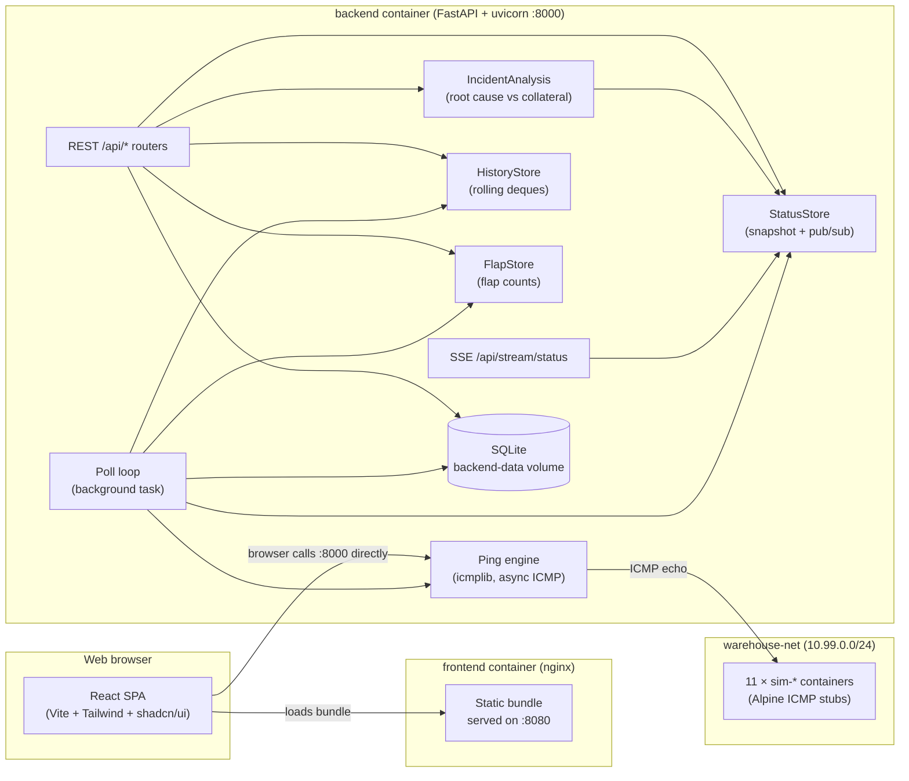
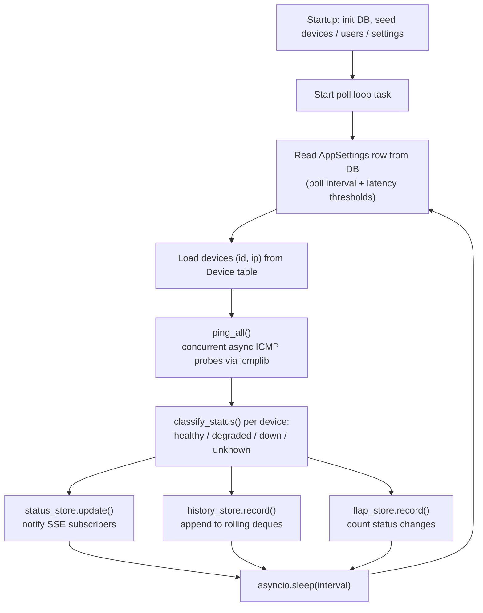
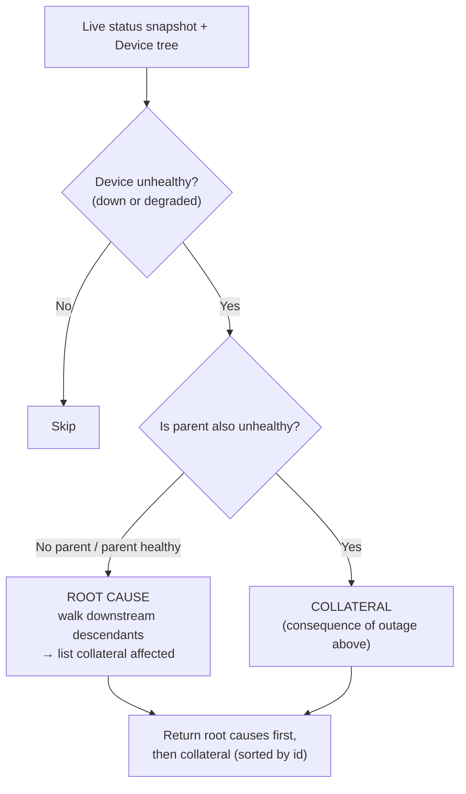
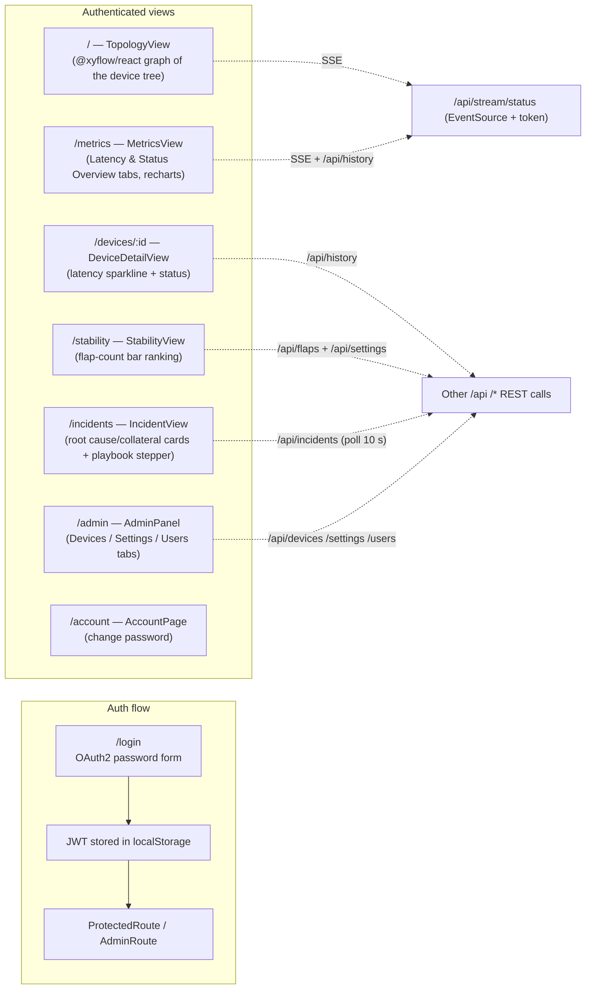
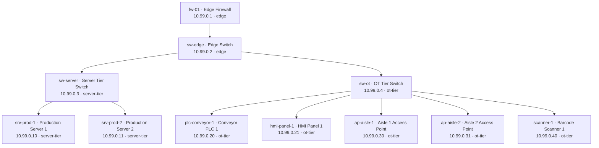
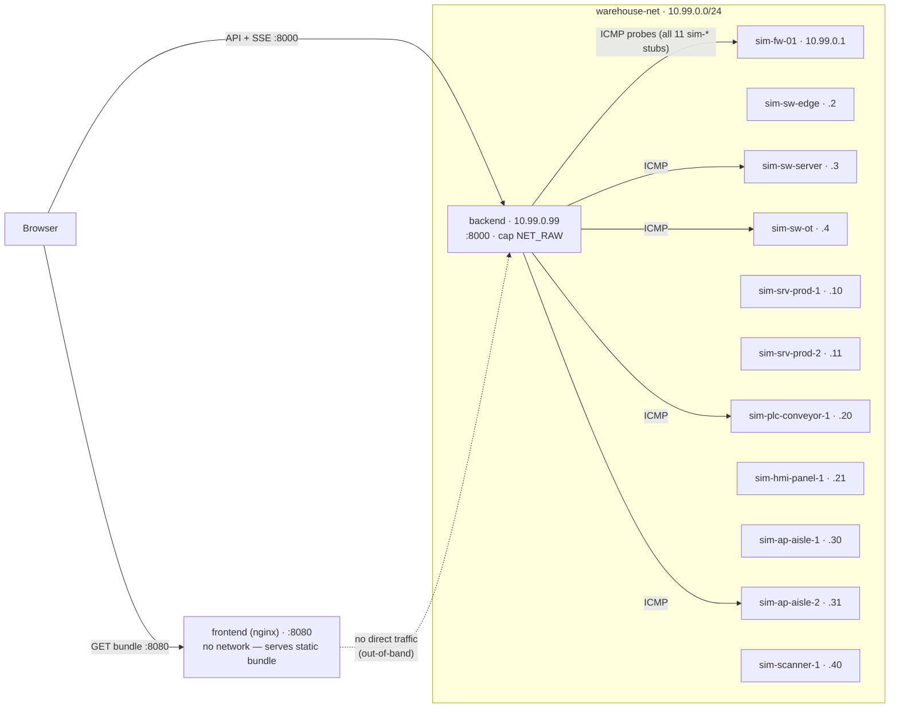

# Network Analyser

Real-time monitoring, stability analysis, and root-cause incident detection for
industrial / OT networks. The system pings every device in a warehouse network
over ICMP, classifies its health (healthy / degraded / down / unknown), streams
live status to a web dashboard over SSE, and automatically separates **root
causes** from **collateral damage** whenever something goes offline.

Built as three layers: a FastAPI backend that owns all monitoring logic, a
React SPA that visualizes it, and a Docker Compose stack that simulates an
entire warehouse LAN so the whole system runs on one machine.

## Overview

- **ICMP monitoring** — an async `icmplib` ping engine probes every device on a
  configurable interval (~10 s default) and classifies each one.
- **Live dashboards** — a Server-Sent Events (SSE) stream pushes full status
  snapshots to every connected browser; latency history, flap counts, and
  incident lists come on top via REST.
- **Tree-based incident analysis** — devices are stored as a parent/child tree
  (firewall → switches → PLCs/HMIs/servers). An unhealthy device whose parent
  is also unhealthy is marked **collateral**; one whose parent is healthy is a
  **root cause** with the list of downstream devices it took down.
- **Guided-fix playbooks** — each incident links to a static, device-type +
  status-specific troubleshooting playbook.
- **Role-based access** — JWT login with `admin` / `viewer` roles; device CRUD,
  user management, monitoring settings, and users' password changes all live
  behind the appropriate role check.
- **Simulated hardware** — Docker Compose brings up 11 Alpine containers that
  stand in for firewall/switch/PLC/HMI/AP/scanner hardware, so the entire
  lifecycle (dev, demo, testing) works without touching real devices.

## System architecture



The browser is the client that talks to the API: the frontend container only
serves static files, so API calls and the SSE connection originate from the
user's browser straight to the backend.

## Repository layout

```
.
├── .github/workflows/ci.yml CI: backend tests + coverage, frontend typecheck/lint/build
├── backend/                 FastAPI application (Python 3.12)
│   ├── app/
│   │   ├── main.py          App factory, lifespan (DB seed + poll loop), SSE endpoint
│   │   ├── core/            Config (pydantic-settings), JWT/bcrypt security, auth deps
│   │   ├── db/              SQLAlchemy/sqlmodel session + seed scripts
│   │   ├── models/          Device, User, AppSettings (SQLModel tables)
│   │   ├── routers/         auth, devices, settings, users, history, flaps, incidents, playbooks
│   │   ├── schemas/         Pydantic request/response DTOs
│   │   ├── services/        ping_engine, poll_loop, status/history/flap stores, incident_analysis
│   │   └── data/playbooks.py  Static guided-fix playbook content
│   ├── tests/               pytest suite (temporary SQLite DB, fake ping, no ICMP)
│   └── Dockerfile
├── frontend/                React SPA (React 19 + TypeScript + Vite)
│   ├── src/
│   │   ├── components/      Views: Topology, DeviceDetail, Metrics, Stability, Incidents, Admin, Login
│   │   ├── contexts/        AuthContext (JWT state)
│   │   ├── hooks/           useStatusStream (SSE), useDevices, useHistory, useFlapCounts, useIncidents
│   │   └── lib/             api client (fetch + SSE), topology layout, metrics helpers
│   └── Dockerfile           Multi-stage: node build → nginx static server
├── infra/
│   ├── docker-compose.yml   Full stack: 11 sim devices + backend + frontend
│   ├── devices.seed.json    Seeded device tree (the warehouse topology)
│   └── README.md            Deployment runbook
└── docs/                    (empty; reserved for further docs)
```

## Backend (FastAPI)

The backend is a single FastAPI app (`backend/app/main.py`) that, at startup
(`lifespan`), initializes the SQLite DB, seeds devices from
`infra/devices.seed.json`, seeds default users and settings, and launches the
foreground poll loop as a background `asyncio` task.

### The poll loop



Everything the poll loop needs is re-read from the DB-backed `AppSettings`
singleton at the **start of every cycle**, so an admin editing the poll
interval or latency thresholds in the UI takes effect within one cycle — no
backend restart required.

Setting `POLL_ENABLED=False` starts the API without the poll loop (the test
suite does this). Nothing is pinged, so every device stays `unknown`.

### Device status classification

Each probe is classified against live latency thresholds:

| Result          | Condition                                        |
| --------------- | ------------------------------------------------ |
| `healthy`       | reachable, latency ≤ warn threshold              |
| `degraded`      | reachable, latency > warn **or** > crit threshold |
| `down`          | unreachable (ICMP timed out)                     |
| `unknown`       | probe failed with an exception (no result)       |

### Incident analysis

`incident_analysis.analyze_incidents()` is a pure function — status snapshot +
device tree in, classified incidents out. It is re-evaluated from scratch on
every `/api/incidents` request, so recovery reclassifies immediately.



Each root cause carries the list of `downstream_affected` devices it took down,
and the frontend renders these as incident cards with a guided-fix playbook
stepper linked from the static `backend/app/data/playbooks.py`.

### API endpoints

| Method   | Path                              | Access      | Description                                   |
| -------- | --------------------------------- | ----------- | --------------------------------------------- |
| `GET`    | `/api/health`                     | public      | Liveness smoke check                          |
| `POST`   | `/api/auth/login`                 | public      | OAuth2 password login → JWT + role            |
| `GET`    | `/api/auth/me`                    | user        | Current session identity                       |
| `PATCH`  | `/api/auth/change-password`       | user        | Self-service password change                   |
| `GET`    | `/api/status`                     | user        | Latest status snapshot (non-streaming)         |
| `GET`    | `/api/stream/status?token=`       | user (query)| SSE stream of full status snapshots            |
| `GET`    | `/api/devices`                    | user        | List devices                                   |
| `GET`    | `/api/devices/{id}`               | user        | Get one device                                 |
| `POST`   | `/api/devices`                    | **admin**   | Create device (parent/cycle validation)        |
| `PATCH`  | `/api/devices/{id}`               | **admin**   | Update device                                  |
| `DELETE` | `/api/devices/{id}`               | **admin**   | Delete device (blocked if it has children)     |
| `GET`    | `/api/history/{id}`               | user        | Rolling latency history for a device           |
| `GET`    | `/api/flaps`                      | user        | Flap counts, highest flapper first             |
| `GET`    | `/api/incidents`                  | user        | Root-cause/collateral incident set             |
| `GET`    | `/api/playbooks/{type}/{state}`   | user        | Guided-fix playbook for a device type/state    |
| `GET`    | `/api/settings`                   | user        | Monitoring settings (poll interval, thresholds)|
| `PATCH`  | `/api/settings`                   | **admin**   | Update monitoring settings                     |
| `GET`    | `/api/users`                      | **admin**   | List users                                     |
| `POST`   | `/api/users`                      | **admin**   | Create user                                    |
| `DELETE` | `/api/users/{id}`                 | **admin**   | Delete user (self/last-admin guarded)          |

> **SSE auth note:** the stream endpoint authenticates via a `token` query
> parameter because the browser `EventSource` API cannot set an
> `Authorization` header; every other endpoint uses `Bearer` tokens.

## Frontend (React)

A single-page React app (React 19, TypeScript, Vite) styled with Tailwind CSS
and shadcn/ui components. Routing (`React Router`) and the JWT auth state live
in `AuthContext`; `ProtectedRoute` guards every view and `AdminRoute` restricts
the admin panel to `admin` users.



The live status path is **push** (SSE), while everything else is **pull**
(REST polling): incidents re-poll every 10 s, flap counts/settings on mount,
and history per device view.

## Simulated network topology

The seeded device tree (`infra/devices.seed.json`) models a small warehouse
LAN: an edge firewall fronts a server tier and an OT tier (PLCs, HMIs, access
points, scanners).



This hierarchy is exactly what the incident analysis walks: if `sw-ot` goes
down, all five OT devices under it come back as **collateral** of a single
root cause instead of five separate alarms.

## Deployment (Docker Compose)

The full stack runs from `infra/docker-compose.yml` on a single bridge network
(`warehouse-net`, `10.99.0.0/24`) with the gateway moved off `.1` so the
firewall stub can own `10.99.0.1`.



- **11 `sim-*` containers** — Alpine stubs that answer ICMP, standing in for
  warehouse hardware.
- **`backend`** — FastAPI + SQLite; needs `CAP_NET_RAW` for raw ICMP sockets,
  publishes `:8000`, persists the DB in the `backend-data` named volume, and
  mounts `infra/devices.seed.json` read-only as the topology source.
- **`frontend`** — nginx serving the built SPA on `:8080`. It is deliberately
  not on `warehouse-net`: it never talks to the backend itself (the browser
  does), so attaching it adds nothing.
- **13 containers total** when running (11 sims + backend + frontend).

Persisted SQLite data (settings, users, devices) survives `down`/`up` and
rebuilds via the `backend-data` volume; flap counts and latency history are
in-memory and reset on backend restart by design.

## Running with Docker Compose

The full deployment (simulated devices + backend + frontend) runs from
`infra/`: see **`infra/README.md`** for setup (it requires a generated
`JWT_SECRET_KEY` in `infra/.env`), the startup/stop commands, and the seeded
login credentials.

## Development Setup

### Backend

```sh
cd backend
python -m venv .venv && source .venv/bin/activate
pip install -r requirements.txt
cp .env.example .env   # set JWT_SECRET_KEY / CORS_ORIGINS / thresholds
uvicorn app.main:app --reload --port 8000
```

Requires `CAP_NET_RAW` (or root) for privileged raw-ICMP pings. For
rootless local development, set `PING_PRIVILEGED=False` in `.env` to use
icmplib's unprivileged datagram mode (see `backend/app/services/ping_engine.py`
for platform caveats). Seeded logins default to `admin` / `admin123` and
`viewer` / `viewer123`.

### Frontend

```sh
cd frontend
npm install
cp .env.example .env   # VITE_API_BASE_URL defaults to http://localhost:8000
npm run dev            # Vite dev server on :5173
```

### Without real hardware

Run the 11 simulated devices from `infra/docker-compose.yml`:

```sh
docker compose -f infra/docker-compose.yml up -d sim-fw-01 sim-sw-edge sim-sw-server sim-sw-ot \
  sim-srv-prod-1 sim-srv-prod-2 sim-plc-conveyor-1 sim-hmi-panel-1 sim-ap-aisle-1 sim-ap-aisle-2 sim-scanner-1
docker compose -f infra/docker-compose.yml down   # or the whole stack
```

Or run the whole stack (sims + backend + frontend) per **`infra/README.md`**.

## Testing

Backend tests live in `backend/tests/` and run with pytest. They need no
network, no root and no Docker:

- they use a temporary SQLite file, never the dev database
  (`tests/conftest.py` refuses to start otherwise);
- the background poll loop is off (`POLL_ENABLED=false`), and the loop itself
  is tested with a fake ping function, so no ICMP is sent.

```sh
cd backend
python -m venv .venv && source .venv/bin/activate   # Python 3.12
pip install -r requirements.txt -r requirements-dev.txt
pytest                                              # run the suite
pytest --cov=app --cov-report=term-missing          # same, with a coverage report
coverage report --include="app/services/*" --fail-under=80   # the gate CI enforces
coverage html                                       # optional: browsable report in htmlcov/
```

These are characterization tests: they pin what the code does today, so a
later change in behaviour shows up as a failing test. A test marked `xfail`
records a known bug that has deliberately not been fixed yet; pytest lists each
one with its reason at the end of the run.

Frontend checks:

```sh
cd frontend
npm ci
npx tsc -b --noEmit   # typecheck
npm run lint
npm run build
```

`.github/workflows/ci.yml` runs both sets of commands on every push and pull
request.

## Tech stack

| Layer        | Technologies                                                                  |
| ------------ | ----------------------------------------------------------------------------- |
| Backend      | Python 3.12, FastAPI, Uvicorn, SQLModel + SQLite, `icmplib`, sse-starlette, passlib + bcrypt (4.0.1), python-jose, pydantic-settings |
| Frontend     | React 19, TypeScript, Vite, Tailwind CSS, shadcn/ui (Radix), @xyflow/react, recharts, React Router |
| Deployment   | Docker Compose, nginx, Alpine, multi-stage Dockerfiles                        |
| Testing / CI | pytest, pytest-asyncio, pytest-cov, httpx (`TestClient`), GitHub Actions      |
