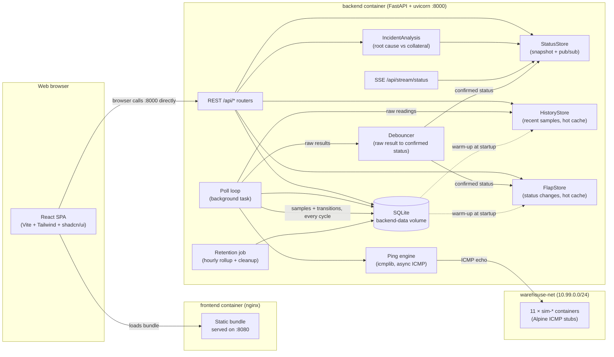
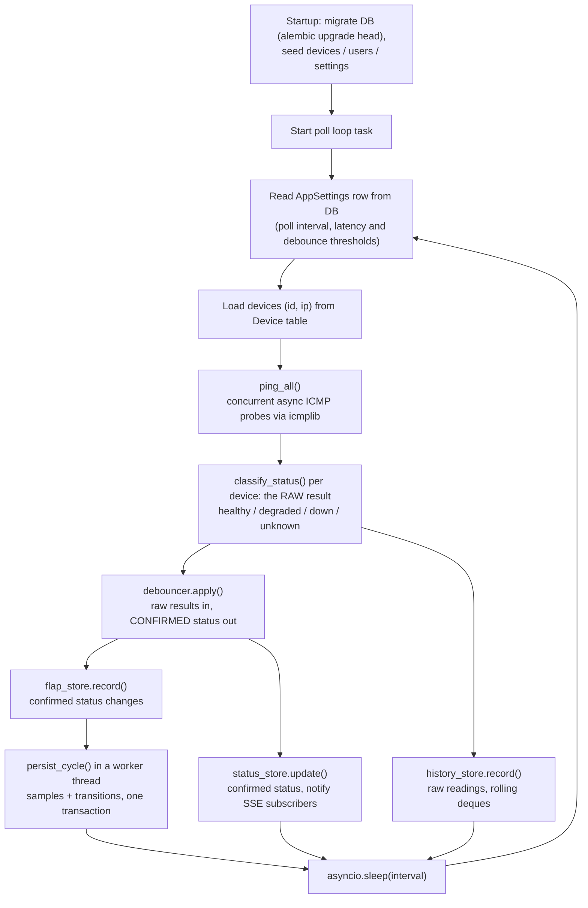
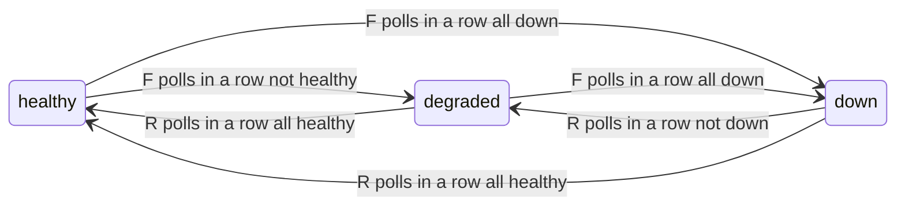
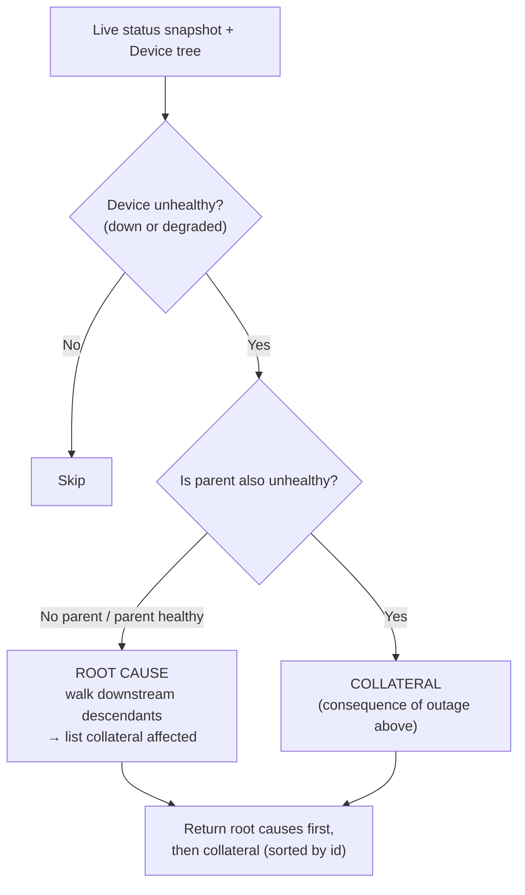
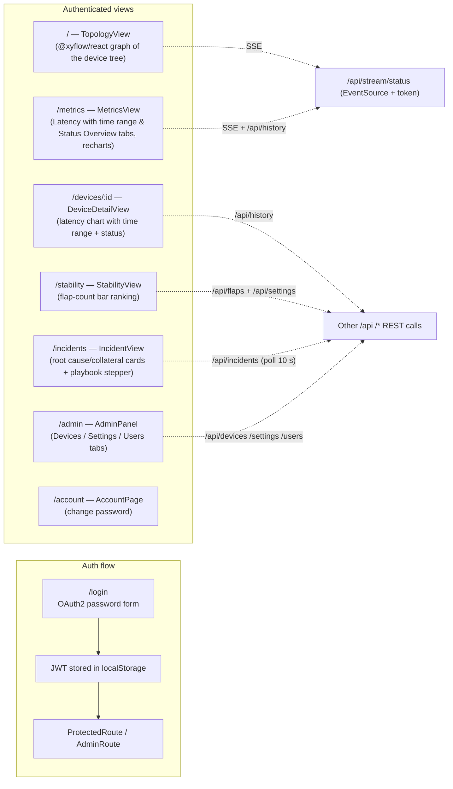
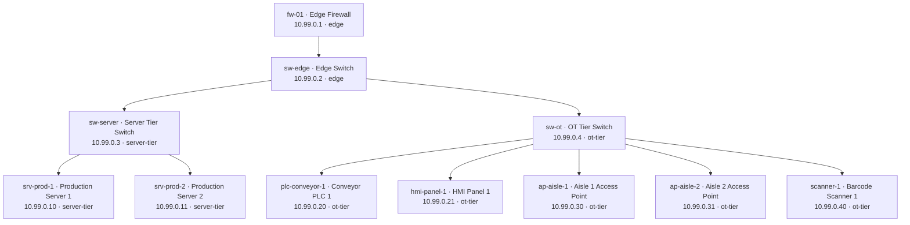
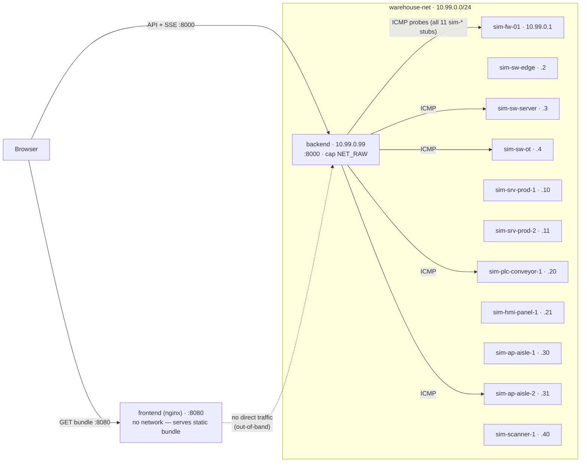
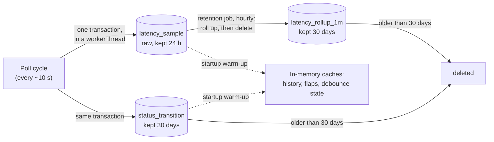

# Network Analyser

Real-time monitoring, stability analysis, and root-cause incident detection for
industrial / OT networks. The system pings every device in a warehouse network
over ICMP, classifies its health (healthy / degraded / down / unknown), streams
live status to a web dashboard over SSE, and automatically separates **root
causes** from **collateral damage** whenever something goes offline.

Built as three layers: a FastAPI backend that owns all monitoring logic, a
React SPA that visualizes it, and a Docker Compose stack that simulates an
entire warehouse LAN so the whole system runs on one machine.

## Overview

- **ICMP monitoring** — an async `icmplib` ping engine probes every device on a
  configurable interval (~10 s default) and classifies each one.
- **Debounced status** — a device changes state only after several polls in a
  row agree (3 to get worse, 2 to recover by default), so one lost ping does
  not raise an incident.
- **Live dashboards** — a Server-Sent Events (SSE) stream pushes full status
  snapshots to every connected browser; latency history, flap counts, and
  incident lists come on top via REST.
- **History that survives restarts** — every poll and every status change is
  stored in SQLite. Raw samples are kept for a day, then downsampled to
  1-minute rollups kept for 30 days; charts can show the last hour up to the
  last 30 days.
- **Tree-based incident analysis** — devices are stored as a parent/child tree
  (firewall → switches → PLCs/HMIs/servers). An unhealthy device whose parent
  is also unhealthy is marked **collateral**; one whose parent is healthy is a
  **root cause** with the list of downstream devices it took down.
- **Guided-fix playbooks** — each incident links to a static, device-type +
  status-specific troubleshooting playbook.
- **Role-based access** — JWT login with `admin` / `viewer` roles; device CRUD,
  user management, monitoring settings, and users' password changes all live
  behind the appropriate role check.
- **Simulated hardware** — Docker Compose brings up 11 Alpine containers that
  stand in for firewall/switch/PLC/HMI/AP/scanner hardware, so the entire
  lifecycle (dev, demo, testing) works without touching real devices.

## System architecture



The browser is the client that talks to the API: the frontend container only
serves static files, so API calls and the SSE connection originate from the
user's browser straight to the backend.

## Repository layout

```
.
├── .github/workflows/ci.yml CI: backend tests + coverage, frontend typecheck/lint/build
├── backend/                 FastAPI application (Python 3.12)
│   ├── app/
│   │   ├── main.py          App factory, lifespan (migrate, seed, warm-up, background tasks), SSE endpoint
│   │   ├── core/            Config (pydantic-settings), JWT/bcrypt security, auth deps
│   │   ├── db/              SQLAlchemy/sqlmodel session, Alembic migrations/, seed scripts
│   │   ├── models/          Device, User, AppSettings, and the history tables (SQLModel)
│   │   ├── routers/         auth, devices, settings, users, history, flaps, incidents, playbooks
│   │   ├── schemas/         Pydantic request/response DTOs
│   │   ├── services/        ping_engine, debounce, poll_loop, status/history/flap stores, incident_analysis,
│   │   │                    persistence (DB writes, warm-up, windowed history), rollup, retention
│   │   └── data/playbooks.py  Static guided-fix playbook content
│   ├── tests/               pytest suite (temporary SQLite DB, fake ping, no ICMP)
│   ├── alembic.ini          Alembic command-line config (the app migrates itself at startup)
│   └── Dockerfile
├── frontend/                React SPA (React 19 + TypeScript + Vite)
│   ├── src/
│   │   ├── components/      Views: Topology, DeviceDetail, Metrics, Stability, Incidents, Admin, Login
│   │   ├── contexts/        AuthContext (JWT state)
│   │   ├── hooks/           useStatusStream (SSE), useDevices, useHistory, useFlapCounts, useIncidents
│   │   └── lib/             api client (fetch + SSE), topology layout, metrics helpers
│   └── Dockerfile           Multi-stage: node build → nginx static server
├── infra/
│   ├── docker-compose.yml   Full stack: 11 sim devices + backend + frontend
│   ├── devices.seed.json    Seeded device tree (the warehouse topology)
│   └── README.md            Deployment runbook
└── docs/                    (empty; reserved for further docs)
```

## Backend (FastAPI)

The backend is a single FastAPI app (`backend/app/main.py`) that, at startup
(`lifespan`), brings the SQLite schema up to date (see
[Database migrations](#database-migrations)), seeds devices from
`infra/devices.seed.json`, seeds default users and settings, refills its
in-memory caches from the database, and launches two background `asyncio`
tasks: the poll loop and the hourly retention job (see
[Data persistence and retention](#data-persistence-and-retention)).

### The poll loop



Everything the poll loop needs is re-read from the DB-backed `AppSettings`
singleton at the **start of every cycle**, so an admin editing the poll
interval, the latency thresholds or the debounce thresholds in the UI takes
effect within one cycle — no backend restart required.

Setting `POLL_ENABLED=False` starts the API without the background tasks (the
test suite does this). Nothing is pinged, so every device stays `unknown`, and
the retention job does not run.

### Device status classification

Each probe is classified against live latency thresholds:

| Result          | Condition                                        |
| --------------- | ------------------------------------------------ |
| `healthy`       | reachable, latency ≤ warn threshold              |
| `degraded`      | reachable, latency > warn **or** > crit threshold |
| `down`          | unreachable (ICMP timed out)                     |
| `unknown`       | probe failed with an exception (no result)       |

### Status debouncing

The result above is a device's **raw** status for one poll. A single lost ICMP
packet reads as a raw `down`, so the dashboards, the flap counter and the
incident analysis do not use it directly. They use the **confirmed** status,
which changes only when several polls in a row agree. The logic is a pure
state machine in `backend/app/services/debounce.py`.

Statuses are ranked `healthy < degraded < down < unknown`, and three rules
decide each device's confirmed status:

1. A device's first result is accepted as it is.
2. **Getting worse:** when the last `failure_threshold` raw results are all
   worse than the confirmed status, it becomes the mildest of them.
3. **Getting better:** when the last `recovery_threshold` raw results are all
   better than the confirmed status, it becomes the worst of them.

With the defaults, a device is marked `down` only after 3 lost pings in a row
and `healthy` again only after 2 replies in a row. Moves between `healthy` and
`degraded` follow the same two rules. A probe error (`unknown`) ranks worst, so
it does not interrupt a run of `down` results.



`F` is `failure_threshold` and `R` is `recovery_threshold`:

| Setting              | Default | Range | Meaning                                              |
| -------------------- | ------- | ----- | ---------------------------------------------------- |
| `failure_threshold`  | 3       | 1–10  | polls in a row before a worse status is confirmed    |
| `recovery_threshold` | 2       | 1–10  | polls in a row before a better status is confirmed   |

Both are edited in Admin → Settings (or `PATCH /api/settings`) and are re-read
every poll cycle. Setting both to 1 switches debouncing off.

Each device in the status snapshot (`/api/status` and the SSE stream) carries
the confirmed status plus the raw details. This one has just missed a poll:

```json
{
  "sw-ot": {
    "status": "healthy",
    "latency_ms": null,
    "timestamp": "2026-11-15T10:00:20.123456+00:00",
    "raw_status": "down",
    "consecutive_failures": 1,
    "consecutive_successes": 0
  }
}
```

- `status` is the confirmed status; `raw_status` is the latest poll's result.
- `latency_ms` and `timestamp` belong to the latest poll.
- `consecutive_failures` / `consecutive_successes` count the polls in a row
  that were not healthy / were healthy.

Things to know:

- Latency history, and the reachability figure in the Metrics view, are built
  from the raw readings. Intermittent loss that never reaches the threshold
  shows up there rather than as a status change or a flap.
- Debounce state is held in memory and rebuilt at startup from the stored
  samples, so a restart does not turn the next poll into a "first result". The
  exception is a long gap: if a device's last stored poll is more than 10 poll
  intervals old, its next result is accepted at once.
- A deleted device's state is dropped on the next cycle.

### Incident analysis

`incident_analysis.analyze_incidents()` is a pure function — status snapshot +
device tree in, classified incidents out. It is re-evaluated from scratch on
every `/api/incidents` request, so recovery reclassifies immediately. It works
on the confirmed statuses, so an unconfirmed lost ping does not create an
incident.



Each root cause carries the list of `downstream_affected` devices it took down,
and the frontend renders these as incident cards with a guided-fix playbook
stepper linked from the static `backend/app/data/playbooks.py`.

### API endpoints

| Method   | Path                              | Access      | Description                                   |
| -------- | --------------------------------- | ----------- | --------------------------------------------- |
| `GET`    | `/api/health`                     | public      | Liveness smoke check                          |
| `POST`   | `/api/auth/login`                 | public      | OAuth2 password login → JWT + role            |
| `GET`    | `/api/auth/me`                    | user        | Current session identity                       |
| `PATCH`  | `/api/auth/change-password`       | user        | Self-service password change                   |
| `GET`    | `/api/status`                     | user        | Latest status snapshot (non-streaming)         |
| `GET`    | `/api/stream/status?token=`       | user (query)| SSE stream of full status snapshots            |
| `GET`    | `/api/devices`                    | user        | List devices                                   |
| `GET`    | `/api/devices/{id}`               | user        | Get one device                                 |
| `POST`   | `/api/devices`                    | **admin**   | Create device (parent/cycle validation)        |
| `PATCH`  | `/api/devices/{id}`               | **admin**   | Update device                                  |
| `DELETE` | `/api/devices/{id}`               | **admin**   | Delete device (blocked if it has children)     |
| `GET`    | `/api/history/{id}`               | user        | Latency history; `?window=` for longer ranges |
| `GET`    | `/api/flaps`                      | user        | Flap counts (last 30 days), highest first     |
| `GET`    | `/api/incidents`                  | user        | Root-cause/collateral incident set             |
| `GET`    | `/api/playbooks/{type}/{state}`   | user        | Guided-fix playbook for a device type/state    |
| `GET`    | `/api/settings`                   | user        | Monitoring settings (poll interval, thresholds)|
| `PATCH`  | `/api/settings`                   | **admin**   | Update monitoring settings                     |
| `GET`    | `/api/users`                      | **admin**   | List users                                     |
| `POST`   | `/api/users`                      | **admin**   | Create user                                    |
| `DELETE` | `/api/users/{id}`                 | **admin**   | Delete user (self/last-admin guarded)          |

> **SSE auth note:** the stream endpoint authenticates via a `token` query
> parameter because the browser `EventSource` API cannot set an
> `Authorization` header; every other endpoint uses `Bearer` tokens.

## Frontend (React)

A single-page React app (React 19, TypeScript, Vite) styled with Tailwind CSS
and shadcn/ui components. Routing (`React Router`) and the JWT auth state live
in `AuthContext`; `ProtectedRoute` guards every view and `AdminRoute` restricts
the admin panel to `admin` users.



The live status path is **push** (SSE), while everything else is **pull**
(REST polling): incidents re-poll every 10 s, flap counts/settings on mount,
and history per device view.

The latency charts (device detail, and the Latency tab of Metrics) have a
time-range selector: **Live** (the most recent samples, refreshed every 10 s),
or the last hour, 6 hours, 24 hours, 7 days or 30 days (refreshed every
minute). For the longer ranges the backend returns time buckets, and the chart
draws the average as a line over a shaded min–max band. The resolution in use
is shown under the chart.

## Simulated network topology

The seeded device tree (`infra/devices.seed.json`) models a small warehouse
LAN: an edge firewall fronts a server tier and an OT tier (PLCs, HMIs, access
points, scanners).



This hierarchy is exactly what the incident analysis walks: if `sw-ot` goes
down, all five OT devices under it come back as **collateral** of a single
root cause instead of five separate alarms.

## Deployment (Docker Compose)

The full stack runs from `infra/docker-compose.yml` on a single bridge network
(`warehouse-net`, `10.99.0.0/24`) with the gateway moved off `.1` so the
firewall stub can own `10.99.0.1`.



- **11 `sim-*` containers** — Alpine stubs that answer ICMP, standing in for
  warehouse hardware.
- **`backend`** — FastAPI + SQLite; needs `CAP_NET_RAW` for raw ICMP sockets,
  publishes `:8000`, persists the DB in the `backend-data` named volume, and
  mounts `infra/devices.seed.json` read-only as the topology source.
- **`frontend`** — nginx serving the built SPA on `:8080`. It is deliberately
  not on `warehouse-net`: it never talks to the backend itself (the browser
  does), so attaching it adds nothing.
- **13 containers total** when running (11 sims + backend + frontend).

Persisted SQLite data (settings, users, devices, latency history and status
transitions) survives `down`/`up` and rebuilds via the `backend-data` volume,
and the backend upgrades its schema in place at startup (see
[Database migrations](#database-migrations)). Latency history, flap counts and
debounce state are held in memory for speed, but they are rebuilt from the
database at startup, so they no longer reset when the backend restarts (see
[Data persistence and retention](#data-persistence-and-retention)). Only the
live status snapshot starts empty, until the first poll completes.

## Running with Docker Compose

The full deployment (simulated devices + backend + frontend) runs from
`infra/`: see **`infra/README.md`** for setup (it requires a generated
`JWT_SECRET_KEY` in `infra/.env`), the startup/stop commands, and the seeded
login credentials.

## Development Setup

### Backend

```sh
cd backend
python -m venv .venv && source .venv/bin/activate
pip install -r requirements.txt
cp .env.example .env   # set JWT_SECRET_KEY / CORS_ORIGINS / thresholds
uvicorn app.main:app --reload --port 8000
```

Requires `CAP_NET_RAW` (or root) for privileged raw-ICMP pings. For
rootless local development, set `PING_PRIVILEGED=False` in `.env` to use
icmplib's unprivileged datagram mode (see `backend/app/services/ping_engine.py`
for platform caveats). Seeded logins default to `admin` / `admin123` and
`viewer` / `viewer123`.

### Frontend

```sh
cd frontend
npm install
cp .env.example .env   # VITE_API_BASE_URL defaults to http://localhost:8000
npm run dev            # Vite dev server on :5173
```

### Without real hardware

Run the 11 simulated devices from `infra/docker-compose.yml`:

```sh
docker compose -f infra/docker-compose.yml up -d sim-fw-01 sim-sw-edge sim-sw-server sim-sw-ot \
  sim-srv-prod-1 sim-srv-prod-2 sim-plc-conveyor-1 sim-hmi-panel-1 sim-ap-aisle-1 sim-ap-aisle-2 sim-scanner-1
docker compose -f infra/docker-compose.yml down   # or the whole stack
```

Or run the whole stack (sims + backend + frontend) per **`infra/README.md`**.

## Data persistence and retention

Everything the poll loop measures is written to SQLite, so latency history and
flap counts survive a backend restart.

### Tables

- **`latency_sample`**: one row per device per poll (the raw data). Columns:
  `device_id`, `ts`, `latency_ms` (null when there was no reply),
  `raw_status`, `confirmed_status`.
- **`latency_rollup_1m`**: one row per device per minute. Columns:
  `device_id`, `bucket_start`, `min`, `avg`, `max`, `sample_count`,
  `fail_count`.
- **`status_transition`**: one row per confirmed status change (a flap).
  Columns: `device_id`, `ts`, `from_status`, `to_status`.

`latency_sample` and `status_transition` are indexed on `(device_id, ts)`, and
`latency_rollup_1m` is unique on `(device_id, bucket_start)`. All timestamps
are UTC. In a rollup, `min` / `avg` / `max` cover the polls that got a reply
and `fail_count` is the number that did not. None of these tables references
`device`, so the history of a deleted device simply ages out.

### Data lifecycle



1. **Write.** After every poll cycle the loop stores one `latency_sample` per
   device, plus a `status_transition` for each confirmed status change, in a
   single transaction. The write runs in a worker thread
   (`asyncio.to_thread`), so it never blocks the event loop. If it fails, the
   error is logged and live monitoring carries on.
2. **Warm-up.** At startup the in-memory caches are refilled from the
   database: each device's most recent samples (the 36 behind the default
   history response), its status changes inside the flap window, and its
   debounce state.
3. **Roll up.** A background job runs at startup and then every hour. Raw
   samples older than `RAW_RETENTION_HOURS` are summarised into 1-minute
   rollups and deleted.
4. **Expire.** The same job deletes rollups older than `ROLLUP_RETENTION_DAYS`
   and transitions older than `TRANSITION_RETENTION_DAYS`.

The rollup is safe to run again at any time. Each batch of raw samples is
added to the rollups and deleted in the same transaction, so a sample is
always in exactly one place. If a rollup row for that minute already exists,
the new samples are merged into it: counts are added, min and max are
combined, and the average is re-weighted by the number of replies. A minute is
rolled up only once all of it is older than the cutoff.

### Retention settings

Set these as environment variables (`backend/.env`, or `infra/.env` for the
Docker deployment):

| Variable                     | Default | Meaning                                                              |
| ---------------------------- | ------- | -------------------------------------------------------------------- |
| `RAW_RETENTION_HOURS`        | `24`    | Raw samples older than this are rolled up to 1-minute rows           |
| `ROLLUP_RETENTION_DAYS`      | `30`    | Rollups older than this are deleted                                  |
| `TRANSITION_RETENTION_DAYS`  | `30`    | Transitions older than this are deleted; also the flap-count window  |
| `RETENTION_INTERVAL_SECONDS` | `3600`  | How often the retention job runs                                     |
| `HISTORY_MAX_SAMPLES`        | `36`    | Recent samples per device kept in memory                             |

With the defaults and 11 devices polled every 10 s, the database settles at
roughly 95,000 raw rows and 475,000 rollup rows.

### Reading history

`GET /api/history/{id}` without parameters is unchanged: a list of the most
recent samples, `[{"latency_ms": ..., "timestamp": ...}]`, served from memory.

With `?window=` it reads the database and returns a time range. The resolution
is chosen by the window, so every range is a few hundred points:

| `window` | Resolution | What a point is                               |
| -------- | ---------- | --------------------------------------------- |
| `1h`     | `raw`      | one poll                                      |
| `6h`     | `1m`       | min / avg / max over 1 minute                 |
| `24h`    | `5m`       | min / avg / max over 5 minutes                |
| `7d`     | `30m`      | min / avg / max over 30 minutes               |
| `30d`    | `2h`       | min / avg / max over 2 hours                  |

```json
{
  "device_id": "sw-ot",
  "window": "24h",
  "resolution": "5m",
  "resolution_seconds": 300,
  "points": [
    {
      "timestamp": "2026-11-15T10:00:00Z",
      "latency_ms": 1.4,
      "min_ms": 0.9,
      "max_ms": 3.2,
      "sample_count": 30,
      "fail_count": 0
    }
  ]
}
```

In a bucket, `latency_ms` is the average over the polls that got a reply (null
if none did). For `raw`, each point is one poll, so `min_ms` and `max_ms` equal
`latency_ms` and `sample_count` is 1. Buckets are built from the rollups plus
the raw samples that have not been rolled up yet, so the most recent day is
always included.

### Flap counts

A flap is a confirmed status change, stored as a `status_transition`.
`GET /api/flaps` counts each device's transitions over the last
`TRANSITION_RETENTION_DAYS` days. The response shape is unchanged, and the
counts survive a restart.

## Database migrations

The SQLite schema is managed with [Alembic](https://alembic.sqlalchemy.org/).
The migration scripts live in `backend/app/db/migrations/versions/` and are
applied automatically: at startup, before seeding, the backend runs the
equivalent of `alembic upgrade head`. A new database is built from the first
migration; an existing one gets only the migrations it is missing and keeps
its data.

- `0001` is the baseline: the `device`, `user` and `appsettings` tables as they
  were before Alembic. It creates only the tables that are missing, so a
  database from an older version (for example the `backend-data` Docker
  volume) is adopted as it is.
- `0002` adds `failure_threshold` and `recovery_threshold` to `appsettings`.
- `0003` adds the history tables: `latency_sample`, `latency_rollup_1m` and
  `status_transition`.

Every change to a model in `backend/app/models/` needs a migration:

```sh
cd backend
source .venv/bin/activate
alembic upgrade head      # bring your local database up to date first
# ...edit the model...
alembic revision --autogenerate --rev-id 0004 -m "describe the change"
# review the new file in app/db/migrations/versions/, then:
alembic upgrade head      # or simply start the backend
pytest                    # test_migrations.py fails if a model has no migration
```

What to check in a generated migration:

- A new NOT NULL column needs a `server_default`. Without one, SQLite refuses
  to add it to a table that already has rows.
- Batch mode (`render_as_batch=True`) is on, so Alembic rebuilds a table when
  SQLite cannot alter it in place.
- Use the next number as `--rev-id`, so the history reads `0001`, `0002`, ...
- A column using the app's `UTCDateTime` type is generated as
  `app.db.types.UTCDateTime()`. Replace it with `sa.DateTime()` (the same
  column), so the migration does not import application code.

`alembic current`, `alembic history` and `alembic downgrade -1` are useful
while developing. The command line works on the same database as the app (the
one named by `DATABASE_PATH`); `backend/alembic.ini` only tells it where the
scripts are.

## Testing

Backend tests live in `backend/tests/` and run with pytest. They need no
network, no root and no Docker:

- they use a temporary SQLite file, never the dev database
  (`tests/conftest.py` refuses to start otherwise);
- the background poll loop is off (`POLL_ENABLED=false`), and the loop itself
  is tested with a fake ping function, so no ICMP is sent.

```sh
cd backend
python -m venv .venv && source .venv/bin/activate   # Python 3.12
pip install -r requirements.txt -r requirements-dev.txt
pytest                                              # run the suite
pytest --cov=app --cov-report=term-missing          # same, with a coverage report
coverage report --include="app/services/*" --fail-under=80   # the gate CI enforces
coverage html                                       # optional: browsable report in htmlcov/
```

These are characterization tests: they pin what the code does today, so a
later change in behaviour shows up as a failing test. A test marked `xfail`
records a known bug that has deliberately not been fixed yet; pytest lists each
one with its reason at the end of the run.

Frontend checks:

```sh
cd frontend
npm ci
npx tsc -b --noEmit   # typecheck
npm run lint
npm run build
```

`.github/workflows/ci.yml` runs both sets of commands on every push and pull
request.

## Tech stack

| Layer        | Technologies                                                                  |
| ------------ | ----------------------------------------------------------------------------- |
| Backend      | Python 3.12, FastAPI, Uvicorn, SQLModel + SQLite, Alembic, `icmplib`, sse-starlette, passlib + bcrypt (4.0.1), python-jose, pydantic-settings |
| Frontend     | React 19, TypeScript, Vite, Tailwind CSS, shadcn/ui (Radix), @xyflow/react, recharts, React Router |
| Deployment   | Docker Compose, nginx, Alpine, multi-stage Dockerfiles                        |
| Testing / CI | pytest, pytest-asyncio, pytest-cov, httpx (`TestClient`), GitHub Actions      |
