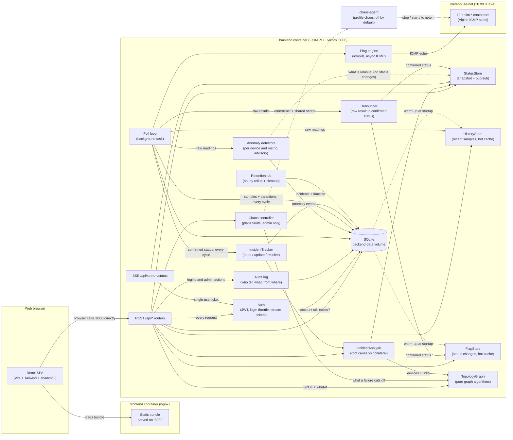
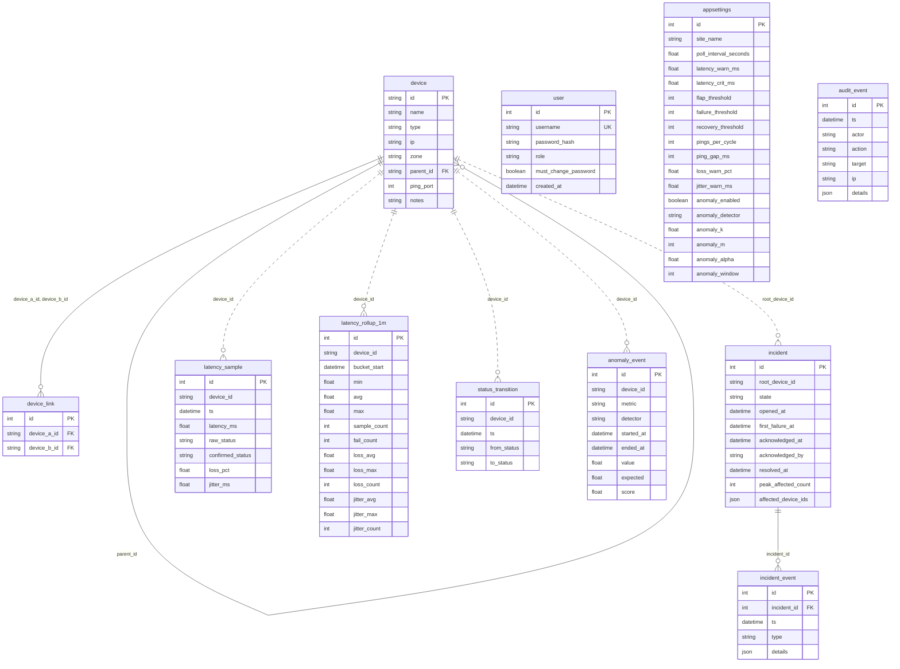

# Network Analyser

A network monitor for industrial (OT) sites that tells the operator **which
device actually failed**, instead of raising an alarm for every device behind
it.

**The problem: alert storms.** In a plant network one switch sits in front of
many machines. When it fails, every PLC, HMI and scanner behind it stops
answering too, and a monitor that only pings devices raises an alert for each
of them. The one alert that matters is somewhere in the pile.

**The solution: topology-aware root-cause analysis.** Network Analyser knows
how the devices are connected, redundant links included. When devices stop
answering, it works out which of them the network can still reach: those are
the **root causes**. Everything that is only unreachable because of them is
**collateral**. One outage becomes one incident, with the devices it took
down, the number of alerts it replaced, and a step-by-step playbook.

It has three parts: a FastAPI backend that does the monitoring and the
analysis, a React single-page app that shows it live, and a Docker Compose
stack that simulates a small warehouse network, so that everything runs on
one machine.

## What it does

**Monitoring**

- **Probing.** Every poll cycle (10 s by default) each device gets several
  ICMP pings (4 by default). From the replies come its latency, packet loss
  and jitter, and a status: healthy, degraded, down or unknown.
- **Debounced status.** A status changes only after several polls in a row
  agree (3 to get worse, 2 to recover), so one bad poll raises nothing.
- **Live view.** The topology page updates over a Server-Sent Events stream.
  History, flap counts and incidents come over REST.
- **History that survives restarts.** Every poll is stored in SQLite: raw for
  a day, then as 1-minute rollups for 30 days. Charts cover the last hour up
  to the last 30 days.
- **Metrics and stability pages.** Per device: a latency chart with the
  median and the share of polls that got a reply, a packet-loss and jitter
  table, and a status overview. A ranking of the devices by status changes
  (flaps), with those at or above a threshold highlighted, and an
  availability table.
- **Anomaly detection, advisory.** Each device's latency and packet loss are
  compared with that device's own learned baseline (EWMA or rolling z-score).
  An unusual reading gets a badge and a chart marker. It never changes a
  status or opens an incident. Measured results:
  [docs/anomaly-evaluation.md](docs/anomaly-evaluation.md).

**Analysis**

- **Root cause or collateral.** Devices form a parent tree, plus optional
  extra links (a second uplink, a ring). An unhealthy device the network can
  still reach is a root cause; one that is cut off is collateral.
- **Incident lifecycle.** Every root cause becomes a stored incident: opened,
  optionally acknowledged by an admin, resolved automatically. It has a
  timeline with notes, and the app reports detection delay, MTTR, alerts
  suppressed and per-device availability.
- **Single points of failure.** A hand-written graph engine (Tarjan
  low-links, union-find) finds every device whose loss cuts others off, and
  how many.
- **What-if simulator.** Tick devices to fail and see what would be cut off
  and which incidents would be raised, without touching the network.
- **Guided-fix playbooks.** Each incident links to troubleshooting steps for
  that device type and status.

**Operations**

- **Fault injection.** An admin-only Chaos tab breaks the simulated network
  on purpose: fail or slow down a device, or run a preset. A failure also
  stops every device it cuts off. A separate agent, off by default, does the
  Docker work: [docs/chaos.md](docs/chaos.md).
- **Admin panel.** Devices, extra links, monitoring settings, users, fault
  injection and the audit log.
- **Security.** Two roles (admin, viewer), no built-in passwords, a forced
  password change at the first login, throttled logins, 60-minute tokens,
  single-use tickets for the status stream, strict CORS, security headers and
  an audit log. The backend refuses to start on a placeholder signing
  secret. Details: [docs/security.md](docs/security.md).
- **Simulated network.** Twelve containers stand in for a firewall, switches,
  servers, a PLC, an HMI, access points and a scanner, so development, tests
  and demos need no hardware.

## Architecture



The browser is the client that talks to the API: the frontend container only
serves static files, so API calls and the SSE connection originate from the
user's browser straight to the backend.

More on each part, the data flow and the deployment:
[docs/architecture.md](docs/architecture.md).

## Data model

SQLite, eleven tables. The schema is managed with Alembic and upgraded at
startup (see [Database migrations](docs/architecture.md#database-migrations)).



- **Solid lines** are foreign keys declared in the schema. **Dashed lines**
  are references by id that are deliberately not foreign keys: the history and
  the incidents of a deleted device are kept (the history until retention
  removes it, the incidents for good).
- `appsettings` holds exactly one row. `user` and `audit_event` stand alone:
  the audit log stores names, not ids, so it outlives what it describes.
- `device_link` stores a pair once, smaller id first (`CHECK` and `UNIQUE`).
  `incident` has a partial unique index: one unresolved incident per root
  device. `latency_rollup_1m` is unique per device and minute.
- SQLite does not enforce the foreign keys in this app. The API keeps them
  true instead: a device with children cannot be deleted, and deleting a
  device deletes its links.

What each table holds, and how long:
[Data persistence and retention](docs/architecture.md#data-persistence-and-retention).

## API

Every path is under `/api`. `user` means any logged-in account, `admin` the
admin role, `ticket` a single-use stream ticket. The interactive OpenAPI page
is at `http://localhost:8000/docs`.

| Method   | Path                              | Access      | Description                                   |
| -------- | --------------------------------- | ----------- | --------------------------------------------- |
| `GET`    | `/api/health`                     | public      | Liveness smoke check                          |
| `POST`   | `/api/auth/login`                 | public      | OAuth2 password login → JWT + role            |
| `GET`    | `/api/auth/me`                    | user        | Current session identity                       |
| `PATCH`  | `/api/auth/change-password`       | user        | Self-service password change                   |
| `GET`    | `/api/status`                     | user        | Latest status snapshot (non-streaming)         |
| `POST`   | `/api/stream/ticket`              | user        | Single-use ticket (30 s) for the stream       |
| `GET`    | `/api/stream/status?ticket=`      | ticket      | SSE stream of full status snapshots           |
| `GET`    | `/api/devices`                    | user        | List devices                                   |
| `GET`    | `/api/devices/{id}`               | user        | Get one device                                 |
| `POST`   | `/api/devices`                    | **admin**   | Create device (parent/cycle validation)        |
| `PATCH`  | `/api/devices/{id}`               | **admin**   | Update device                                  |
| `DELETE` | `/api/devices/{id}`               | **admin**   | Delete device (blocked if it has children)     |
| `GET`    | `/api/links`                      | user        | Extra links between devices                   |
| `POST`   | `/api/links`                      | **admin**   | Link two devices (validated)                  |
| `DELETE` | `/api/links/{id}`                 | **admin**   | Delete a link                                 |
| `GET`    | `/api/history/{id}`               | user        | Latency history; `?window=` for longer ranges |
| `GET`    | `/api/flaps`                      | user        | Flap counts (last 30 days), highest first     |
| `GET`    | `/api/anomalies`                  | user        | Recent anomaly events (advisory), newest first |
| `GET`    | `/api/incidents`                  | user        | Live root-cause/collateral incident set       |
| `GET`    | `/api/incidents/history`          | user        | Stored incidents, newest first                |
| `GET`    | `/api/incidents/{id}`             | user        | One stored incident with its timeline         |
| `POST`   | `/api/incidents/{id}/acknowledge` | **admin**   | Acknowledge an open incident                  |
| `POST`   | `/api/incidents/{id}/notes`       | **admin**   | Add a note to an incident's timeline          |
| `GET`    | `/api/stats/incidents`            | user        | Detection delay, MTTR and alerts suppressed   |
| `GET`    | `/api/stats/availability?window=` | user        | Per-device uptime over 24h, 7d or 30d         |
| `GET`    | `/api/analysis/spof`              | user        | Single points of failure, with blast radius   |
| `POST`   | `/api/analysis/what-if`           | user        | Predicted incidents if given devices failed   |
| `GET`    | `/api/chaos/state`                | **admin**   | Injected faults in place, and the presets     |
| `POST`   | `/api/chaos/fail`                 | **admin**   | Fail devices and everything they cut off      |
| `POST`   | `/api/chaos/degrade`              | **admin**   | Add delay, jitter and packet loss             |
| `POST`   | `/api/chaos/flap`                 | **admin**   | Switch a device off and on repeatedly         |
| `POST`   | `/api/chaos/scenario/{name}`      | **admin**   | Run a fault-injection preset                  |
| `POST`   | `/api/chaos/restore-all`          | **admin**   | Undo every injected fault                     |
| `GET`    | `/api/playbooks/{type}/{state}`   | user        | Guided-fix playbook for a device type/state    |
| `GET`    | `/api/settings`                   | user        | Monitoring settings (poll interval, thresholds)|
| `PATCH`  | `/api/settings`                   | **admin**   | Update monitoring settings                     |
| `GET`    | `/api/users`                      | **admin**   | List users                                     |
| `POST`   | `/api/users`                      | **admin**   | Create user                                    |
| `DELETE` | `/api/users/{id}`                 | **admin**   | Delete user (self/last-admin guarded)          |
| `GET`    | `/api/audit`                      | **admin**   | Audit log, newest first                       |

Requests are authenticated with `Authorization: Bearer <token>`, the token
coming from `POST /api/auth/login`. A request that breaks a rule gets a 422
whose `detail` names the field. Request and response shapes, paging and the
validation rules: [API notes](docs/architecture.md#api-notes).

## Setup with Docker

Needs Docker with Compose v2. Nothing else: the stack builds its own images.

```sh
cp infra/.env.example infra/.env
openssl rand -hex 32          # paste the output into infra/.env as JWT_SECRET_KEY
make up                       # or: docker compose -f infra/docker-compose.yml up -d --build
```

- Frontend: <http://localhost:8080>
- API: <http://localhost:8000/api/health>

This starts 14 containers: 12 simulated devices, the backend and the
frontend. The backend refuses to start (its log says why) while
`JWT_SECRET_KEY` is still the placeholder or shorter than 32 characters.

**First login.** The first start creates two accounts, `admin` and `viewer`.
Their first passwords are `ADMIN_INITIAL_PASSWORD` and
`VIEWER_INITIAL_PASSWORD` from `infra/.env`. If you set none, the backend
generates them and writes them to its log, once:

```sh
docker compose -f infra/docker-compose.yml logs backend | grep "initial password"
```

Each account has to choose a new password at its first login before it can do
anything else.

**Demo mode.** `DEMO_MODE=true` in `infra/.env` creates the accounts as
`admin` / `admin123` and `viewer` / `viewer123`, with no forced change. It is
insecure, off by default, and only chooses the passwords of a new database:
to switch an existing installation, run `make seed-reset`.

**Fault injection.** Off by default. To enable the Chaos tab:

```sh
echo "CHAOS_AGENT_TOKEN=$(openssl rand -hex 32)" >> infra/.env
make up CHAOS=1
```

Read [docs/chaos.md](docs/chaos.md) first: the agent holds the Docker socket.

**Stopping.** `make down` stops the stack and keeps the data (settings,
users, devices, history, incidents, audit log) in the `backend-data` volume.
`make seed-reset` also deletes that volume and starts again from the seed
file. If the frontend is reached from another machine, set
`FRONTEND_API_BASE_URL` in `infra/.env` to the address of the API as that
browser sees it, add the frontend's own origin (for example
`http://10.0.0.50:8080`) to `CORS_ORIGINS`, and run `make up` again.

## Development setup

Backend (Python 3.12):

```sh
cd backend
python -m venv .venv && source .venv/bin/activate
pip install -r requirements.txt -r requirements-dev.txt
cp .env.example .env   # then set JWT_SECRET_KEY, or DEMO_MODE=True
uvicorn app.main:app --reload --port 8000
```

- The backend does not start on the placeholder `JWT_SECRET_KEY` from
  `.env.example`. Put your own in `.env`, for example the output of
  `python -c "import secrets; print(secrets.token_hex(32))"`, or set
  `DEMO_MODE=True` for a throwaway local setup.
- Raw ICMP needs root or `CAP_NET_RAW`. Without it, set
  `PING_PRIVILEGED=False` in `.env`.
- The first start prints a generated password for `admin` and `viewer` in the
  log (or uses `ADMIN_INITIAL_PASSWORD` and `VIEWER_INITIAL_PASSWORD`).

Frontend (Node 22):

```sh
cd frontend
npm install
cp .env.example .env   # VITE_API_BASE_URL defaults to http://localhost:8000
npm run dev            # Vite dev server on :5173
```

A backend started like this pings the addresses in the seed file. The
simulated devices can only be reached from inside Docker (or from a Linux
Docker host), so for development without hardware either run the Docker
stack, or point `SEED_PATH` at a copy of `infra/devices.seed.json` whose
addresses your machine can reach (`127.0.0.1` answers).

Common commands, from the repository root:

| Command | What it does |
| --- | --- |
| `make up` | Builds and starts the Docker stack. `make up CHAOS=1` adds the fault-injection agent. |
| `make down` | Stops the stack. The data is kept. |
| `make seed-reset` | Stops the stack, **deletes its database** and starts again from the seed file. |
| `make test` | Backend tests with coverage, then the coverage gate CI enforces. |
| `make lint` | Frontend typecheck and lint. |
| `make build` | Frontend production build. |

## Configuration

**Environment variables.** The backend reads them from the environment or
from `backend/.env`. In the Docker stack the ones marked in the third column
are set in `infra/.env`; the others keep their defaults there. Both
`.env.example` files explain each value.

| Variable | Default | In `infra/.env` | Meaning |
| --- | --- | --- | --- |
| `JWT_SECRET_KEY` | a placeholder | required | Signs the login tokens. At least 32 characters, not a placeholder. |
| `JWT_ALGORITHM` | `HS256` | | Signing algorithm. |
| `JWT_EXPIRE_MINUTES` | `60` | yes | How long a login lasts. |
| `ADMIN_INITIAL_PASSWORD` | not set | yes | First password of `admin`. Not set: generated and logged once. |
| `VIEWER_INITIAL_PASSWORD` | not set | yes | The same for `viewer`. |
| `DEMO_MODE` | `False` | yes | Insecure: documented demo logins, no forced password change. |
| `CORS_ORIGINS` | `["http://localhost:5173"]` | yes | Exact origins that may call the API. The stack adds `http://localhost:8080`. |
| `DATABASE_PATH` | `./data/network_analyser.db` | | The SQLite file. |
| `SEED_PATH` | not set | | The seed file. Not set: `infra/devices.seed.json`. |
| `PING_PRIVILEGED` | `True` | | Raw ICMP sockets. `False` uses the unprivileged mode. |
| `PING_TIMEOUT_SECONDS` | `2.0` | yes | How long one ping waits for its reply. |
| `POLL_ENABLED` | `True` | | `False` starts the API without the poll loop (the tests do). |
| `PING_INTERVAL_SECONDS` | `10.0` | | Fallback only, used if the settings row is missing. |
| `LATENCY_WARN_MS` | `100.0` | | Fallback only, as above. |
| `LATENCY_CRIT_MS` | `500.0` | | Fallback only, as above. |
| `HISTORY_MAX_SAMPLES` | `36` | | Recent samples per device kept in memory. |
| `RAW_RETENTION_HOURS` | `24` | yes | Raw samples older than this become 1-minute rollups. |
| `ROLLUP_RETENTION_DAYS` | `30` | yes | Rollups older than this are deleted. |
| `TRANSITION_RETENTION_DAYS` | `30` | yes | Status changes and anomaly events older than this are deleted. Also the flap-count window. |
| `RETENTION_INTERVAL_SECONDS` | `3600` | yes | How often the retention job runs. |
| `CHAOS_AGENT_URL` | not set | yes | Where the chaos agent listens. The stack sets it. |
| `CHAOS_AGENT_TOKEN` | not set | yes | Shared secret with the chaos agent. Not set: fault injection is off. |
| `APP_NAME` | `Network Analyser API` | | Shown by `/api/health`. |
| `APP_ENV` | `development` | | Shown by `/api/health`. |

Two more are read when the frontend is built: `FRONTEND_API_BASE_URL` in
`infra/.env` (Docker) and `VITE_API_BASE_URL` in `frontend/.env`
(development). Both are the address of the API as the browser sees it, and
default to `http://localhost:8000`.

**Monitoring settings.** These live in the database and are changed in
Admin, Settings (or with `PATCH /api/settings`). The poll loop reads them at
the start of every cycle, so a change needs no restart.

| Setting | Default | Allowed | Meaning |
| --- | --- | --- | --- |
| `site_name` | `Warehouse Network Monitor` | 1 to 100 characters | Name of the site. |
| `poll_interval_seconds` | `10` | 5 to 3600 | Pause between two poll cycles. |
| `latency_warn_ms` | `100` | above 0, below crit | Degraded above this average latency. |
| `latency_crit_ms` | `500` | above warn | The upper latency threshold. |
| `flap_threshold` | `3` | 1 to 1000 | Status changes that mark a device as flapping. |
| `failure_threshold` | `3` | 1 to 10 | Polls in a row before a worse status is confirmed. |
| `recovery_threshold` | `2` | 1 to 10 | Polls in a row before a better status is confirmed. |
| `pings_per_cycle` | `4` | 1 to 10 | Pings per device per cycle. |
| `ping_gap_ms` | `200` | 10 to 5000 | Pause between them. |
| `loss_warn_pct` | `20` | above 0, up to 100 | Degraded from this much packet loss. |
| `jitter_warn_ms` | `30` | above 0 | Degraded from this much jitter. |
| `anomaly_enabled` | `true` | true, false | Anomaly detection on or off. |
| `anomaly_detector` | `ewma` | `ewma`, `rolling` | Which detector. |
| `anomaly_k` | `3` | 1 to 10 | Standard deviations above the baseline that count. |
| `anomaly_m` | `3` | 1 to 20 | Readings in a row that have to be above. |
| `anomaly_alpha` | `0.1` | 0.01 to 0.5 | EWMA only: how fast the baseline forgets. |
| `anomaly_window` | `60` | 30 to 1000 | Rolling only: how many readings it looks back on. |

`pings_per_cycle x ping_gap_ms + PING_TIMEOUT_SECONDS` has to fit in 80% of
the poll interval; a combination that does not is rejected with the
arithmetic in the message.

## Testing

Backend tests live in `backend/tests/` and run with pytest. They need no
network, no root and no Docker:

- they use a temporary SQLite file, never the dev database
  (`tests/conftest.py` refuses to start otherwise);
- the background poll loop is off (`POLL_ENABLED=false`), and the loop itself
  is tested with a fake ping function, so no ICMP is sent;
- nothing waits for real time: the login limiter and the stream tickets take
  their clock as a parameter, and the tests move it by hand.

```sh
cd backend
python -m venv .venv && source .venv/bin/activate   # Python 3.12
pip install -r requirements.txt -r requirements-dev.txt
pytest                                              # run the suite
pytest --cov=app --cov-report=term-missing          # same, with a coverage report
coverage report --include="app/services/*" --fail-under=80   # the gate CI enforces
coverage html                                       # optional: browsable report in htmlcov/
```

These are characterization tests: they pin what the code does today, so a
later change in behaviour shows up as a failing test. A test marked `xfail`
records a known bug that has deliberately not been fixed yet; pytest lists each
one with its reason at the end of the run. There are none at the moment.

The suite runs with `DEMO_MODE=true`, so that it can log in as `admin` /
`admin123`; `test_security.py` switches it off to test the forced password
change, how the default accounts are seeded, and the refusal to start on a
placeholder signing secret.

The suite is seeded with a frozen copy of the original 11-device tree
(`backend/tests/data/classic_tree.seed.json`), so tests of the monitoring
logic do not change when the shipped topology does. `test_seed_topology.py`
checks the shipped seed file, the compose file that simulates it, and link
seeding.

The graph algorithms are also checked on seeded random graphs against slow,
obvious implementations (see [docs/algorithms.md](docs/algorithms.md#the-graph-engine)). A failing case prints
its seed, so it can be reproduced.

The anomaly detectors' running statistics are compared with a recomputation
from scratch on random data, and `test_eval_anomaly.py` runs the evaluation
script and checks that the figures quoted in
[docs/anomaly-evaluation.md](docs/anomaly-evaluation.md) are what it prints.

Frontend checks:

```sh
cd frontend
npm ci
npx tsc -b --noEmit   # typecheck
npm run lint
npm run build
```

`.github/workflows/ci.yml` runs both sets of commands on every push and pull
request.

`backend/tests/test_docs.py` keeps this README honest: it fails if the API
table and the app's routes differ, if the ER diagram and the models differ,
if a setting is missing from the tables above or from an `.env.example`
file, or if a link between the documents points nowhere.

`make test` runs the backend commands above, and `make lint` and `make build`
the frontend ones.

## Known limitations

Monitoring and analysis

- **Ping only.** A device is judged on ICMP replies. One that blocks ping
  looks down, and a service that has died on a host that still answers looks
  healthy.
- **`unknown` is never a failure.** If the monitor itself cannot probe (no
  `CAP_NET_RAW`, say), every device is `unknown` and no incident is raised.
- **Stale data is not flagged.** If the poll loop stops, the pages keep
  showing the last statuses, and `/api/health` still answers ok.
- **Detection takes three polls.** That is the price of debouncing. With the
  defaults an outage is confirmed after about 50 seconds, because every ping
  to a device that does not answer waits for its timeout. A lower
  `PING_TIMEOUT_SECONDS` shortens it.
- **Shared collateral is counted once per root cause.** With redundant links
  a device cut off by two failures together is listed under both, so "alerts
  suppressed" counts it twice.
- **Anomaly detection needs a warm-up.** 30 readings per device after every
  backend restart (about five minutes); a slowdown that begins during the
  warm-up is learned as normal. It does not see a slow drift, and it was
  evaluated on synthetic traces, not on a real network.

Design limits

- **One backend process.** The latest snapshot, the debounce state, the
  detectors, the login throttle and the stream tickets are in its memory. A
  second process would poll twice and disagree.
- **SQLite.** One writer at a time, and foreign keys are not enforced.
- **Built for tens of devices.** The Metrics page asks for history one device
  at a time, and nothing is paged on the topology page.
- **Security.** Plain HTTP, the token in `localStorage`, no way to revoke a
  token before it expires. The full list is in
  [docs/security.md](docs/security.md#known-limitations-accepted).
- **Seeded devices and links come back.** One that an admin deletes is added
  again at the next start, because seeding adds whatever is missing.
- **Stored data is not re-checked.** The validation rules apply to new
  requests. The seed file is trusted: its links are checked against the link
  rules and its devices for parent loops, and nothing else.

Simulation and tooling

- **The simulated devices do not depend on each other.** Each container
  answers ping by itself, so the chaos agent stops the devices behind a
  failed one to make a failure look real. It can only act on simulated
  devices, and it holds the Docker socket: see [docs/chaos.md](docs/chaos.md).
- **Checked on Docker Desktop for macOS and in Chrome.** A native Linux
  Docker host (where `tc netem` needs the `sch_netem` kernel module loaded)
  and other browsers were not tried.
- **No automated frontend tests.** The frontend is covered by the typecheck,
  the linter, the build and manual browser runs.
- **Dependency advisories were not revisited.** `pip-audit` and `npm audit`
  reported advisories for some pinned packages at the start of this work;
  the pins are unchanged, and whether any applies here was not assessed.

## Documentation

| Document | What is in it |
| --- | --- |
| [docs/architecture.md](docs/architecture.md) | The parts, the poll loop, the incident lifecycle, storage and retention, migrations, the frontend, the deployment |
| [docs/algorithms.md](docs/algorithms.md) | Every algorithm: purpose, cost, and why it is right |
| [docs/design-decisions.md](docs/design-decisions.md) | Why SSE, SQLite, debouncing, advisory anomalies and the other main choices, with their tradeoffs |
| [docs/security.md](docs/security.md) | Threat model, what is mitigated, what is accepted |
| [docs/chaos.md](docs/chaos.md) | Fault injection: how it works, the Docker-socket risk, the scenarios |
| [docs/anomaly-evaluation.md](docs/anomaly-evaluation.md) | Measured precision, recall and delay of the anomaly detectors |
| [docs/demo-script.md](docs/demo-script.md) | A timed five-minute demo, click by click |
| [CHANGELOG.md](CHANGELOG.md) | What each commit on this branch added |

## Tech stack

| Layer        | Technologies                                                                  |
| ------------ | ----------------------------------------------------------------------------- |
| Backend      | Python 3.12, FastAPI, Uvicorn, SQLModel + SQLite, Alembic, `icmplib`, sse-starlette, passlib + bcrypt (4.0.1), python-jose, pydantic-settings |
| Frontend     | React 19, TypeScript, Vite, Tailwind CSS, shadcn/ui (Radix), @xyflow/react, recharts, React Router |
| Deployment   | Docker Compose, nginx, Alpine, multi-stage Dockerfiles                        |
| Testing / CI | pytest, pytest-asyncio, pytest-cov, httpx (`TestClient`), GitHub Actions      |
