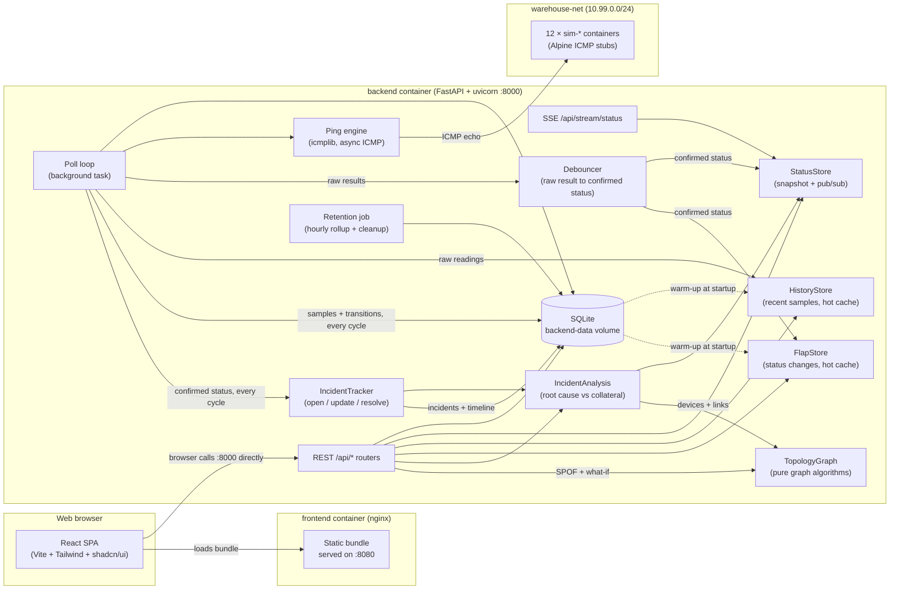
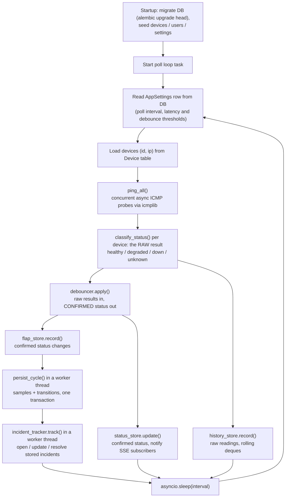
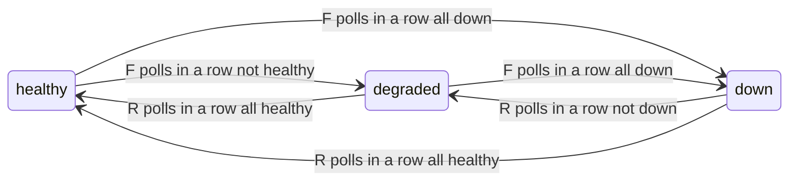
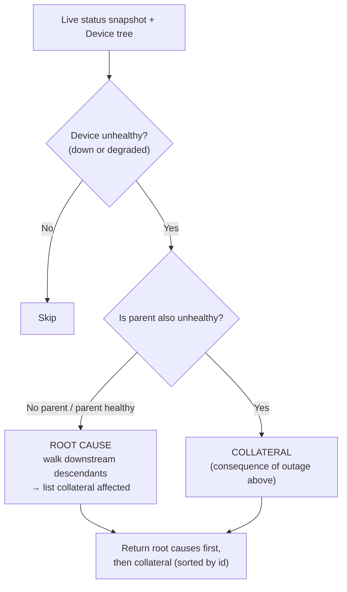
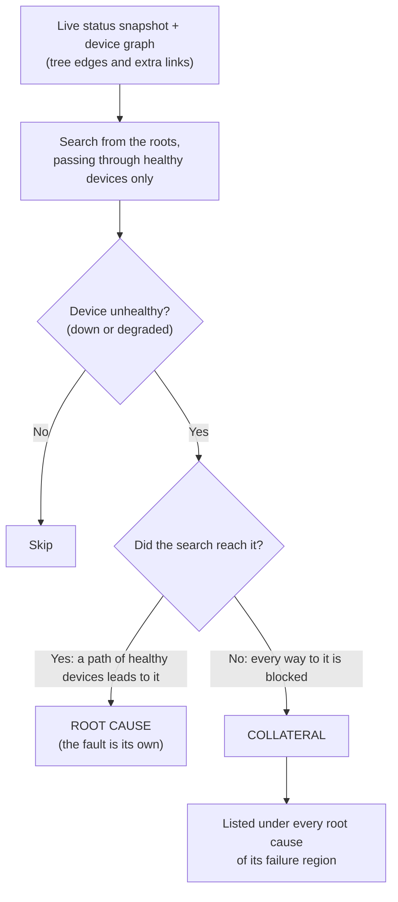
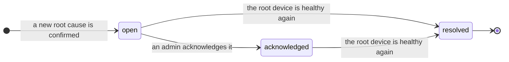
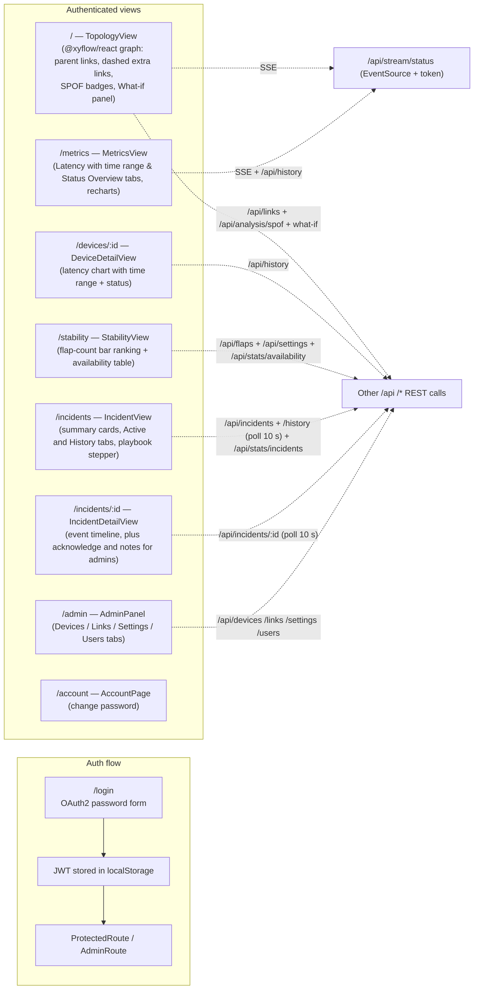
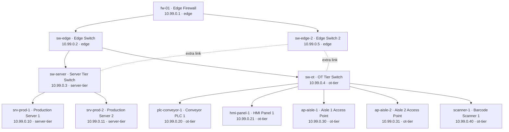
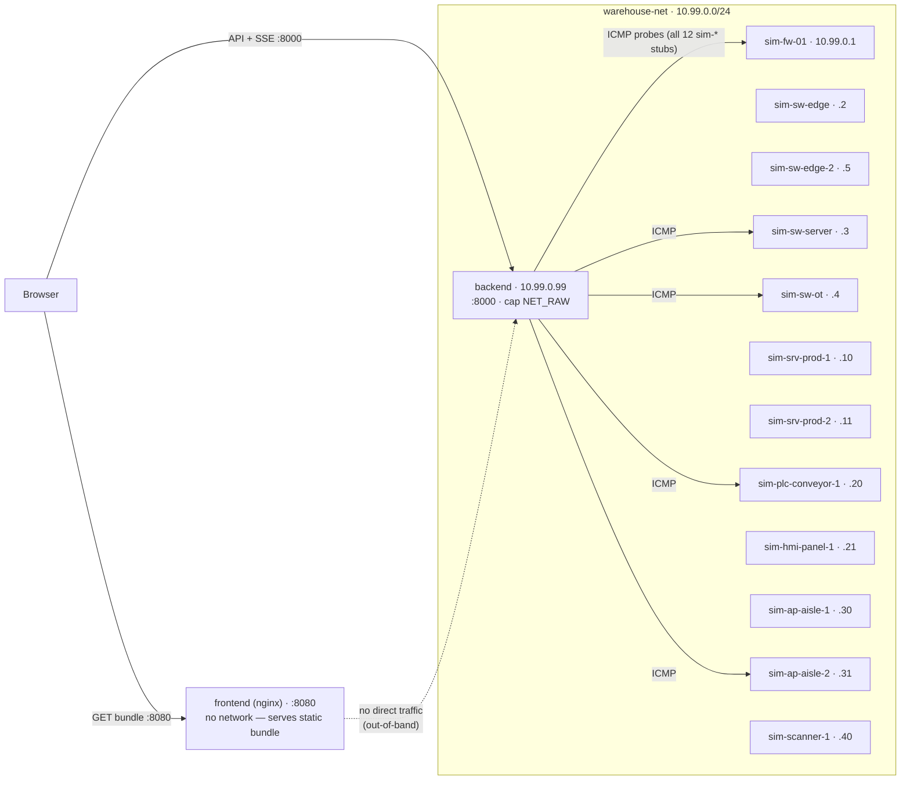
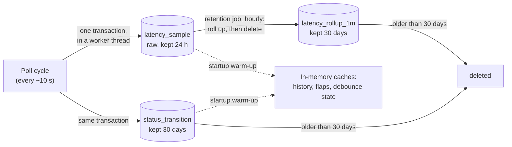

# Network Analyser

Real-time monitoring, stability analysis, and root-cause incident detection for
industrial / OT networks. The system pings every device in a warehouse network
over ICMP, classifies its health (healthy / degraded / down / unknown), streams
live status to a web dashboard over SSE, and automatically separates **root
causes** from **collateral damage** whenever something goes offline.

Built as three layers: a FastAPI backend that owns all monitoring logic, a
React SPA that visualizes it, and a Docker Compose stack that simulates an
entire warehouse LAN so the whole system runs on one machine.

## Overview

- **ICMP monitoring** — an async `icmplib` ping engine probes every device on a
  configurable interval (~10 s default) and classifies each one.
- **Debounced status** — a device changes state only after several polls in a
  row agree (3 to get worse, 2 to recover by default), so one lost ping does
  not raise an incident.
- **Live dashboards** — a Server-Sent Events (SSE) stream pushes full status
  snapshots to every connected browser; latency history, flap counts, and
  incident lists come on top via REST.
- **History that survives restarts** — every poll and every status change is
  stored in SQLite. Raw samples are kept for a day, then downsampled to
  1-minute rollups kept for 30 days; charts can show the last hour up to the
  last 30 days.
- **Tree-based incident analysis** — devices are stored as a parent/child tree
  (firewall → switches → PLCs/HMIs/servers). An unhealthy device whose parent
  is also unhealthy is marked **collateral**; one whose parent is healthy is a
  **root cause** with the list of downstream devices it took down.
- **Redundancy-aware topology** — besides the parent tree, devices can be
  joined by extra links (a second uplink, a ring). A hand-written graph engine
  finds every single point of failure and the blast radius of each device, and
  incident analysis then follows reachability instead of the parent alone.
- **What-if simulator** — pick devices to fail and see on the topology what
  would be cut off and which incidents would be raised, without touching the
  live network.
- **Incident lifecycle** — every root cause becomes a stored incident that is
  opened, optionally acknowledged, and resolved automatically, with a timeline,
  detection delay, MTTR and per-device availability.
- **Guided-fix playbooks** — each incident links to a static, device-type +
  status-specific troubleshooting playbook.
- **Role-based access** — JWT login with `admin` / `viewer` roles; device CRUD,
  user management, monitoring settings, and users' password changes all live
  behind the appropriate role check.
- **Simulated hardware** — Docker Compose brings up 12 Alpine containers that
  stand in for firewall/switch/PLC/HMI/AP/scanner hardware, so the entire
  lifecycle (dev, demo, testing) works without touching real devices.

## System architecture



The browser is the client that talks to the API: the frontend container only
serves static files, so API calls and the SSE connection originate from the
user's browser straight to the backend.

## Repository layout

```
.
├── .github/workflows/ci.yml CI: backend tests + coverage, frontend typecheck/lint/build
├── backend/                 FastAPI application (Python 3.12)
│   ├── app/
│   │   ├── main.py          App factory, lifespan (migrate, seed, warm-up, background tasks), SSE endpoint
│   │   ├── core/            Config (pydantic-settings), JWT/bcrypt security, auth deps
│   │   ├── db/              SQLAlchemy/sqlmodel session, Alembic migrations/, seed scripts
│   │   ├── models/          Device, DeviceLink, User, AppSettings, the history tables and incidents (SQLModel)
│   │   ├── routers/         auth, devices, links, settings, users, history, flaps, incidents, stats,
│   │   │                    analysis (SPOF, what-if), playbooks
│   │   ├── schemas/         Pydantic request/response DTOs
│   │   ├── services/        ping_engine, debounce, poll_loop, status/history/flap stores, incident_analysis,
│   │   │                    persistence (DB writes, warm-up, windowed history), rollup, retention,
│   │   │                    incident_tracker (incident lifecycle), incident_stats (MTTR, availability),
│   │   │                    topology_graph (graph algorithms), device_links (rules for extra links),
│   │   │                    topology_analysis (SPOF report, what-if)
│   │   └── data/playbooks.py  Static guided-fix playbook content
│   ├── tests/               pytest suite (temporary SQLite DB, fake ping, no ICMP)
│   ├── alembic.ini          Alembic command-line config (the app migrates itself at startup)
│   └── Dockerfile
├── frontend/                React SPA (React 19 + TypeScript + Vite)
│   ├── src/
│   │   ├── components/      Views: Topology, DeviceDetail, Metrics, Stability, Incidents, Admin, Login
│   │   ├── contexts/        AuthContext (JWT state)
│   │   ├── hooks/           useStatusStream (SSE), useDevices, useHistory, useFlapCounts, useIncidents,
│   │   │                    useIncidentRecords, useAvailability, useTopology (links, SPOFs),
│   │   │                    usePolled (shared polling)
│   │   └── lib/             api client (fetch + SSE), topology layout, metrics helpers
│   └── Dockerfile           Multi-stage: node build → nginx static server
├── infra/
│   ├── docker-compose.yml   Full stack: 12 sim devices + backend + frontend
│   ├── devices.seed.json    Seeded devices and extra links (the warehouse topology)
│   └── README.md            Deployment runbook
└── docs/                    (empty; reserved for further docs)
```

## Backend (FastAPI)

The backend is a single FastAPI app (`backend/app/main.py`) that, at startup
(`lifespan`), brings the SQLite schema up to date (see
[Database migrations](#database-migrations)), seeds devices from
`infra/devices.seed.json`, seeds default users and settings, refills its
in-memory caches from the database, and launches two background `asyncio`
tasks: the poll loop and the hourly retention job (see
[Data persistence and retention](#data-persistence-and-retention)).

### The poll loop



Everything the poll loop needs is re-read from the DB-backed `AppSettings`
singleton at the **start of every cycle**, so an admin editing the poll
interval, the latency thresholds or the debounce thresholds in the UI takes
effect within one cycle — no backend restart required.

Setting `POLL_ENABLED=False` starts the API without the background tasks (the
test suite does this). Nothing is pinged, so every device stays `unknown`, and
the retention job does not run.

### Device status classification

Each probe is classified against live latency thresholds:

| Result          | Condition                                        |
| --------------- | ------------------------------------------------ |
| `healthy`       | reachable, latency ≤ warn threshold              |
| `degraded`      | reachable, latency > warn **or** > crit threshold |
| `down`          | unreachable (ICMP timed out)                     |
| `unknown`       | probe failed with an exception (no result)       |

### Status debouncing

The result above is a device's **raw** status for one poll. A single lost ICMP
packet reads as a raw `down`, so the dashboards, the flap counter and the
incident analysis do not use it directly. They use the **confirmed** status,
which changes only when several polls in a row agree. The logic is a pure
state machine in `backend/app/services/debounce.py`.

Statuses are ranked `healthy < degraded < down < unknown`, and three rules
decide each device's confirmed status:

1. A device's first result is accepted as it is.
2. **Getting worse:** when the last `failure_threshold` raw results are all
   worse than the confirmed status, it becomes the mildest of them.
3. **Getting better:** when the last `recovery_threshold` raw results are all
   better than the confirmed status, it becomes the worst of them.

With the defaults, a device is marked `down` only after 3 lost pings in a row
and `healthy` again only after 2 replies in a row. Moves between `healthy` and
`degraded` follow the same two rules. A probe error (`unknown`) ranks worst, so
it does not interrupt a run of `down` results.



`F` is `failure_threshold` and `R` is `recovery_threshold`:

| Setting              | Default | Range | Meaning                                              |
| -------------------- | ------- | ----- | ---------------------------------------------------- |
| `failure_threshold`  | 3       | 1–10  | polls in a row before a worse status is confirmed    |
| `recovery_threshold` | 2       | 1–10  | polls in a row before a better status is confirmed   |

Both are edited in Admin → Settings (or `PATCH /api/settings`) and are re-read
every poll cycle. Setting both to 1 switches debouncing off.

Each device in the status snapshot (`/api/status` and the SSE stream) carries
the confirmed status plus the raw details. This one has just missed a poll:

```json
{
  "sw-ot": {
    "status": "healthy",
    "latency_ms": null,
    "timestamp": "2026-11-15T10:00:20.123456+00:00",
    "raw_status": "down",
    "consecutive_failures": 1,
    "consecutive_successes": 0
  }
}
```

- `status` is the confirmed status; `raw_status` is the latest poll's result.
- `latency_ms` and `timestamp` belong to the latest poll.
- `consecutive_failures` / `consecutive_successes` count the polls in a row
  that were not healthy / were healthy.

Things to know:

- Latency history, and the reachability figure in the Metrics view, are built
  from the raw readings. Intermittent loss that never reaches the threshold
  shows up there rather than as a status change or a flap.
- Debounce state is held in memory and rebuilt at startup from the stored
  samples, so a restart does not turn the next poll into a "first result". The
  exception is a long gap: if a device's last stored poll is more than 10 poll
  intervals old, its next result is accepted at once.
- A deleted device's state is dropped on the next cycle.

### Incident analysis

`incident_analysis.analyze_incidents()` is a pure function — status snapshot +
device tree in, classified incidents out. It is re-evaluated from scratch on
every `/api/incidents` request, so recovery reclassifies immediately. It works
on the confirmed statuses, so an unconfirmed lost ping does not create an
incident.



Each root cause carries the list of `downstream_affected` devices it took down,
and the frontend renders these as incident cards with a guided-fix playbook
stepper linked from the static `backend/app/data/playbooks.py`.

#### With redundant links

The rule above looks only at a device's parent. That is right for a tree,
where the parent is the only way up. Once the topology has extra links (see
[Redundant links](#redundant-links)), a device can have a second way up, so
the analysis switches to **reachability**. With no links stored it uses the
tree rule exactly as before.



- A device is **reachable** when a path leads to it from a root (a device with
  no parent) on which every device in between is healthy. `unknown` counts as
  healthy here: a missing measurement is not a failure.
- An unhealthy device that is reachable is a **root cause**. One that is not
  is **collateral**.
- A **failure region** is a group of unhealthy devices joined to each other.
  A collateral device is listed in the `downstream_affected` of every root
  cause in its region. That list holds collateral devices only.

Example: a PLC with two uplinks, `s1` (its parent) and `s2` (an extra link).

| What is down        | Tree only                 | With the link                              |
| ------------------- | ------------------------- | ------------------------------------------ |
| `s1` and the PLC    | PLC is collateral of `s1` | PLC is a root cause: `s2` still reaches it |
| `s1`, `s2`, the PLC | PLC is collateral of `s1` | PLC is collateral of both `s1` and `s2`    |

### Incident lifecycle

The analysis above is stateless: it answers "what is wrong right now?" and
remembers nothing. The **incident tracker**
(`backend/app/services/incident_tracker.py`) adds the memory. The poll loop
calls it after every cycle (never per HTTP request). It runs the same
analysis, compares the result with the unresolved incidents in the database,
and stores what changed. There is one incident per outage, keyed by its
root-cause device.



What the tracker does each cycle:

- **Open.** A root cause with no unresolved incident gets a new one.
  `opened_at` is the poll that confirmed it; `first_failure_at` is the first
  failing raw probe of the streak that led to it (from the debouncer).
- **Update.** When the set of downstream devices changes, the incident's
  snapshot and its peak are updated and an `affected_changed` event is logged.
  Collateral devices never get an incident of their own.
- **Resolve.** When the root device is confirmed healthy again (or deleted),
  the incident is resolved. A later failure of the same device is a **new**
  incident.

Three cases are handled on purpose:

- If an outage further up turns the root device into collateral, its incident
  is left as it is: the device is still down.
- If the root device becomes `unknown` (the probe itself fails), the incident
  stays open. Not being able to measure is not a recovery.
- If a device is still down when its parent recovers, it becomes a root cause
  and gets its own incident, with no detection delay because it was already
  known to be down.

**Restarts.** Incidents live in the database and the tracker keeps no other
state, so there is no special restart code. The first cycle after a restart
continues the incidents whose root is still unhealthy, resolves the ones that
recovered while the backend was down, and opens new ones. A partial unique
index allows only one unresolved incident per root device, so a duplicate
cannot be stored.

**Timeline.** Every incident has events: `opened`, `affected_changed`,
`acknowledged`, `note` and `resolved`. Acknowledging and adding notes are
admin actions; everything else is logged by the tracker.

**Statistics** (`GET /api/stats/incidents`, over all stored incidents):

| Field                          | Meaning                                                      |
| ------------------------------ | ------------------------------------------------------------ |
| `count`                        | incidents recorded (`open_count` and `resolved_count` too)   |
| `mean_detection_delay_seconds` | mean of `opened_at - first_failure_at`                       |
| `mttr_seconds`                 | mean of `resolved_at - opened_at`, resolved incidents only   |
| `alerts_suppressed`            | sum of each incident's peak number of collateral devices     |

With the default thresholds the detection delay is about two poll intervals:
a failure is confirmed on the third failing poll.

**Availability** (`GET /api/stats/availability?window=24h|7d|30d`) is computed
from `status_transition`. For each device it rebuilds the status over the
window and reports `uptime_percent`, `downtime_seconds` and `outages`. Only
`down` counts as downtime; a degraded device still answers. A device is judged
on the time it was actually monitored (`observed_seconds`), so one added an
hour ago is not credited with a full day of uptime.

### API endpoints

| Method   | Path                              | Access      | Description                                   |
| -------- | --------------------------------- | ----------- | --------------------------------------------- |
| `GET`    | `/api/health`                     | public      | Liveness smoke check                          |
| `POST`   | `/api/auth/login`                 | public      | OAuth2 password login → JWT + role            |
| `GET`    | `/api/auth/me`                    | user        | Current session identity                       |
| `PATCH`  | `/api/auth/change-password`       | user        | Self-service password change                   |
| `GET`    | `/api/status`                     | user        | Latest status snapshot (non-streaming)         |
| `GET`    | `/api/stream/status?token=`       | user (query)| SSE stream of full status snapshots            |
| `GET`    | `/api/devices`                    | user        | List devices                                   |
| `GET`    | `/api/devices/{id}`               | user        | Get one device                                 |
| `POST`   | `/api/devices`                    | **admin**   | Create device (parent/cycle validation)        |
| `PATCH`  | `/api/devices/{id}`               | **admin**   | Update device                                  |
| `DELETE` | `/api/devices/{id}`               | **admin**   | Delete device (blocked if it has children)     |
| `GET`    | `/api/links`                      | user        | Extra links between devices                   |
| `POST`   | `/api/links`                      | **admin**   | Link two devices (validated)                  |
| `DELETE` | `/api/links/{id}`                 | **admin**   | Delete a link                                 |
| `GET`    | `/api/history/{id}`               | user        | Latency history; `?window=` for longer ranges |
| `GET`    | `/api/flaps`                      | user        | Flap counts (last 30 days), highest first     |
| `GET`    | `/api/incidents`                  | user        | Live root-cause/collateral incident set       |
| `GET`    | `/api/incidents/history`          | user        | Stored incidents, newest first (see below)    |
| `GET`    | `/api/incidents/{id}`             | user        | One stored incident with its timeline         |
| `POST`   | `/api/incidents/{id}/acknowledge` | **admin**   | Acknowledge an open incident                  |
| `POST`   | `/api/incidents/{id}/notes`       | **admin**   | Add a note to an incident's timeline          |
| `GET`    | `/api/stats/incidents`            | user        | Detection delay, MTTR and alerts suppressed   |
| `GET`    | `/api/stats/availability?window=` | user        | Per-device uptime over 24h, 7d or 30d         |
| `GET`    | `/api/analysis/spof`              | user        | Single points of failure, with blast radius   |
| `POST`   | `/api/analysis/what-if`           | user        | Predicted incidents if given devices failed   |
| `GET`    | `/api/playbooks/{type}/{state}`   | user        | Guided-fix playbook for a device type/state    |
| `GET`    | `/api/settings`                   | user        | Monitoring settings (poll interval, thresholds)|
| `PATCH`  | `/api/settings`                   | **admin**   | Update monitoring settings                     |
| `GET`    | `/api/users`                      | **admin**   | List users                                     |
| `POST`   | `/api/users`                      | **admin**   | Create user                                    |
| `DELETE` | `/api/users/{id}`                 | **admin**   | Delete user (self/last-admin guarded)          |

> **SSE auth note:** the stream endpoint authenticates via a `token` query
> parameter because the browser `EventSource` API cannot set an
> `Authorization` header; every other endpoint uses `Bearer` tokens.

`GET /api/incidents/history` takes `state` (`open`, `acknowledged` or
`resolved`; may be repeated), `device_id` (the root-cause device), `limit`
(1–200, default 50) and `offset`, and returns `{total, limit, offset, items}`.
`POST /api/incidents/{id}/notes` takes `{"text": "..."}` (1–2000 characters).
Acknowledging an incident that is not open returns 409.

`POST /api/links` takes `{"device_a_id": "...", "device_b_id": "..."}`, in
either order, and answers 201 with `{id, device_a_id, device_b_id}` (smaller
id first). A device linked to itself or an unknown device is a 422; two
devices that are connected already are a 409. Deleting a device also deletes
its links.

`GET /api/analysis/spof` returns `[{device_id, blast_radius,
cut_off_device_ids}]`, largest blast radius first.
`POST /api/analysis/what-if` takes `{"failed_device_ids": [...]}` and returns
`{incidents, unreachable_device_ids, total_blast_radius}`, where `incidents`
has the shape of `GET /api/incidents`. It only calculates: nothing is stored
and the live status is not touched. An unknown device id is a 422.

## Algorithms

The topology is treated as a graph, and every graph algorithm is written by
hand in `backend/app/services/topology_graph.py`: no graph library, no
database access, and no recursion. Each traversal keeps its own stack or
queue, so a very deep network cannot hit Python's recursion limit.

- A **vertex** is a device.
- An **edge** is undirected: the connection between a device and its parent,
  or an extra link (see [Redundant links](#redundant-links)).
- A **root** is a device with no parent. The monitor reaches the network
  through the roots, so "can reach a root" means "is reachable".
- Where an algorithm needs one starting point, it adds a virtual
  **super-root** joined to every root.

In the table V is the number of devices and E the number of edges.

| Algorithm                            | Function                                    | Purpose                                                                         | Time              |
| ------------------------------------ | ------------------------------------------- | ------------------------------------------------------------------------------- | ----------------- |
| Adjacency builder                    | `build_graph`                               | Turns devices and links into adjacency lists and the list of roots              | O(V + E)          |
| Breadth-first search                 | `reachable_from_roots`                      | Devices reachable from a root through healthy devices: root cause or collateral | O(V + E)          |
| Tarjan's low-link search (iterative) | `low_link_search`                           | One depth-first search giving every device a discovery number and a low-link    | O(V + E)          |
| Articulation points and bridges      | `articulation_points_and_bridges`           | Devices and connections whose loss splits the network                           | O(V + E)          |
| Blast radius                         | `blast_radius`, `single_points_of_failure`  | For every device, how many others lose every root if it fails                   | O(V + E)          |
| Union-find (DSU)                     | `DisjointSet`, `cut_off`, `component_count` | What is cut off when several devices fail together; failure regions             | O((V + E) · α(V)) |
| Brute force                          | `blast_radius_bruteforce`                   | Removes each device in turn and searches again; the reference for the tests     | O(V · (V + E))    |

α is the inverse Ackermann function. It is at most 4 for any realistic V, so
union-find is linear in practice.

**Low-link values.** The depth-first search numbers the devices in the order
it discovers them. The low-link of a device is the smallest number that can
be reached from it by going down the search tree and then along at most one
other edge. For a tree edge from `p` down to `c`:

- `low[c] >= discovery[p]`: nothing below the edge reaches higher than `p`,
  so removing `p` cuts that part off. `p` is an articulation point.
- `low[c] > discovery[p]`: nothing below reaches even `p` except through this
  edge, so the edge is a bridge.

**Blast radius.** The blast radius of a device is the number of other devices
that can no longer reach any root when it is removed. With the super-root on
top, one search covers every device: the blast radius of `p` is the sum of
the subtree sizes of its children `c` with `low[c] >= discovery[p]`. A device
with a blast radius above 0 is a **single point of failure** (SPOF).

A SPOF is not the same as an articulation point. A root with one chain below
it is a SPOF (everything depends on it) but not an articulation point. A
device that only joins two roots is an articulation point (the graph splits)
but not a SPOF (both halves keep a root).

**Several failures at once.** Low-link values describe the loss of one device
only. `cut_off(graph, failed)` answers the question for any set of failed
devices by rebuilding connectivity with union-find.

**How they are tested.** Hand-built graphs (path, star, cycle, two cycles
sharing a node, disconnected graph, several roots, dual-homed device), and
seeded random graphs: 600 trees and 1,500 graphs per property, on which the
fast algorithms must give the same answers as the brute force. A chain of
20,000 devices shows that nothing recurses.

### Redundant links

The parent tree gives every device one uplink. The `device_link` table adds
extra, undirected connections: a second uplink, a ring, a cross-link. A link
is stored once, with its two device ids in alphabetical order, and must obey
four rules:

1. a device is not linked to itself;
2. both devices exist;
3. the two are not already parent and child;
4. the pair is not already linked, in either order.

Rules 1 and 4 are database constraints. `backend/app/services/device_links.py`
checks all four when a link is added. Deleting a device deletes its links,
and moving a device under a device it was linked to removes that link,
because the connection is now the tree edge.

Links are managed in the Admin panel (Links tab) or through `/api/links`.
They can also be seeded: a device in `infra/devices.seed.json` may carry
`"links"`, the ids of the devices it is linked to besides its parent.
Seeding runs at every start and is idempotent: a seeded device or link that
is missing is added, and nothing is duplicated or overwritten.

Two endpoints expose the engine:

- `GET /api/analysis/spof` lists the single points of failure, each with its
  blast radius and the devices it would cut off.
- `POST /api/analysis/what-if` answers "what if these devices failed?". The
  failed devices, and everything they cut off, are treated as down in an
  otherwise healthy network, and that snapshot goes through the normal
  incident analysis. The total blast radius is the number of devices cut
  off.

## Frontend (React)

A single-page React app (React 19, TypeScript, Vite) styled with Tailwind CSS
and shadcn/ui components. Routing (`React Router`) and the JWT auth state live
in `AuthContext`; `ProtectedRoute` guards every view and `AdminRoute` restricts
the admin panel to `admin` users.



The live status path is **push** (SSE), while everything else is **pull**
(REST polling): live and stored incidents re-poll every 10 s, incident
statistics every 30 s, availability every minute, flap counts/settings on
mount, and history per device view.

The Topology page draws parent links in grey and extra links as blue dashed
lines, and marks every single point of failure with a `SPOF n` badge, n being
its blast radius. Its What-if panel lists the devices: tick the ones to fail,
press Simulate, and the graph shows the predicted statuses (`failed`,
`cut off`) next to the predicted root causes and the total blast radius. Reset
returns to the live view. The Admin panel has a Links tab to list, add and
delete extra links; a rejected link shows the backend's reason.

The Incidents page has four summary cards (incidents recorded, mean detection
delay, MTTR, alerts suppressed) above two tabs. **Active** is the live
root-cause/collateral view with the playbook stepper, and each root cause
links to its stored incident. **History** lists the stored incidents with a
state filter and paging. An incident's own page shows its details and
timeline; admins also get an Acknowledge button and a note form. The Stability
page has an availability table with a 24 hours / 7 days / 30 days selector.

The latency charts (device detail, and the Latency tab of Metrics) have a
time-range selector: **Live** (the most recent samples, refreshed every 10 s),
or the last hour, 6 hours, 24 hours, 7 days or 30 days (refreshed every
minute). For the longer ranges the backend returns time buckets, and the chart
draws the average as a line over a shaded min–max band. The resolution in use
is shown under the chart.

## Simulated network topology

The seeded topology (`infra/devices.seed.json`) models a small warehouse LAN:
an edge firewall, two edge switches, a server tier and an OT tier (PLCs,
HMIs, access points, scanners). Twelve devices and two extra links.



Solid arrows are parent links and dashed lines are extra links. Both tier
switches are dual-homed: each reaches the firewall through `sw-edge` or
through `sw-edge-2`, so losing one edge switch cuts nothing off. The single
points of failure that remain are `fw-01` (blast radius 11), `sw-ot` (5) and
`sw-server` (2).

This graph is what the incident analysis works on: if `sw-ot` goes down, all
five OT devices under it come back as **collateral** of a single root cause
instead of five separate alarms. If `sw-edge` goes down, it is a root cause
with nothing behind it.

## Deployment (Docker Compose)

The full stack runs from `infra/docker-compose.yml` on a single bridge network
(`warehouse-net`, `10.99.0.0/24`) with the gateway moved off `.1` so the
firewall stub can own `10.99.0.1`.



- **12 `sim-*` containers** — Alpine stubs that answer ICMP, standing in for
  warehouse hardware.
- **`backend`** — FastAPI + SQLite; needs `CAP_NET_RAW` for raw ICMP sockets,
  publishes `:8000`, persists the DB in the `backend-data` named volume, and
  mounts `infra/devices.seed.json` read-only as the topology source.
- **`frontend`** — nginx serving the built SPA on `:8080`. It is deliberately
  not on `warehouse-net`: it never talks to the backend itself (the browser
  does), so attaching it adds nothing.
- **14 containers total** when running (12 sims + backend + frontend).

Persisted SQLite data (settings, users, devices, latency history and status
transitions) survives `down`/`up` and rebuilds via the `backend-data` volume,
and the backend upgrades its schema in place at startup (see
[Database migrations](#database-migrations)). Latency history, flap counts and
debounce state are held in memory for speed, but they are rebuilt from the
database at startup, so they no longer reset when the backend restarts (see
[Data persistence and retention](#data-persistence-and-retention)). Only the
live status snapshot starts empty, until the first poll completes.

## Running with Docker Compose

The full deployment (simulated devices + backend + frontend) runs from
`infra/`: see **`infra/README.md`** for setup (it requires a generated
`JWT_SECRET_KEY` in `infra/.env`), the startup/stop commands, and the seeded
login credentials.

## Development Setup

### Backend

```sh
cd backend
python -m venv .venv && source .venv/bin/activate
pip install -r requirements.txt
cp .env.example .env   # set JWT_SECRET_KEY / CORS_ORIGINS / thresholds
uvicorn app.main:app --reload --port 8000
```

Requires `CAP_NET_RAW` (or root) for privileged raw-ICMP pings. For
rootless local development, set `PING_PRIVILEGED=False` in `.env` to use
icmplib's unprivileged datagram mode (see `backend/app/services/ping_engine.py`
for platform caveats). Seeded logins default to `admin` / `admin123` and
`viewer` / `viewer123`.

### Frontend

```sh
cd frontend
npm install
cp .env.example .env   # VITE_API_BASE_URL defaults to http://localhost:8000
npm run dev            # Vite dev server on :5173
```

### Without real hardware

Run the 12 simulated devices from `infra/docker-compose.yml`:

```sh
docker compose -f infra/docker-compose.yml up -d sim-fw-01 sim-sw-edge sim-sw-edge-2 sim-sw-server sim-sw-ot \
  sim-srv-prod-1 sim-srv-prod-2 sim-plc-conveyor-1 sim-hmi-panel-1 sim-ap-aisle-1 sim-ap-aisle-2 sim-scanner-1
docker compose -f infra/docker-compose.yml down   # or the whole stack
```

Or run the whole stack (sims + backend + frontend) per **`infra/README.md`**.

## Data persistence and retention

Everything the poll loop measures is written to SQLite, so latency history and
flap counts survive a backend restart.

### Tables

- **`latency_sample`**: one row per device per poll (the raw data). Columns:
  `device_id`, `ts`, `latency_ms` (null when there was no reply),
  `raw_status`, `confirmed_status`.
- **`latency_rollup_1m`**: one row per device per minute. Columns:
  `device_id`, `bucket_start`, `min`, `avg`, `max`, `sample_count`,
  `fail_count`.
- **`status_transition`**: one row per confirmed status change (a flap).
  Columns: `device_id`, `ts`, `from_status`, `to_status`.
- **`incident`**: one row per outage (see "Incident lifecycle"). Columns:
  `root_device_id`, `state`, `opened_at`, `first_failure_at`,
  `acknowledged_at`, `acknowledged_by`, `resolved_at`, `peak_affected_count`,
  `affected_device_ids` (the downstream devices, stored as JSON).
- **`incident_event`**: an incident's timeline, one row per event. Columns:
  `incident_id`, `ts`, `type`, `details` (JSON).
- **`device_link`**: one row per extra link between two devices (see
  "Redundant links"). Columns: `device_a_id`, `device_b_id`, with
  `device_a_id < device_b_id`.

`latency_sample` and `status_transition` are indexed on `(device_id, ts)`, and
`latency_rollup_1m` is unique on `(device_id, bucket_start)`. `incident` has a
partial unique index that allows one unresolved incident per root device. All
timestamps are UTC. In a rollup, `min` / `avg` / `max` cover the polls that
got a reply and `fail_count` is the number that did not. The history and
incident tables do not reference `device`, so the history of a deleted device
simply ages out. Incidents are the exception to ageing out: there are few of
them, so they are kept until the database is deleted. `device_link` is
different: a link is deleted together with either of its two devices.

### Data lifecycle



1. **Write.** After every poll cycle the loop stores one `latency_sample` per
   device, plus a `status_transition` for each confirmed status change, in a
   single transaction. The write runs in a worker thread
   (`asyncio.to_thread`), so it never blocks the event loop. If it fails, the
   error is logged and live monitoring carries on.
2. **Warm-up.** At startup the in-memory caches are refilled from the
   database: each device's most recent samples (the 36 behind the default
   history response), its status changes inside the flap window, and its
   debounce state.
3. **Roll up.** A background job runs at startup and then every hour. Raw
   samples older than `RAW_RETENTION_HOURS` are summarised into 1-minute
   rollups and deleted.
4. **Expire.** The same job deletes rollups older than `ROLLUP_RETENTION_DAYS`
   and transitions older than `TRANSITION_RETENTION_DAYS`.

The rollup is safe to run again at any time. Each batch of raw samples is
added to the rollups and deleted in the same transaction, so a sample is
always in exactly one place. If a rollup row for that minute already exists,
the new samples are merged into it: counts are added, min and max are
combined, and the average is re-weighted by the number of replies. A minute is
rolled up only once all of it is older than the cutoff.

### Retention settings

Set these as environment variables (`backend/.env`, or `infra/.env` for the
Docker deployment):

| Variable                     | Default | Meaning                                                              |
| ---------------------------- | ------- | -------------------------------------------------------------------- |
| `RAW_RETENTION_HOURS`        | `24`    | Raw samples older than this are rolled up to 1-minute rows           |
| `ROLLUP_RETENTION_DAYS`      | `30`    | Rollups older than this are deleted                                  |
| `TRANSITION_RETENTION_DAYS`  | `30`    | Transitions older than this are deleted; also the flap-count window  |
| `RETENTION_INTERVAL_SECONDS` | `3600`  | How often the retention job runs                                     |
| `HISTORY_MAX_SAMPLES`        | `36`    | Recent samples per device kept in memory                             |

With the defaults and 12 devices polled every 10 s, the database settles at
roughly 104,000 raw rows and 518,000 rollup rows.

### Reading history

`GET /api/history/{id}` without parameters is unchanged: a list of the most
recent samples, `[{"latency_ms": ..., "timestamp": ...}]`, served from memory.

With `?window=` it reads the database and returns a time range. The resolution
is chosen by the window, so every range is a few hundred points:

| `window` | Resolution | What a point is                               |
| -------- | ---------- | --------------------------------------------- |
| `1h`     | `raw`      | one poll                                      |
| `6h`     | `1m`       | min / avg / max over 1 minute                 |
| `24h`    | `5m`       | min / avg / max over 5 minutes                |
| `7d`     | `30m`      | min / avg / max over 30 minutes               |
| `30d`    | `2h`       | min / avg / max over 2 hours                  |

```json
{
  "device_id": "sw-ot",
  "window": "24h",
  "resolution": "5m",
  "resolution_seconds": 300,
  "points": [
    {
      "timestamp": "2026-11-15T10:00:00Z",
      "latency_ms": 1.4,
      "min_ms": 0.9,
      "max_ms": 3.2,
      "sample_count": 30,
      "fail_count": 0
    }
  ]
}
```

In a bucket, `latency_ms` is the average over the polls that got a reply (null
if none did). For `raw`, each point is one poll, so `min_ms` and `max_ms` equal
`latency_ms` and `sample_count` is 1. Buckets are built from the rollups plus
the raw samples that have not been rolled up yet, so the most recent day is
always included.

### Flap counts

A flap is a confirmed status change, stored as a `status_transition`.
`GET /api/flaps` counts each device's transitions over the last
`TRANSITION_RETENTION_DAYS` days. The response shape is unchanged, and the
counts survive a restart.

## Database migrations

The SQLite schema is managed with [Alembic](https://alembic.sqlalchemy.org/).
The migration scripts live in `backend/app/db/migrations/versions/` and are
applied automatically: at startup, before seeding, the backend runs the
equivalent of `alembic upgrade head`. A new database is built from the first
migration; an existing one gets only the migrations it is missing and keeps
its data.

- `0001` is the baseline: the `device`, `user` and `appsettings` tables as they
  were before Alembic. It creates only the tables that are missing, so a
  database from an older version (for example the `backend-data` Docker
  volume) is adopted as it is.
- `0002` adds `failure_threshold` and `recovery_threshold` to `appsettings`.
- `0003` adds the history tables: `latency_sample`, `latency_rollup_1m` and
  `status_transition`.
- `0004` adds the incident tables: `incident` and `incident_event`.
- `0005` adds `device_link`, the extra links between devices.

Every change to a model in `backend/app/models/` needs a migration:

```sh
cd backend
source .venv/bin/activate
alembic upgrade head      # bring your local database up to date first
# ...edit the model...
alembic revision --autogenerate --rev-id 0006 -m "describe the change"
# review the new file in app/db/migrations/versions/, then:
alembic upgrade head      # or simply start the backend
pytest                    # test_migrations.py fails if a model has no migration
```

What to check in a generated migration:

- A new NOT NULL column needs a `server_default`. Without one, SQLite refuses
  to add it to a table that already has rows.
- Batch mode (`render_as_batch=True`) is on, so Alembic rebuilds a table when
  SQLite cannot alter it in place.
- Use the next number as `--rev-id`, so the history reads `0001`, `0002`, ...
- A column using the app's `UTCDateTime` type is generated as
  `app.db.types.UTCDateTime()`. Replace it with `sa.DateTime()` (the same
  column), so the migration does not import application code.

`alembic current`, `alembic history` and `alembic downgrade -1` are useful
while developing. The command line works on the same database as the app (the
one named by `DATABASE_PATH`); `backend/alembic.ini` only tells it where the
scripts are.

## Testing

Backend tests live in `backend/tests/` and run with pytest. They need no
network, no root and no Docker:

- they use a temporary SQLite file, never the dev database
  (`tests/conftest.py` refuses to start otherwise);
- the background poll loop is off (`POLL_ENABLED=false`), and the loop itself
  is tested with a fake ping function, so no ICMP is sent.

```sh
cd backend
python -m venv .venv && source .venv/bin/activate   # Python 3.12
pip install -r requirements.txt -r requirements-dev.txt
pytest                                              # run the suite
pytest --cov=app --cov-report=term-missing          # same, with a coverage report
coverage report --include="app/services/*" --fail-under=80   # the gate CI enforces
coverage html                                       # optional: browsable report in htmlcov/
```

These are characterization tests: they pin what the code does today, so a
later change in behaviour shows up as a failing test. A test marked `xfail`
records a known bug that has deliberately not been fixed yet; pytest lists each
one with its reason at the end of the run.

The suite is seeded with a frozen copy of the original 11-device tree
(`backend/tests/data/classic_tree.seed.json`), so tests of the monitoring
logic do not change when the shipped topology does. `test_seed_topology.py`
checks the shipped seed file, the compose file that simulates it, and link
seeding.

The graph algorithms are also checked on seeded random graphs against slow,
obvious implementations (see [Algorithms](#algorithms)). A failing case prints
its seed, so it can be reproduced.

Frontend checks:

```sh
cd frontend
npm ci
npx tsc -b --noEmit   # typecheck
npm run lint
npm run build
```

`.github/workflows/ci.yml` runs both sets of commands on every push and pull
request.

## Tech stack

| Layer        | Technologies                                                                  |
| ------------ | ----------------------------------------------------------------------------- |
| Backend      | Python 3.12, FastAPI, Uvicorn, SQLModel + SQLite, Alembic, `icmplib`, sse-starlette, passlib + bcrypt (4.0.1), python-jose, pydantic-settings |
| Frontend     | React 19, TypeScript, Vite, Tailwind CSS, shadcn/ui (Radix), @xyflow/react, recharts, React Router |
| Deployment   | Docker Compose, nginx, Alpine, multi-stage Dockerfiles                        |
| Testing / CI | pytest, pytest-asyncio, pytest-cov, httpx (`TestClient`), GitHub Actions      |
