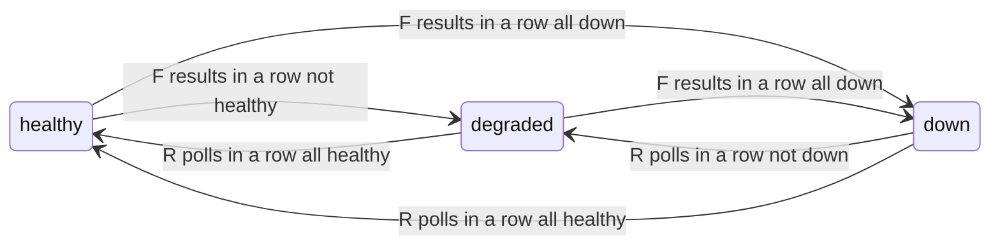
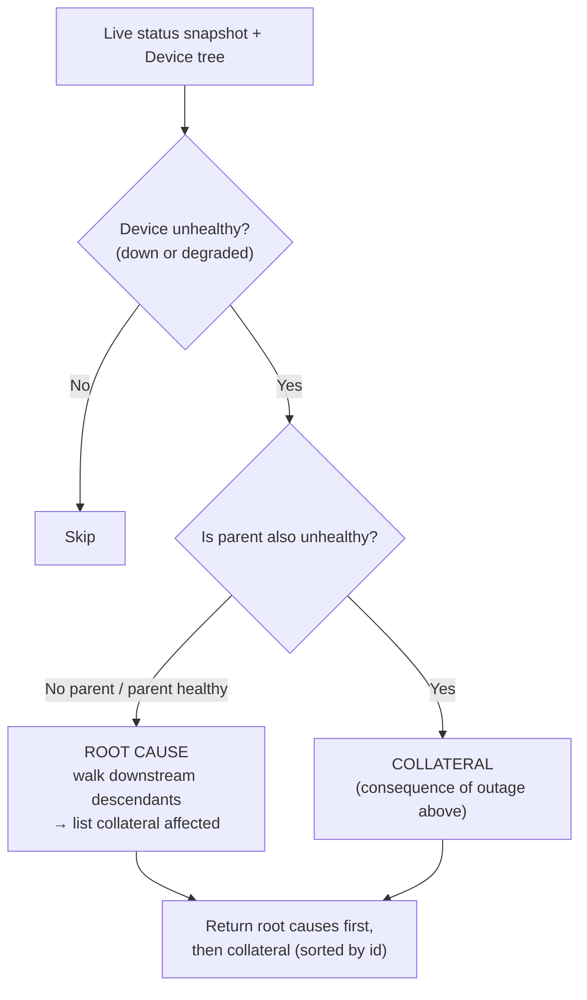
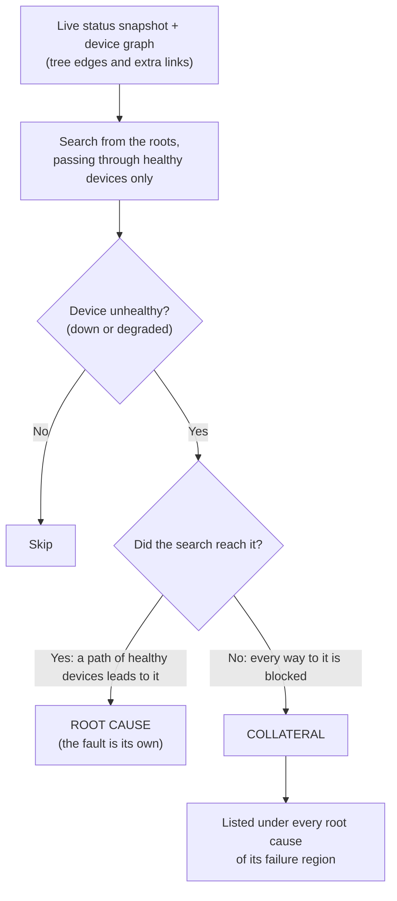

# Algorithms

Every algorithm in the project: what it is for, how it works, what it costs,
and why its answer is right. Almost all are in `backend/app/services/`,
written as pure functions (plain data in, plain data out), which is what lets
the tests check them on thousands of generated cases without a database or a
network. The graph algorithms are written by hand: no graph library is used.

N is the number of devices, V and E the vertices and edges of the topology
graph, p the pings per device per cycle.

| Algorithm | Where | Time | Memory |
| --- | --- | --- | --- |
| [Probe statistics and classification](#probe-statistics-and-classification) | `ping_engine.py` | O(p) per device | O(p) |
| [Status debouncing](#status-debouncing) | `debounce.py` | O(1) per result | O(1) per device |
| [Fixed-rate polling and retry on suspect](#fixed-rate-polling-and-retry-on-suspect) | `poll_loop.py`, `debounce.py` | O(suspects) per retry | O(N) |
| [Root cause on a tree](#root-cause-on-a-tree) | `incident_analysis.py` | O(N), O(N²) if root causes nest | O(N) |
| [Root cause with redundant links](#root-cause-with-redundant-links) | `incident_analysis.py` | O((V + E) · α(V)) | O(V + E) |
| [Low-links, articulation points, bridges](#the-graph-engine) | `topology_graph.py` | O(V + E) | O(V + E) |
| [Blast radius and single points of failure](#the-graph-engine) | `topology_graph.py` | O(V + E) | O(V + E) |
| [Union-find: several failures at once](#the-graph-engine) | `topology_graph.py` | O((V + E) · α(V)) | O(V + E) |
| [What-if simulation](#redundant-links-and-the-what-if) | `topology_analysis.py` | O((V + E) · α(V)) | O(V + E) |
| [Incident tracking](#incident-tracking-as-a-difference) | `incident_tracker.py` | O(N) per root cause | O(N) |
| [Availability, MTTR, detection delay](#availability-mttr-and-detection-delay) | `incident_stats.py` | O(T) for T stored status changes | O(T) |
| [Rollups](#rollups-that-merge-exactly) | `rollup.py`, `retention.py` | O(samples) | O(buckets) |
| [EWMA anomaly detector](#anomaly-detection) | `anomaly/detectors.py` | O(1) per reading | O(1) |
| [Rolling z-score detector](#anomaly-detection) | `anomaly/detectors.py` | O(1) per reading | O(W) |
| [Login throttle](#login-throttling-a-sliding-window) | `rate_limit.py` | O(1) amortised | O(limit) per key |
| [Stream tickets](#stream-tickets) | `stream_tickets.py` | O(1) amortised | O(tickets of the last 30 s) |
| [Parent-loop check](#keeping-the-parents-a-tree) | `routers/devices.py`, `db/seed.py` | O(depth) | O(depth) |

## Probe statistics and classification

**Purpose.** Turn one cycle's pings into a latency, a packet loss, a jitter and a raw status.

Every cycle each device gets `pings_per_cycle` echo requests (4 by default),
`ping_gap_ms` apart (200 ms). They are staggered (`staggered_ping`): each
request is sent on time, whether or not the one before it has been answered,
and waits up to the ping timeout for its own reply. All devices are probed at
the same time. Three figures come out of a device's replies:

| Figure       | What it is                                                         | Example: replies of 10, 12 and 30 ms, one probe lost |
| ------------ | ------------------------------------------------------------------ | ---------------------------------------------------- |
| `latency_ms` | average round-trip time (with its minimum and maximum)             | (10 + 12 + 30) / 3 = 17.3 ms                         |
| `loss_pct`   | share of the probes without a reply                                | 1 of 4 = 25%                                         |
| `jitter_ms`  | mean absolute difference of consecutive round-trip times           | (\|12 − 10\| + \|30 − 12\|) / 2 = 10 ms                |

Jitter needs two replies to compare, so it is empty when fewer came back. Both
formulas are small pure functions in `backend/app/services/ping_engine.py`.

The four probe settings live in `AppSettings` and are edited in Admin,
Settings:

| Setting           | Default | Allowed            | Meaning                                         |
| ----------------- | ------- | ------------------ | ----------------------------------------------- |
| `pings_per_cycle` | `4`     | 1 – 10             | Echo requests per device per cycle              |
| `ping_gap_ms`     | `200`   | 10 – 5000          | Time from one of them to the next               |
| `loss_warn_pct`   | `20`    | above 0, up to 100 | Degraded from this much packet loss             |
| `jitter_warn_ms`  | `30`    | above 0            | Degraded from this much jitter                  |

A combination is rejected, with the arithmetic in the message, unless
`pings_per_cycle × ping_gap_ms + the ping timeout` fits in 80% of the poll
interval. With the defaults that is 4 × 0.2 s + 2 s = 2.8 s of the 6.4 s
that an 8 s interval allows.

> **How long a cycle takes.** The last ping is sent `(pings − 1) × gap` after
> the first: 0.6 s with the defaults, and that is what a cycle takes when
> every device answers. A device that does not answer adds one ping timeout
> (`PING_TIMEOUT_SECONDS`, 2 s), for that last ping: 2.6 s. The earlier pings
> wait for their replies while the later ones are sent. Sent one after the
> other, each waiting for its reply, the same four pings took
> `pings × timeout + (pings − 1) × gap`, 8.6 s: that is what staggering
> saves. The sum checked above allows one gap more than a cycle can take, so
> it is a safe upper bound.

### Classification

Each cycle's probes are classified against the live thresholds:

| Result     | Condition                                                                                                                                  |
| ---------- | ------------------------------------------------------------------------------------------------------------------------------------------ |
| `down`     | no probe was answered (100% packet loss)                                                                                                   |
| `degraded` | answered, and packet loss ≥ `loss_warn_pct`, **or** jitter ≥ `jitter_warn_ms`, **or** average latency > the warn (or crit) latency threshold |
| `healthy`  | answered, and none of the above                                                                                                            |
| `unknown`  | the probe itself failed with an exception (no result)                                                                                      |

With `pings_per_cycle = 1` packet loss and jitter are not looked at: a device
is judged on reachability and latency alone, whatever the loss and jitter
thresholds say. The result is the raw status, which then goes through the
debouncer below.

**Cost.** One pass over a device's replies: O(p) for the loss, the average
and the jitter. A cycle is O(N · p) work, but the devices are probed at the
same time, so it takes as long as the slowest device, not the sum. Staggering
costs one short-lived socket per ping instead of one per device.

**Why it is right.**

- Loss is counted against the probes that were actually sent, so it is always
  between 0 and 100, and it is exactly 100 when nothing answered. That is the
  one case classified as `down`.
- Jitter compares neighbouring replies, so it is only defined with two or
  more. With fewer it is left empty instead of being reported as 0, which
  would read as "perfectly steady".
- Overlapping pings cannot be mixed up. Each request is sent with its own
  ICMP identifier, and a reply is accepted only by the request it answers.
  The round-trip times are listed in the order the requests were sent, not
  the order the replies came in, which is the order jitter is defined on.
- The classification is layered. The latency rule runs first, and loss and
  jitter can only turn `healthy` into `degraded`. With one ping per cycle the
  loss and jitter branch is skipped, so the result depends on reachability
  and latency alone. A test compares it with a single-ping classifier that is
  written out separately.

## Status debouncing

**Purpose.** Keep one bad poll from changing a status, raising an incident or counting as a flap.

The result above is a device's **raw** status for one poll. One cycle of lost
packets reads as a raw `degraded` or `down`, so the dashboards, the flap counter and the
incident analysis do not use it directly. They use the **confirmed** status,
which changes only when several results in a row agree. A result is a poll,
or a retry of a suspect device (see
[Fixed-rate polling and retry on suspect](#fixed-rate-polling-and-retry-on-suspect)).
The logic is a pure state machine in `backend/app/services/debounce.py`.

Statuses are ranked `healthy < degraded < down < unknown`, and three rules
decide each device's confirmed status:

1. A device's first result is accepted as it is.
2. **Getting worse:** when the last `failure_threshold` raw results are all
   worse than the confirmed status, it becomes the mildest of them.
3. **Getting better:** when the last `recovery_threshold` raw results are all
   better than the confirmed status, it becomes the worst of them.

With the defaults, a device is marked `down` only after 3 results in a row
without a single reply, and `healthy` again only after 2 healthy polls in a row. Moves between `healthy` and
`degraded` follow the same two rules. A probe error (`unknown`) ranks worst, so
it does not interrupt a run of `down` results.



`F` is `failure_threshold` and `R` is `recovery_threshold`:

| Setting              | Default | Range | Meaning                                              |
| -------------------- | ------- | ----- | ---------------------------------------------------- |
| `failure_threshold`  | 3       | 1–10  | results in a row before a worse status is confirmed  |
| `recovery_threshold` | 2       | 1–10  | polls in a row before a better status is confirmed   |

Both are edited in Admin → Settings (or `PATCH /api/settings`) and are re-read
every poll cycle. Setting both to 1 switches debouncing off.

Things to know:

- Latency history, and the reachability figure in the Metrics view, are built
  from the raw readings. Intermittent loss that never reaches the threshold
  shows up there rather than as a status change or a flap.
- Debounce state is held in memory and rebuilt at startup from the stored
  samples, so a restart does not turn the next poll into a "first result". The
  exception is a long gap: if a device's last stored poll is more than 10 poll
  intervals old, its next result is accepted at once.
- A deleted device's state is dropped on the next cycle.
- A retry is not stored, so after a restart the streak of a device counts the
  polls only. A status that a retry confirmed is not lost: its change is
  stored, and the warm-up takes the confirmed status from the last stored
  change when that is newer than the last sample.

**Cost.** Each device keeps its confirmed status and its last 10 raw results
(the largest threshold allowed). A new result is compared with at most 10
stored ones: O(1) time per result and O(1) memory per device, whatever the
history.

**Why it is right.**

- *No single bad poll can change a status.* The confirmed status changes only
  when the last F results are all worse than it, or the last R all better.
  With F at 2 or more, one bad poll is never enough.
- *It never overstates.* The new status is the mildest of the bad run (or the
  worst of the good run), so every result in the run supports it. A run of
  down, degraded, down confirms `degraded`, which all three agree on.
- *The rule cannot contradict itself.* "All worse" and "all better" cannot
  both hold for the same results, so at most one rule fires.
- *Thresholds of 1 switch it off.* Then every result is a run of length 1 and
  is confirmed at once: the raw status.

## Fixed-rate polling and retry on suspect

**Purpose.** Confirm a real outage in seconds, not in multiples of the poll
interval, without letting one bad poll through.

Three results in a row have to agree before a device is marked down. How long
that takes depends on when those results come, and two rules of the poll loop
(`backend/app/services/poll_loop.py`) decide it.

**Fixed rate.** A cycle starts one poll interval after the cycle before it
*started*. The loop notes the time, runs the cycle, and sleeps what is left of
the interval; if the cycle took longer, the next one starts at once. So the
interval (8 s by default) is the period of the polling. Before, the loop
slept a whole interval after every cycle, so the period was the interval plus
the time the pings took, and it grew just when a device stopped answering.

**Retry on suspect.** A device is *suspect* when its raw result is worse than
its confirmed status: a failure that is not confirmed yet. Nagios calls this
a "soft" state, and re-checks at a `retry_interval` that is shorter than the
normal check interval. Here:

1. After a cycle, if any device is suspect and the next cycle is not due
   within the retry interval (1 s, `RETRY_INTERVAL_SECONDS`), the loop waits
   that second and pings the suspect devices again, all of them in one pass.
2. A retry goes through the debouncer like any other result. It can confirm
   the failure: then the status, the stored transition and the incident
   follow at once. Or it gets an answer, and the suspicion is over.
3. This repeats until no device is suspect or the next cycle is due. A cycle
   that is due while a retry is still running starts as soon as it ends.
4. A retry is left out of everything that expects one reading per cycle. No
   sample is stored, the history charts and the reachability figure do not
   get it, and the anomaly detectors never see it.

A recovery is not retried. A device whose result is *better* than its status
is confirmed by the next polls, as before.

With the defaults a device that falls silent is confirmed down like this
(times in seconds from the cycle that first finds it silent):

| At | What happens | Failures in a row |
| --- | --- | --- |
| 0 | A cycle starts. The device does not answer: the pass takes 2.6 s. | |
| 2.6 | Raw `down`, confirmed `healthy`: suspect. | 1 |
| 3.6 | The first retry starts, 1 s later. Only this device is pinged. | |
| 6.2 | Still silent. | 2 |
| 7.2 | The second retry starts: the next cycle is not due before 8. | |
| 9.8 | Still silent: confirmed `down`, incident opened. The cycle that was due at 8 starts now. | 3 |

The outage began before that first cycle, and after the last ping of the
cycle before it, which is at most 7.4 s earlier. So it is confirmed 9.8 to
17.2 s after it begins. (An outage that begins while a cycle's pings are
going out is the case of the next paragraph.) Measured on the simulated
network, with a device killed at random moments: 10 to 17 s, 13 on average,
in eight trials. Before these two rules and the staggered pings it took 46 to
56 s.

**An outage that begins inside a probe, and why the gap is short.** A probe
that is under way when the device fails gets some replies and loses the
rest, so it reads `degraded`. The run is then degraded, down, down: the
debouncer confirms the mildest of the three, `degraded`, and one retry later
the last three are all down. That is two status changes for one outage, and
the flap ranking counts both; a recovery that begins inside a probe does the
same in reverse and takes one poll longer. How often it happens depends on
how long a probe lasts, which is `(pings − 1) × gap`. With the default gap of
200 ms a probe lasts 0.6 s of every 8: it happened in 1 of 8 measured
outages. With pings a second apart a probe lasts 3 s, and it happened in 4 of
11. A longer gap spreads the pings over more time, and pays for it this way.

**Cost.** A retry reads the device table, pings the suspect devices only and
steps their debounce state: O(N) for the read, O(suspects) for the rest. The
loop keeps the last reading of each device while it retries: O(N). A
suspicion ends as soon as a result is not worse than the confirmed status, or
the status has caught up with the results: after `failure_threshold − 1`
retries for a device that simply stops answering, and a few more when its
results got worse in steps. And no retry starts once the next cycle is due,
so retries cannot crowd the cycles out.

**Why it is right.**

- *A retry cannot make the rule weaker.* The debouncer still needs
  `failure_threshold` results in a row that are all worse than the confirmed
  status. A retry is a full probe with the same pings and the same
  classification as a poll, so each of the three is as good a witness as a
  poll would be. Only the waiting between them is shorter.
- *One answered retry clears the device.* A result that is not worse breaks
  the run, exactly as a good poll does.
- *The history stays one reading per cycle.* The history charts, the
  reachability figure, the rollups and the anomaly detectors all assume
  evenly spaced readings. A device in trouble would otherwise contribute
  three readings where a healthy one contributes one, and its averages and
  its baseline would lean towards its bad moments.
- *An outage is still one incident.* All suspect devices are retried in the
  same pass, so a switch and the devices behind it are confirmed together,
  and the analysis sees the root cause and its collateral at the same time.
  After a retry the incidents are judged on the latest reading of every
  device, not on the retried ones alone.
- *A retry acts on the devices as they are now.* The device table is read
  again before every retry: a device that was deleted since the cycle is left
  alone, and one whose address was corrected is pinged on the new address.
- *The rate cannot drift.* Each cycle is scheduled from the start of the one
  before it, so the time a cycle takes never adds up from cycle to cycle.

## Root cause on a tree

**Purpose.** Split the unhealthy devices into the ones that failed (root causes) and the ones that are only unreachable because of them (collateral).

`incident_analysis.analyze_incidents()` is a pure function — status snapshot +
device tree in, classified incidents out. It is re-evaluated from scratch on
every `/api/incidents` request, so recovery reclassifies immediately. It works
on the confirmed statuses, so one unconfirmed bad poll does not create an
incident.



Each root cause carries the list of `downstream_affected` devices it took down,
and the frontend renders these as incident cards with a guided-fix playbook
stepper linked from the static `backend/app/data/playbooks.py`.

The parents have to form a tree. The API refuses a change that would close a
loop, and the seed loader skips a device that would. The walk below a root
cause also visits each device only once, so even a loop that is already in
the data cannot keep it going for ever.

**Cost.** Building the parent-to-children map is O(N), and so is classifying
every device against its parent. Listing what is below a root cause walks its
subtree. When root causes do not sit below each other the subtrees do not
overlap, and the whole analysis is O(N). In the worst case (root causes
nested under healthy devices under root causes) it is O(N²). Memory is O(N).

**Why it is right.** Every unhealthy device has exactly one parent, and that
parent is either unhealthy or it is not. So every unhealthy device is
classified exactly once, as collateral or as a root cause, and no device is
left out. The walk below a root cause keeps the set of devices it has seen,
so it ends even on a loop of parents. A test runs it on 500 random parent
maps, loops included, and checks both properties.

## Root cause with redundant links

The rule above looks only at a device's parent. That is right for a tree,
where the parent is the only way up. Once the topology has extra links (see
[Redundant links](#redundant-links-and-the-what-if)), a device can have a second way up, so
the analysis switches to **reachability**. With no links stored it uses the
tree rule.



- A device is **reachable** when a path leads to it from a root (a device with
  no parent) on which every device in between is healthy. `unknown` counts as
  healthy here: a missing measurement is not a failure.
- An unhealthy device that is reachable is a **root cause**. One that is not
  is **collateral**.
- A **failure region** is a group of unhealthy devices joined to each other.
  A collateral device is listed in the `downstream_affected` of every root
  cause in its region. That list holds collateral devices only.

Example: a PLC with two uplinks, `s1` (its parent) and `s2` (an extra link).

| What is down        | Tree only                 | With the link                              |
| ------------------- | ------------------------- | ------------------------------------------ |
| `s1` and the PLC    | PLC is collateral of `s1` | PLC is a root cause: `s2` still reaches it |
| `s1`, `s2`, the PLC | PLC is collateral of `s1` | PLC is collateral of both `s1` and `s2`    |

**Cost.** One breadth-first search from the roots: O(V + E). Grouping the
unhealthy devices into failure regions uses union-find over the edges
between them: O((V + E) · α(V)). Memory is O(V + E) for the adjacency lists.

**Why it is right.** The search only moves on from a device that is healthy.
So it reaches a device exactly when some path from a root leads to it on
which every device in between is healthy. An unhealthy device that is
reached is the first failure on such a path: nothing in front of it is
broken, so the fault is its own. One that is not reached has a failure on
every path to it, so nothing can be said about the device itself: it is
collateral. With no links stored the tree rule is used unchanged, and a test
checks that on every snapshot a real tree can produce the two rules agree.

## The graph engine

**Purpose.** Find the devices the network cannot afford to lose, and what each failure would cut off.
The application uses the blast radius (the SPOF badges and `GET /api/analysis/spof`) and `cut_off`
(the what-if simulator and fault injection). Articulation points, bridges and the component count
are implemented and tested, but no page shows them.

The topology is treated as a graph, and every graph algorithm is written by
hand in `backend/app/services/topology_graph.py`: no graph library, no
database access, and no recursion. Each traversal keeps its own stack or
queue, so a very deep network cannot hit Python's recursion limit.

- A **vertex** is a device.
- An **edge** is undirected: the connection between a device and its parent,
  or an extra link (see [Redundant links](#redundant-links-and-the-what-if)).
- A **root** is a device with no parent. The monitor reaches the network
  through the roots, so "can reach a root" means "is reachable".
- Where an algorithm needs one starting point, it adds a virtual
  **super-root** joined to every root.

In the table V is the number of devices and E the number of edges.

| Algorithm                            | Function                                    | Purpose                                                                         | Time              |
| ------------------------------------ | ------------------------------------------- | ------------------------------------------------------------------------------- | ----------------- |
| Adjacency builder                    | `build_graph`                               | Turns devices and links into adjacency lists and the list of roots              | O(V + E)          |
| Breadth-first search                 | `reachable_from_roots`                      | Devices reachable from a root through healthy devices: root cause or collateral | O(V + E)          |
| Tarjan's low-link search (iterative) | `low_link_search`                           | One depth-first search giving every device a discovery number and a low-link    | O(V + E)          |
| Articulation points and bridges      | `articulation_points_and_bridges`           | Devices and connections whose loss splits the network                           | O(V + E)          |
| Blast radius                         | `blast_radius`, `single_points_of_failure`  | For every device, how many others lose every root if it fails                   | O(V + E)          |
| Union-find (DSU)                     | `DisjointSet`, `cut_off`, `component_count` | What is cut off when several devices fail together; failure regions             | O((V + E) · α(V)) |
| Brute force                          | `blast_radius_bruteforce`                   | Removes each device in turn and searches again; the reference for the tests     | O(V · (V + E))    |

α is the inverse Ackermann function. It is at most 4 for any realistic V, so
union-find is linear in practice.

**Low-link values.** The depth-first search numbers the devices in the order
it discovers them. The low-link of a device is the smallest number that can
be reached from it by going down the search tree and then along at most one
other edge. For a tree edge from `p` down to `c`:

- `low[c] >= discovery[p]`: nothing below the edge reaches higher than `p`,
  so removing `p` cuts that part off. `p` is an articulation point.
- `low[c] > discovery[p]`: nothing below reaches even `p` except through this
  edge, so the edge is a bridge.

**Blast radius.** The blast radius of a device is the number of other devices
that can no longer reach any root when it is removed. With the super-root on
top, one search covers every device: the blast radius of `p` is the sum of
the subtree sizes of its children `c` with `low[c] >= discovery[p]`. A device
with a blast radius above 0 is a **single point of failure** (SPOF).

A SPOF is not the same as an articulation point. A root with one chain below
it is a SPOF (everything depends on it) but not an articulation point. A
device that only joins two roots is an articulation point (the graph splits)
but not a SPOF (both halves keep a root).

**Several failures at once.** Low-link values describe the loss of one device
only. `cut_off(graph, failed)` answers the question for any set of failed
devices by rebuilding connectivity with union-find.

**How they are tested.** Hand-built graphs (path, star, cycle, two cycles
sharing a node, disconnected graph, several roots, dual-homed device), and
seeded random graphs: 600 trees and 1,500 graphs per property, on which the
fast algorithms must give the same answers as the brute force. A chain of
20,000 devices shows that nothing recurses.

**Cost.** The search pushes and pops every device once and reads every
adjacency list once: O(V + E) time and memory, for low-links,
articulation points, bridges and all blast radii together. The brute force
needs a search per device: O(V · (V + E)).

**Why it is right.**

- *Articulation points.* Take a tree edge from `p` down to `c`. If
  `low[c] >= discovery[p]`, no edge from the part of the tree below `c`
  reaches a device discovered before `p`. Every path from that part to the
  rest of the graph therefore passes through `p`, and removing `p` cuts it
  off. If `low[c] < discovery[p]`, such an edge exists and the part stays
  connected without `p`.
- *Blast radius.* With the super-root on top, "cut off from every root" means
  "cut off from the super-root". The parts cut off by removing `p` are
  exactly the child subtrees with `low[c] >= discovery[p]`. They do not
  overlap, so their sizes can be added up. The sizes come from one pass over
  the devices in reverse discovery order.
- *Union-find.* Two devices are connected after a failure exactly when a
  chain of surviving edges joins them. Joining the two ends of every
  surviving edge builds those groups, and a device is cut off when it is not
  in the group of the super-root. Union by size with path compression keeps
  each operation at O(α(V)).
- *No recursion.* An explicit stack of (device, position in its neighbour
  list) replaces the call stack, so the depth of the network does not matter.
- *Checked against the definition.* On 600 random trees and 1,500 random
  graphs the fast answers must equal the brute force.

## Redundant links and the what-if

The parent tree gives every device one uplink. The `device_link` table adds
extra, undirected connections: a second uplink, a ring, a cross-link. A link
is stored once, with its two device ids in alphabetical order, and must obey
four rules:

1. a device is not linked to itself;
2. both devices exist;
3. the two are not already parent and child;
4. the pair is not already linked, in either order.

Rules 1 and 4 are database constraints. `backend/app/services/device_links.py`
checks all four when a link is added. Deleting a device deletes its links,
and moving a device under a device it was linked to removes that link,
because the connection is now the tree edge.

Links are managed in the Admin panel (Links tab) or through `/api/links`.
They can also be seeded: a device in `infra/devices.seed.json` may carry
`"links"`, the ids of the devices it is linked to besides its parent.
Seeding runs at every start and is idempotent: a seeded device or link that
is missing is added, and nothing is duplicated or overwritten. An entry that
breaks a rule (a link that is not allowed, a device that would be its own
ancestor) is skipped with a warning in the log.

Two endpoints expose the engine:

- `GET /api/analysis/spof` lists the single points of failure, each with its
  blast radius and the devices it would cut off.
- `POST /api/analysis/what-if` answers "what if these devices failed?". The
  failed devices, and everything they cut off, are treated as down in an
  otherwise healthy network, and that snapshot goes through the normal
  incident analysis. The total blast radius is the number of devices cut
  off.

**What-if, cost and argument.** The simulator builds an imagined snapshot:
the chosen devices are down, and so is everything `cut_off` says they
disconnect (union-find, O((V + E) · α(V))). Then it runs the ordinary
incident analysis on that snapshot. Because the prediction uses the same
function as the live view, the two cannot disagree about the rules. Nothing
is stored and no status is touched: it is a pure function.

Fault injection uses the same calculation to decide which containers to stop
(`plan_failure`, see [chaos.md](chaos.md)), and a test checks that the two
agree on 300 random sets of failed devices.

## Incident tracking as a difference

**Purpose.** The analysis says what is wrong now. The tracker turns that into
stored incidents with a beginning and an end, without keeping the incidents
in memory (see [Incident lifecycle](architecture.md#incident-lifecycle)).

**How.** After every poll cycle `diff_incidents` compares two things: the
root causes the analysis reports, and the unresolved incidents in the
database.

- A root cause without an incident is opened.
- An incident whose root device is healthy again (or deleted) is resolved.
- An incident whose set of affected devices changed is updated.

A device that has its own incident is left out of the affected set of the
incident above it, and so is everything its incident covers.

**Cost.** Set operations over the devices below each root cause: O(N) per
root cause.

**Why it is right.** The function is pure, and after its changes are applied
the stored incidents match the analysis. Running it again on the same input
therefore finds nothing to do: it is idempotent, which is why a restart needs
no recovery step. A partial unique index on the incident table allows one
unresolved incident per root device, so even two writers could not store a
duplicate.

## Availability, MTTR and detection delay

**Purpose.** The figures on the Incidents and Stability pages.

**How.**

- *Availability.* A device's status is constant between two stored status
  changes. For the window asked for (24 hours, 7 days or 30 days) the status
  at the start is the last change before it, and each later change ends one
  interval. Downtime is the total length of the intervals in which the status
  was `down`, cut to the window. Uptime is 1 minus downtime over the time the
  device was actually monitored.
- *Detection delay* is `opened_at - first_failure_at`, averaged: from the
  first failing probe to the incident.
- *MTTR* is `resolved_at - opened_at`, averaged over resolved incidents.
- *Alerts suppressed* is the sum of each incident's largest number of
  affected devices: the alerts a monitor without topology would have raised
  on top of the one that matters.

**Cost.** One pass over the stored status changes: the ones inside the window
are replayed, and the earlier ones are read once to find each device's
status at the start. O(T) time and memory for T stored changes.

**Why it is right.** Because the status only changes at a stored transition,
adding up interval lengths is exact: there is no sampling error. Only `down`
counts as downtime, so a degraded device, which still answers, is not
reported as an outage.

## Rollups that merge exactly

**Purpose.** Keep 30 days of history without keeping every poll. Raw samples
older than a day are replaced by one row per device per minute.

**How.** A bucket stores, for latency, the minimum, the average, the maximum
and the number of polls the average is over; for loss and for jitter, the
average, the maximum and that number.
Two buckets for the same time slot are merged like this:

```text
count = count_a + count_b
min   = min(min_a, min_b)        max = max(max_a, max_b)
avg   = (avg_a * count_a + avg_b * count_b) / count
```

**Cost.** O(1) per merge and O(samples) per retention run, in batches of
20,000 rows so that the poll loop's own write is never kept waiting long.

**Why it is right.** The merge gives the same result as computing the bucket
from all its polls at once, in whatever order and however the polls were
split. That is the property everything rests on:

- The hourly job can stop halfway and run again: a batch is added to the
  rollups and deleted from the raw table in one transaction, so a poll is
  always counted exactly once.
- The coarser buckets of the long charts (5 minutes, 30 minutes, 2 hours) are
  built by merging 1-minute rows on read, and are still exact.

Averaging the averages without the counts would be wrong whenever two buckets
hold a different number of polls. That is why the counts are stored.

## Anomaly detection

A fixed threshold ("degraded above 100 ms") does not know what is normal for a
device. 40 ms is fine for a link to another site and alarming for a PLC that
has always answered in 2 ms. An anomaly detector learns each device's own
baseline, reading by reading, and marks the readings that stand out from it.
There is one detector per device and per metric (latency, packet loss), in
`backend/app/services/anomaly/`.

**Advisory.** An anomaly adds a badge and chart markers. It never changes a
device's status, raw or confirmed, and never opens an incident: the detectors
only add an `anomaly` field to a reading and leave everything else alone.

Both detectors judge a reading the same way and are interchangeable (one
`Detector` interface, chosen in the settings):

```text
score     = (reading − mean) / max(std, floor)     a one-sided z-score
above     = score > k
anomalous = this reading and the m − 1 before it were all above
```

Only readings above the baseline count: a device that got faster is not a
problem. The floor (1 ms of latency, 5 points of loss) keeps a perfectly
steady device from making the smallest wobble look enormous. No reading is
judged before a detector has seen 30 (the warm-up).

| Detector | Its baseline (mean, std) | Update per reading | Time | Memory |
| --- | --- | --- | --- | --- |
| EWMA (`EwmaDetector`) | exponentially weighted: a reading's weight shrinks by (1 − alpha) with every newer one | `mean += alpha·(x − mean)`, `var = (1 − alpha)·(var + alpha·(x − mean)²)` | O(1) | O(1): two numbers |
| Rolling z-score (`RollingZScoreDetector`) | the last W readings | add x to a running sum and sum of squares, subtract the reading that leaves the window | O(1) | O(W): the window, in a deque |

- **EWMA freezes.** A reading above the threshold is not learned, so a spike
  cannot pull the baseline up and hide itself, and an anomaly lasts for as long
  as the readings stay above the baseline of before it began.
- **EWMA re-learns after 360 readings.** On its own, freezing would report a change
  that is there to stay for ever. So after 360 readings in a row above the
  threshold (48 minutes at the default poll interval) the detector accepts the
  new level: it forgets its baseline and warms up again on the readings that
  follow, and the anomaly ends. One reading within the threshold starts that
  count again.
- **The rolling window learns from everything.** A level that stays becomes
  normal after W readings on its own, but a spike widens the window's spread
  and can hide the next one.
- **Running sums are exact enough.** `variance = sum_of_squares / n − mean²`
  costs O(1) instead of the O(W) of adding the window up again. The tests
  compare it with a recomputation on random data after every reading.

| Setting            | Default | Allowed            | Meaning                                              |
| ------------------ | ------- | ------------------ | ---------------------------------------------------- |
| `anomaly_enabled`  | `true`  | true / false       | Switch detection on or off                           |
| `anomaly_detector` | `ewma`  | `ewma`, `rolling`  | Which detector                                       |
| `anomaly_k`        | `3`     | 1 – 10             | Standard deviations above the baseline that count    |
| `anomaly_m`        | `3`     | 1 – 20             | Readings in a row that have to be above              |
| `anomaly_alpha`    | `0.1`   | 0.01 – 0.5         | EWMA only: how fast the baseline forgets             |
| `anomaly_window`   | `60`    | 30 – 1000          | Rolling only: how many readings it looks back on     |

They are edited in Admin, Settings and re-read every poll cycle. Changing one
starts every detector afresh, and ends the anomalies in progress. Detectors
live in memory, so they also start afresh when the backend restarts (30
readings of warm-up, four minutes), and a device that has been deleted
loses its detectors in the next cycle. A poll without a reply is not judged:
a device that answers nothing is "down", which is the status's business. A
retry of a suspect device is not a reading: the detectors see one reading per
device per cycle.

**Does it work?** `backend/scripts/eval_anomaly.py` measures both detectors
and a fixed threshold on synthetic traces with known anomalies. In short, from
[anomaly-evaluation.md](anomaly-evaluation.md):

- the EWMA detector (the default) caught 99% of the spikes and every step, two
  readings after they began, with one false alarm in 114,000 readings, with or
  without a daily rhythm in the baseline;
- a fixed threshold on the same traces dropped to a precision of 0.12 once the
  baseline had a daily rhythm;
- neither detector caught a slow drift. The fixed thresholds of the status
  classification stay in force for that.

**Why it is right.**

- *The statistics.* The EWMA recurrences are the standard exponentially
  weighted mean and variance. The rolling detector's `sum` and
  `sum of squares` describe exactly the readings in its window, because every
  reading is added once when it enters and subtracted once when it leaves.
  The tests compare both with a recomputation from scratch after every
  reading.
- *A spike cannot hide itself.* The EWMA detector does not learn from a
  reading that is above the threshold, so the baseline it is compared with is
  the one from before the anomaly.
- *One glitch is not an anomaly.* m readings in a row have to be above, so a
  single late reply does not raise a badge.
- *It cannot affect monitoring.* The detectors only add a field to a reading.
  A test checks that a device with an anomaly keeps its status and gets no
  incident.

## Login throttling: a sliding window

**Purpose.** Stop password guessing: 5 wrong passwords in 5 minutes for one
username from one address, or 20 from one address, and the login answers 429.

**How.** Each key has a deque with the times of its recent wrong passwords,
oldest on the left. A new one is appended on the right, and those older than
the window are popped from the left. The key is blocked while the deque holds
`limit` entries.

**Cost.** Every wrong password is appended once and popped once: O(1)
amortised per request. A blocked key gets no more entries, so a key never
holds more than `limit`: O(limit) memory per key.

**Why it is right.**

- *The window is exact.* The deque holds precisely the failures of the last
  5 minutes, so there is no boundary at which a burst gets a double
  allowance, as a fixed window has.
- *Parallel guesses cannot slip through.* "Is the caller blocked?" and
  "count this attempt" are one step under a lock, taken before the password
  is checked. A right password takes its count back. Counting only after a
  wrong password would let every guess through that was sent during the
  quarter second a check takes.

## Stream tickets

**Purpose.** The browser's `EventSource` cannot send an `Authorization`
header, and a login token does not belong in a URL, where logs and the
browser history keep it. So the status stream is opened with a ticket that is
good for one connection and 30 seconds.

**How.** A ticket is 32 random bytes. The store is a dictionary from ticket
to the user it was issued to, plus a deque of (expiry time, ticket) in the
order they were issued. Issuing and redeeming both begin by dropping the
expired tickets from the left of the deque. Redeeming then removes the
ticket from the dictionary.

**Cost.** Issue and redeem are O(1). Expired tickets are removed from the
left of the deque, which is in expiry order because every ticket lives
equally long: O(1) amortised per ticket.

**Why it is right.** A ticket is deleted the moment it is redeemed, so it
works once. One that is not redeemed stops working after 30 seconds, because
the expired ones are removed before every lookup. With 256 random bits it
cannot be guessed.

## Keeping the parents a tree

**Purpose.** The tree rule assumes that following `parent_id` upwards ends at
a device without a parent.

**How.** Before a device gets a new parent, the API walks up from that parent.
If the walk arrives at the device itself, the change would close a loop and
is refused. The seed loader does the same for every device it adds.

**Cost.** O(depth of the tree) per change.

**Why it is right.** A loop through the device exists exactly when the device
is one of its new parent's ancestors, which is what the walk looks for. The
walk remembers where it has been, so it ends even if the stored data already
holds a loop somewhere else.
