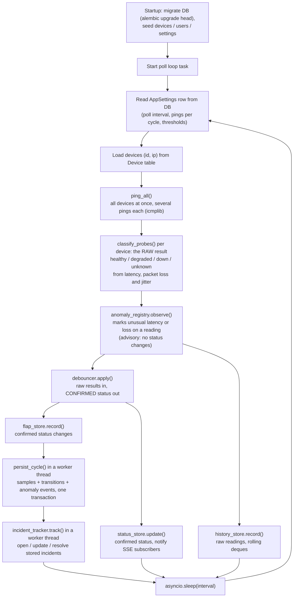
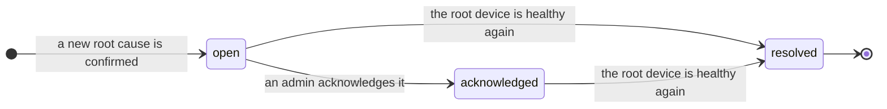
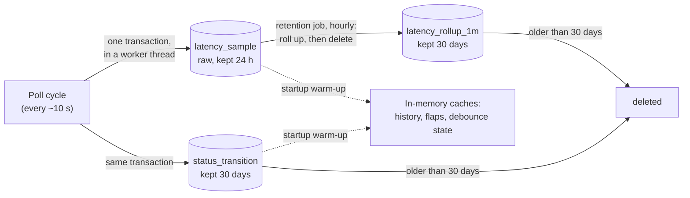
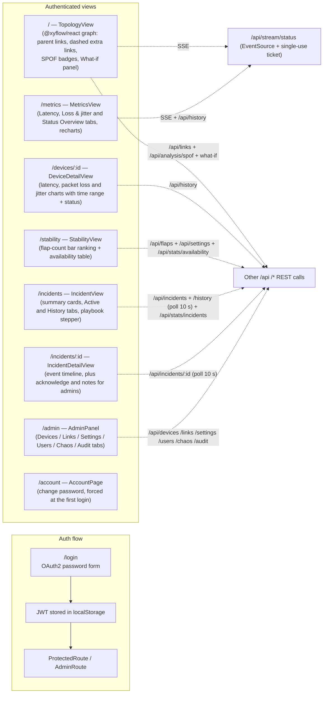
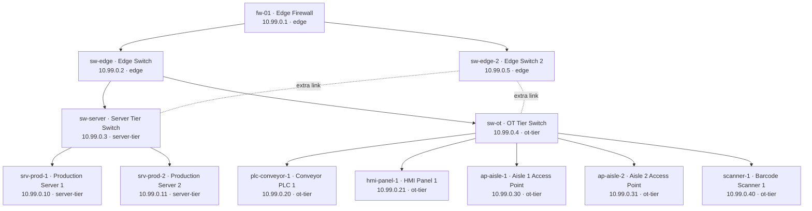
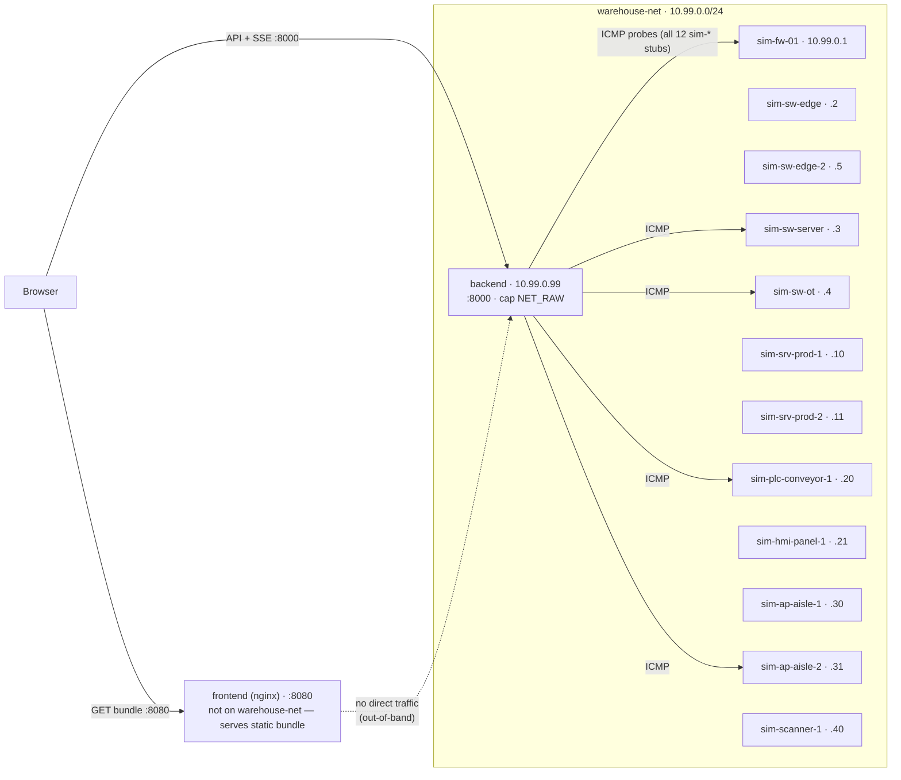

# Architecture

How the system is put together: its parts, how data flows through them, what
is stored, and how it is deployed. The picture of the whole is in the
[README](../README.md#architecture). The algorithms behind the analysis are in
[algorithms.md](algorithms.md), and the reasons for the main choices in
[design-decisions.md](design-decisions.md).

## The three parts

- **Backend** (`backend/`): one FastAPI process. It serves the REST API and
  the live status stream, and runs two background tasks: the poll loop and the
  hourly retention job. All monitoring logic is here, in `app/services/`, as
  pure functions where possible. What has to survive a restart is in SQLite.
  The rest is in memory: the latest snapshot, recent history, debounce state,
  anomaly detectors, the login throttle and the stream tickets.
- **Frontend** (`frontend/`): a React single-page app, built to static files
  and served by nginx. The browser calls the API directly; nginx proxies
  nothing.
- **Infrastructure** (`infra/`): a Docker Compose stack with twelve simulated
  devices, the backend and the frontend, plus an optional chaos agent for
  fault injection.

## Where the code is

```
.
├── .github/workflows/ci.yml CI: backend tests + coverage, frontend typecheck/lint/build
├── Makefile                 up, down, seed-reset, test, lint, build
├── backend/                 FastAPI application (Python 3.12)
│   ├── app/
│   │   ├── main.py          Lifespan (secret check, migrate, seed, warm-up, background tasks), status stream
│   │   ├── core/            config (pydantic-settings), security (JWT, bcrypt, secret check), deps (auth, audit)
│   │   ├── db/              session, Alembic migrations/, seed scripts
│   │   ├── models/          SQLModel tables (see the ER diagram in the README)
│   │   ├── routers/         auth, devices, links, settings, users, history, flaps, incidents, stats,
│   │   │                    analysis (SPOF, what-if), chaos, anomalies, audit, playbooks
│   │   ├── schemas/         Pydantic request and response models
│   │   ├── services/        ping_engine, debounce, poll_loop, status/history/flap stores,
│   │   │                    incident_analysis, incident_tracker, incident_stats,
│   │   │                    topology_graph, topology_analysis, device_links,
│   │   │                    persistence, rollup, retention,
│   │   │                    chaos, chaos_client, rate_limit, stream_tickets, audit,
│   │   │                    anomaly/ (detectors, registry)
│   │   └── data/playbooks.py  Static guided-fix playbook content
│   ├── scripts/eval_anomaly.py  Measures the anomaly detectors on synthetic traces
│   ├── tests/               pytest suite (temporary SQLite database, fake ping, no ICMP)
│   ├── alembic.ini          Alembic command-line config (the app migrates itself at startup)
│   └── Dockerfile
├── frontend/                React SPA (React 19 + TypeScript + Vite)
│   ├── src/
│   │   ├── components/      Views: Topology, DeviceDetail, Metrics, Stability, Incidents, Admin, Account, Login
│   │   ├── contexts/        AuthContext (login state)
│   │   ├── hooks/           useStatusStream (SSE), usePolled (shared polling) and one hook per resource
│   │   ├── lib/             api client (fetch + SSE), topology layout, chart helpers
│   │   └── types/           TypeScript mirrors of the API schemas
│   ├── nginx.conf           SPA fallback and the security headers
│   └── Dockerfile           Multi-stage: node build, then nginx
├── infra/
│   ├── docker-compose.yml   12 simulated devices + backend + frontend (+ chaos agent, profile "chaos")
│   ├── devices.seed.json    Seeded devices and extra links (the warehouse topology)
│   ├── sim/                 Image of a simulated device (Alpine + iproute2)
│   └── chaos-agent/         Fault injection executor: the only service on the Docker socket
└── docs/                    This folder
```

## Startup

At startup (`lifespan` in `backend/app/main.py`) the backend does this, in
order:

1. Checks its signing secret and refuses to start on a placeholder (see
   [security.md](security.md)).
2. Brings the SQLite schema up to date (see
   [Database migrations](#database-migrations)).
3. Seeds what is missing: devices and links from the seed file, the two
   default users, the settings row.
4. Refills its in-memory caches from the database: recent history, flap
   counts and debounce state.
5. If a chaos agent is configured, logs the faults a previous run left in
   place.
6. Starts the poll loop and the hourly retention job.

## The poll loop



Everything the poll loop needs is re-read from the DB-backed `AppSettings`
singleton at the **start of every cycle**, so an admin editing the poll
interval, the probe settings, the latency, loss and jitter thresholds or the
debounce thresholds in the UI takes effect within one cycle — no backend
restart required.

Setting `POLL_ENABLED=False` starts the API without the background tasks (the
test suite does this). Nothing is pinged, so every device stays `unknown`, and
the retention job does not run.

## The status snapshot

`GET /api/status` and the status stream both send the same thing: one entry
per device. The frontend opens the stream with a single-use ticket (see
[API notes](#api-notes)) and replaces its whole picture with every message.

Each device in the status snapshot (`/api/status` and the SSE stream) carries
the confirmed status plus the raw details. This one has just missed a poll:

```json
{
  "sw-ot": {
    "status": "healthy",
    "latency_ms": null,
    "timestamp": "2026-11-15T10:00:20.123456+00:00",
    "raw_status": "down",
    "consecutive_failures": 1,
    "consecutive_successes": 0,
    "latency_min_ms": null,
    "latency_max_ms": null,
    "loss_pct": 100.0,
    "jitter_ms": null,
    "anomaly": null
  }
}
```

- `status` is the confirmed status; `raw_status` is the latest poll's result.
- `latency_ms` and `timestamp` belong to the latest poll. `latency_ms` is the
  average of its probes; `latency_min_ms` and `latency_max_ms` are the fastest
  and the slowest reply, `loss_pct` the share of probes without one, and
  `jitter_ms` the jitter (see [Probe statistics and classification](algorithms.md#probe-statistics-and-classification)).
- `consecutive_failures` / `consecutive_successes` count the polls in a row
  that were not healthy / were healthy.
- `anomaly` is advisory: `null`, or what the anomaly detector finds unusual,
  per metric, for example
  `{"latency": {"value": 60.5, "expected": 10.5, "score": 50.0, "since": "..."}}`
  (see [Anomaly detection](algorithms.md#anomaly-detection)). It does not affect `status`.

## Incident lifecycle

The incident analysis (see [algorithms.md](algorithms.md#root-cause-on-a-tree))
is stateless: it answers "what is wrong right now?" and
remembers nothing. The **incident tracker**
(`backend/app/services/incident_tracker.py`) adds the memory. The poll loop
calls it after every cycle (never per HTTP request). It runs the same
analysis, compares the result with the unresolved incidents in the database,
and stores what changed. There is one incident per outage, keyed by its
root-cause device.



What the tracker does each cycle:

- **Open.** A root cause with no unresolved incident gets a new one.
  `opened_at` is the poll that confirmed it; `first_failure_at` is the first
  failing raw probe of the streak that led to it (from the debouncer).
- **Update.** When the set of downstream devices changes, the incident's
  snapshot and its peak are updated and an `affected_changed` event is logged.
  Collateral devices never get an incident of their own.
- **Resolve.** When the root device is confirmed healthy again (or deleted),
  the incident is resolved. A later failure of the same device is a **new**
  incident.

Four cases are handled on purpose:

- If a device below the root has an incident of its own (it failed first, or
  a device between the two still answers), it is not counted as affected, and
  neither is anything its incident already covers. So a device is never
  counted for an incident and again for the one above it. (One case remains,
  and only with extra links: collateral that several root causes cut off
  together is listed under each of them.)
- If an outage further up turns the root device into collateral, its incident
  is left as it is: the device is still down.
- If the root device becomes `unknown` (the probe itself fails), the incident
  stays open. Not being able to measure is not a recovery.
- If a device is still down when its parent recovers, it becomes a root cause
  and gets its own incident, with no detection delay because it was already
  known to be down.

**Restarts.** Incidents live in the database, and the tracker reads them from
there every cycle, so a restart needs no recovery step. The first cycle after a restart
continues the incidents whose root is still unhealthy, resolves the ones that
recovered while the backend was down (marked `after_restart` in the
timeline), and opens new ones. A partial unique
index allows only one unresolved incident per root device, so a duplicate
cannot be stored.

**Timeline.** Every incident has events: `opened`, `affected_changed`,
`acknowledged`, `note` and `resolved`. Acknowledging and adding notes are
admin actions; everything else is logged by the tracker.

**Statistics** (`GET /api/stats/incidents`, over all stored incidents):

| Field                          | Meaning                                                      |
| ------------------------------ | ------------------------------------------------------------ |
| `count`                        | incidents recorded (`open_count` and `resolved_count` too)   |
| `mean_detection_delay_seconds` | mean of `opened_at - first_failure_at`                       |
| `mttr_seconds`                 | mean of `resolved_at - opened_at`, resolved incidents only   |
| `alerts_suppressed`            | sum of each incident's peak number of collateral devices     |

With the default thresholds a failure is confirmed on the third failing poll,
so the detection delay is two poll cycles. A cycle takes longer than the poll
interval while a device does not answer, because each of its pings waits for
the timeout: about 37 s with the defaults.

**Availability** (`GET /api/stats/availability?window=24h|7d|30d`) is computed
from `status_transition`. For each device it rebuilds the status over the
window and reports `uptime_percent`, `downtime_seconds` and `outages`. Only
`down` counts as downtime; a degraded device still answers. A device is judged
on the time it was actually monitored (`observed_seconds`), so one added an
hour ago is not credited with a full day of uptime.

## API notes

The endpoint table is in the [README](../README.md#api). What it leaves out:

> **SSE auth note:** the browser `EventSource` API cannot set an
> `Authorization` header, and a login token does not belong in a URL. So the
> stream is opened with a ticket: `POST /api/stream/ticket` (a normal `Bearer`
> request) answers `{"ticket": "...", "expires_in": 30}`. A ticket works once
> and for 30 seconds, so every reconnect needs a new one. Every other
> endpoint uses `Bearer` tokens.

`POST /api/auth/login` and `GET /api/auth/me` also return
`must_change_password`. While it is true, every endpoint except those two and
`PATCH /api/auth/change-password` answers 403 with
`{"detail": {"code": "password_change_required", "message": "..."}}`. After 5
wrong passwords in 5 minutes for one username from one address (or 20 from
one address) the login answers 429 with a `Retry-After` header. See
[security.md](security.md).

`POST /api/devices` and `PATCH /api/devices/{id}` check what they store. An
`id` is 1 to 64 letters, digits, `.`, `_` or `-`, starting with a letter or
digit: it is part of the URL and of the simulated container's name
(`sim-<id>`). `name` and `zone` are 1 to 100 characters, `ip` is 1 to 255,
`notes` at most 2000, and `ping_port` is 1 to 65535.

`PATCH /api/settings` takes a `poll_interval_seconds` of 5 to 3600, latency
thresholds above 0 with `latency_warn_ms` below `latency_crit_ms`, a
`flap_threshold` of 1 to 1000 and a `site_name` of 1 to 100 characters. The
ranges of the other settings are in the README's
[Configuration](../README.md#configuration). A
value outside its range is a 422 that names the field, and nothing is saved.

A number that is not finite (`NaN`, `Infinity`) is a 422 in every field an
endpoint reads.

`GET /api/anomalies` takes `device_id` (optional) and `limit` (1–200, default
50) and returns
`[{id, device_id, metric, detector, started_at, ended_at, value, expected, score}]`,
newest first. `ended_at` is null while the anomaly is still going on; `value`
is the reading that confirmed it and `expected` the baseline it was compared
with.

`GET /api/audit` takes `actor` (a username), `action` (for example
`auth.login_failed`), `limit` (1–200, default 50) and `offset`, and returns
`{total, limit, offset, items}`, an item being
`{id, ts, actor, action, target, ip, details}`. The actions are listed in
[security.md](security.md#the-audit-log).

`GET /api/incidents/history` takes `state` (`open`, `acknowledged` or
`resolved`; may be repeated), `device_id` (the root-cause device), `limit`
(1–200, default 50) and `offset`, and returns `{total, limit, offset, items}`.
`POST /api/incidents/{id}/notes` takes `{"text": "..."}` (1–2000 characters).
Acknowledging an incident that is not open returns 409.

`POST /api/links` takes `{"device_a_id": "...", "device_b_id": "..."}`, in
either order, and answers 201 with `{id, device_a_id, device_b_id}` (smaller
id first). A device linked to itself or an unknown device is a 422; two
devices that are connected already are a 409. Deleting a device also deletes
its links.

`GET /api/analysis/spof` returns `[{device_id, blast_radius,
cut_off_device_ids}]`, largest blast radius first.
`POST /api/analysis/what-if` takes `{"failed_device_ids": [...]}` and returns
`{incidents, unreachable_device_ids, total_blast_radius}`, where `incidents`
has the shape of `GET /api/incidents`. It only calculates: nothing is stored
and the live status is not touched. An unknown device id is a 422.

The `/api/chaos/*` endpoints inject faults into the simulated network. They
answer 503 unless the chaos agent is running, which it is not by default.
Bodies, status codes and scenarios are in [chaos.md](chaos.md).

## Data persistence and retention

Everything the poll loop measures is written to SQLite, so latency history and
flap counts survive a backend restart.

### Tables

- **`latency_sample`**: one row per device per poll (the raw data). Columns:
  `device_id`, `ts`, `latency_ms` (null when there was no reply),
  `raw_status`, `confirmed_status`, `loss_pct`, `jitter_ms`.
- **`latency_rollup_1m`**: one row per device per minute. Columns:
  `device_id`, `bucket_start`, `min`, `avg`, `max`, `sample_count`,
  `fail_count`, and for packet loss and jitter `loss_avg`, `loss_max`,
  `loss_count`, `jitter_avg`, `jitter_max`, `jitter_count`.
- **`status_transition`**: one row per confirmed status change (a flap).
  Columns: `device_id`, `ts`, `from_status`, `to_status`.
- **`incident`**: one row per outage (see [Incident lifecycle](#incident-lifecycle)). Columns:
  `root_device_id`, `state`, `opened_at`, `first_failure_at`,
  `acknowledged_at`, `acknowledged_by`, `resolved_at`, `peak_affected_count`,
  `affected_device_ids` (the downstream devices, stored as JSON).
- **`incident_event`**: an incident's timeline, one row per event. Columns:
  `incident_id`, `ts`, `type`, `details` (JSON).
- **`device_link`**: one row per extra link between two devices (see
  [algorithms.md](algorithms.md#redundant-links-and-the-what-if)). Columns: `device_a_id`, `device_b_id`, with
  `device_a_id < device_b_id`.
- **`audit_event`**: the audit log, one row per event (see
  [security.md](security.md)). Columns: `ts`, `actor`, `action`, `target`, `ip`,
  `details` (JSON). Rows are only ever added, and are kept until the database
  is deleted.
- **`anomaly_event`**: one row per anomaly a detector found (see
  [Anomaly detection](algorithms.md#anomaly-detection)). Columns: `device_id`, `metric`,
  `detector`, `started_at`, `ended_at` (null while it lasts), `value`,
  `expected`, `score`. Kept as long as status transitions.

`latency_sample` and `status_transition` are indexed on `(device_id, ts)`, and
`latency_rollup_1m` is unique on `(device_id, bucket_start)`. `incident` has a
partial unique index that allows one unresolved incident per root device. All
timestamps are UTC. In a rollup, `min` / `avg` / `max` cover the polls that
got a reply and `fail_count` is the number that did not. Loss and jitter are
averaged over the polls that measured them (`loss_count`, `jitter_count`),
which is what keeps the averages exact when rollups are merged; rows from
before they were measured have none. The history and
incident tables do not reference `device`, so the history of a deleted device
simply ages out. Incidents are the exception to ageing out: there are few of
them, so they are kept until the database is deleted. `device_link` is
different: a link is deleted together with either of its two devices.

### Data lifecycle



1. **Write.** After every poll cycle the loop stores one `latency_sample` per
   device, plus a `status_transition` for each confirmed status change, in a
   single transaction. The write runs in a worker thread
   (`asyncio.to_thread`), so it never blocks the event loop. If it fails, the
   error is logged and live monitoring carries on.
2. **Warm-up.** At startup the in-memory caches are refilled from the
   database: each device's most recent samples (the 36 behind the default
   history response), its status changes inside the flap window, and its
   debounce state.
3. **Roll up.** A background job runs at startup and then every hour. Raw
   samples older than `RAW_RETENTION_HOURS` are summarised into 1-minute
   rollups and deleted.
4. **Expire.** The same job deletes rollups older than `ROLLUP_RETENTION_DAYS`
   and transitions older than `TRANSITION_RETENTION_DAYS`, and with them the
   anomaly events that began before then.

The rollup is safe to run again at any time. Each batch of raw samples is
added to the rollups and deleted in the same transaction, so a sample is
always in exactly one place. If a rollup row for that minute already exists,
the new samples are merged into it: counts are added, min and max are
combined, and each average is re-weighted by the number of polls it is over
(replies for latency, measurements for loss and jitter). A minute is rolled up
only once all of it is older than the cutoff.

### Retention settings

How long each kind of data is kept is set by environment variables
(`RAW_RETENTION_HOURS`, `ROLLUP_RETENTION_DAYS`, `TRANSITION_RETENTION_DAYS`,
`RETENTION_INTERVAL_SECONDS`, `HISTORY_MAX_SAMPLES`): see
[Configuration](../README.md#configuration). With the defaults and 12 devices
polled every 10 s, the database settles at roughly 104,000 raw rows and
518,000 rollup rows.

### Reading history

`GET /api/history/{id}` without parameters is a list of the most recent
samples, served from memory:
`[{"latency_ms": ..., "timestamp": ..., "loss_pct": ..., "jitter_ms": ...}]`.

With `?window=` it reads the database and returns a time range. The resolution
is chosen by the window, so every range is a few hundred points:

| `window` | Resolution | What a point is                               |
| -------- | ---------- | --------------------------------------------- |
| `1h`     | `raw`      | one poll                                      |
| `6h`     | `1m`       | min / avg / max over 1 minute                 |
| `24h`    | `5m`       | min / avg / max over 5 minutes                |
| `7d`     | `30m`      | min / avg / max over 30 minutes               |
| `30d`    | `2h`       | min / avg / max over 2 hours                  |

```json
{
  "device_id": "sw-ot",
  "window": "24h",
  "resolution": "5m",
  "resolution_seconds": 300,
  "points": [
    {
      "timestamp": "2026-11-15T10:00:00Z",
      "latency_ms": 1.4,
      "min_ms": 0.9,
      "max_ms": 3.2,
      "sample_count": 30,
      "fail_count": 0,
      "loss_pct": 2.5,
      "loss_max_pct": 25.0,
      "jitter_ms": 0.6,
      "jitter_max_ms": 4.1
    }
  ]
}
```

In a bucket, `latency_ms` is the average over the polls that got a reply (null
if none did). `loss_pct` and `jitter_ms` are the bucket's averages and
`loss_max_pct` and `jitter_max_ms` its highest single poll; all four are null
for history from before they were measured. For `raw`, each point is one
poll, so `min_ms` and `max_ms` equal `latency_ms`, the two `_max` fields equal
their readings, and `sample_count` is 1. Buckets are built from the rollups
plus the raw samples that have not been rolled up yet, so the most recent day
is always included.

### Flap counts

A flap is a confirmed status change, stored as a `status_transition`.
`GET /api/flaps` counts each device's transitions over the last
`TRANSITION_RETENTION_DAYS` days. The counts survive a restart.

## Database migrations

The SQLite schema is managed with [Alembic](https://alembic.sqlalchemy.org/).
The migration scripts live in `backend/app/db/migrations/versions/` and are
applied automatically: at startup, before seeding, the backend runs the
equivalent of `alembic upgrade head`. A new database is built from the first
migration; an existing one gets only the migrations it is missing and keeps
its data.

- `0001` is the baseline: the `device`, `user` and `appsettings` tables as they
  were before Alembic. It creates only the tables that are missing, so a
  database from an older version (for example the `backend-data` Docker
  volume) is adopted as it is.
- `0002` adds `failure_threshold` and `recovery_threshold` to `appsettings`.
- `0003` adds the history tables: `latency_sample`, `latency_rollup_1m` and
  `status_transition`.
- `0004` adds the incident tables: `incident` and `incident_event`.
- `0005` adds `device_link`, the extra links between devices.
- `0006` adds `audit_event` (the audit log) and two columns to `user`:
  `must_change_password` and `created_at`. Existing accounts keep working.
- `0007` adds the four probe settings to `appsettings`, and packet loss and
  jitter to `latency_sample` and `latency_rollup_1m`. Existing history keeps
  its latency and has no loss or jitter.
- `0008` adds the six anomaly settings to `appsettings` and the
  `anomaly_event` table.

Every change to a model in `backend/app/models/` needs a migration:

```sh
cd backend
source .venv/bin/activate
alembic upgrade head      # bring your local database up to date first
# ...edit the model...
alembic revision --autogenerate --rev-id 0009 -m "describe the change"
# review the new file in app/db/migrations/versions/, then:
alembic upgrade head      # or simply start the backend
pytest                    # test_migrations.py fails if a model has no migration
```

What to check in a generated migration:

- A new NOT NULL column needs a `server_default`. Without one, SQLite refuses
  to add it to a table that already has rows.
- Batch mode (`render_as_batch=True`) is on, so Alembic rebuilds a table when
  SQLite cannot alter it in place.
- Use the next number as `--rev-id`, so the history reads `0001`, `0002`, ...
- A column using the app's `UTCDateTime` type is generated as
  `app.db.types.UTCDateTime()`. Replace it with `sa.DateTime()` (the same
  column), so the migration does not import application code.

`alembic current`, `alembic history` and `alembic downgrade -1` are useful
while developing. The command line works on the same database as the app (the
one named by `DATABASE_PATH`); `backend/alembic.ini` only tells it where the
scripts are.

## Frontend

A single-page React app (React 19, TypeScript, Vite) styled with Tailwind CSS
and shadcn/ui components. Routing (`React Router`) and the JWT auth state live
in `AuthContext`; `ProtectedRoute` guards every view and `AdminRoute` restricts
the admin panel to `admin` users. An account that still has to change its
password is sent to the account page from every other route, and a session
the backend no longer accepts (a 401) is logged out.



The live status path is **push** (SSE), while everything else is **pull**
(REST polling): live and stored incidents re-poll every 10 s, incident
statistics every 30 s, availability every minute, flap counts every 10 s,
settings on mount, and history per device view. Every stream connection is opened with
a new ticket. When one drops, it is closed and replaced by a new connection
with a new ticket, after 1 s, 2 s, 4 s and so on up to 30 s while it keeps
failing (the browser's own reconnect would reuse the spent ticket).

The Topology page draws parent links in grey and extra links as blue dashed
lines, and marks every single point of failure with a `SPOF n` badge, n being
its blast radius. A device whose latency or packet loss is out of the ordinary
gets an `ANOMALY` badge (hover for what is unusual); its colour and status
stay what they are. Its What-if panel lists the devices: tick the ones to fail,
press Simulate, and the graph shows the predicted statuses (`failed`,
`cut off`) next to the predicted root causes and the total blast radius. Reset
returns to the live view. The Admin panel has a Links tab to list, add and
delete extra links; a rejected link shows the backend's reason. Its Chaos tab
injects faults into the simulated network: preset scenarios, failing or
slowing down one device, the list of faults in place, and Restore all (see
[chaos.md](chaos.md)). Its Audit tab shows the audit log, newest
first, with a filter for the user and one for the action.

The Incidents page has four summary cards (incidents recorded, mean detection
delay, MTTR, alerts suppressed) above two tabs. **Active** is the live
root-cause/collateral view with the playbook stepper, and each root cause
links to its stored incident. **History** lists the stored incidents with a
state filter and paging. An incident's own page shows its details and
timeline; admins also get an Acknowledge button and a note form. The Stability
page has an availability table with a 24 hours / 7 days / 30 days selector.

The history charts (device detail, and the Latency and Loss & jitter tabs of
Metrics) have a time-range selector: **Live** (the most recent samples,
refreshed every 10 s), or the last hour, 6 hours, 24 hours, 7 days or 30 days
(refreshed every minute). For the longer ranges the backend returns time
buckets, and the chart draws the average as a line over a shaded band
(min–max for latency, average–peak for loss and jitter). The resolution in use
is shown under the chart.

The device page switches its chart between latency, packet loss and jitter,
and shows the current loss and jitter next to the current latency. Each chart
has a dashed line where "degraded" begins, taken from the settings, and the
periods the anomaly detector found unusual are shaded on the latency and loss
charts. The Loss &
jitter tab of Metrics lists every device, worst packet loss first, with a
sparkline, the mean and the peak for each of the two; a figure at or over its
threshold is highlighted.

## Simulated network

The seeded topology (`infra/devices.seed.json`) models a small warehouse LAN:
an edge firewall, two edge switches, a server tier and an OT tier (PLCs,
HMIs, access points, scanners). Twelve devices and two extra links.



Solid arrows are parent links and dashed lines are extra links. Both tier
switches are dual-homed: each reaches the firewall through `sw-edge` or
through `sw-edge-2`, so losing one edge switch cuts nothing off. The single
points of failure that remain are `fw-01` (blast radius 11), `sw-ot` (5) and
`sw-server` (2).

This graph is what the incident analysis works on: if `sw-ot` goes down, all
five OT devices under it come back as **collateral** of a single root cause
instead of five separate alarms. If `sw-edge` goes down, it is a root cause
with nothing behind it.

### Stopping simulated devices by hand

The simulated devices do not really depend on each other: each container
answers pings by itself, so stopping a switch does not take the devices behind
it down. To see what a failure WOULD cut off, use the What-if panel on the
Topology page. What stopping containers by hand can show is how the
redundancy changes the incident analysis. Wait about a minute after each step
(three polls confirm a failure):

```sh
# sw-ot is still reachable through sw-edge-2, so its failure is its own:
docker compose -f infra/docker-compose.yml stop sim-sw-edge sim-sw-ot   # two root causes
# with both edge switches gone, nothing leads to sw-ot any more:
docker compose -f infra/docker-compose.yml stop sim-sw-edge-2           # sw-ot becomes collateral
docker compose -f infra/docker-compose.yml start sim-sw-edge sim-sw-edge-2 sim-sw-ot
```

The Chaos tab does this properly: it works out what a failure cuts off and
stops those containers too (see [chaos.md](chaos.md)).

### Monitoring real hardware

To monitor real hardware, put the real devices and their addresses in
`infra/devices.seed.json` and remove the `sim-*` services from
`infra/docker-compose.yml`. The backend and the frontend work against
whatever devices are stored, with no code changes. Seeding only adds devices
that are not stored yet, so on an existing installation change the addresses
in Admin, Devices, or start from a new database (`make seed-reset`).

## Deployment

The full stack runs from `infra/docker-compose.yml`. The simulated devices
and the backend share one bridge network (`warehouse-net`, `10.99.0.0/24`),
with the gateway moved off `.1` so the firewall stub can own `10.99.0.1`. The
backend is also on `control-net`, an internal network that only the chaos
agent joins.



- **12 `sim-*` containers** — Alpine stubs that answer ICMP, standing in for
  warehouse hardware.
- **`backend`** — FastAPI + SQLite; needs `CAP_NET_RAW` for raw ICMP sockets,
  publishes `:8000`, persists the DB in the `backend-data` named volume, and
  mounts `infra/devices.seed.json` read-only as the topology source.
- **`frontend`** — nginx serving the built SPA on `:8080`, with the security
  headers (see [security.md](security.md)). It is deliberately not on
  `warehouse-net`: it never talks to the backend itself (the browser does),
  so attaching it adds nothing.
- **14 containers total** when running (12 sims + backend + frontend).
- **`chaos-agent`** (optional, a fifteenth) — fault injection for demos. It
  only starts with `--profile chaos`, publishes no port, and is the only
  service on the Docker socket. See [chaos.md](chaos.md).

Persisted SQLite data (settings, users, devices and links, latency history,
status transitions, incidents and the audit log) survives `down`/`up` and rebuilds via the
`backend-data` volume,
and the backend upgrades its schema in place at startup (see
[Database migrations](#database-migrations)). Latency history, flap counts and
debounce state are held in memory for speed, but they are rebuilt from the
database at startup, so they do not reset when the backend restarts (see
[Data persistence and retention](#data-persistence-and-retention)). What does
start empty is the live status snapshot (until the first poll completes), the
anomaly detectors (30 readings of warm-up), the login throttle and the stream
tickets.
