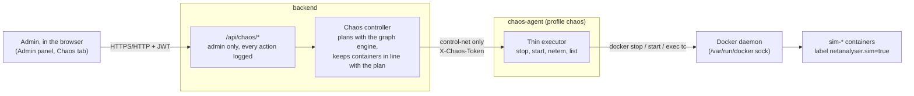

# Fault injection (chaos)

Fault injection breaks the **simulated** network on purpose, so that the
monitoring can be watched reacting: a device fails, a link gets slow, a PLC
flaps. It is a demo and test tool. It is off by default, admin only, and
cannot touch anything that is not a simulated device.

## Why it has to know the topology

All `sim-*` containers sit on one Docker bridge. Each one answers ping by
itself, so stopping the container of a switch does **not** make the devices
behind it unreachable. On real hardware it would.

So a failure is carried out in two steps:

1. The backend works out what the failure cuts off. It uses the graph engine
   (see [algorithms.md](algorithms.md#the-graph-engine)): given the failed devices,
   which other devices lose every path to a root?
2. The failed devices **and** everything they cut off are stopped.

```text
containers to stop = failed devices + cut_off(topology, failed devices)
```

With the shipped topology, failing `sw-edge` stops one container, because
`sw-edge-2` still leads to both tier switches. Failing both edge switches
stops eleven.

## Architecture



- **Backend** (`backend/app/services/chaos.py`): all the decisions.
  `plan_failure` is a pure function that returns the set of devices to stop.
  The controller remembers which devices were failed and which are flapping,
  compares the plan with the containers, and stops or starts what differs.
- **Chaos agent** (`infra/chaos-agent/agent.py`): a thin executor with five
  primitives and no knowledge of the topology. It is the only container that
  can reach the Docker socket.

| Agent primitive                   | What it does                                        |
| --------------------------------- | --------------------------------------------------- |
| `GET /containers`                 | Lists the simulated devices: running or not, netem  |
| `POST /containers/{name}/stop`    | `docker stop`                                       |
| `POST /containers/{name}/start`   | `docker start`                                      |
| `PUT /containers/{name}/netem`    | `tc qdisc replace ... netem delay/jitter/loss`      |
| `DELETE /containers/{name}/netem` | `tc qdisc del ... root`                             |

`{name}` is the Compose service name, for example `sim-sw-ot`.

## The Docker-socket risk, and what limits it

The agent mounts `/var/run/docker.sock`. **Whoever can use that socket
controls the Docker daemon, and through it the host**: they could start a
privileged container, mount the host's disk, or stop any service. Mounting the
socket read-only does not change that, because the API is still writable. This
is the reason the agent is a separate, tiny service instead of part of the
backend, and the reason it is fenced in:

| Risk                                             | Mitigation                                                                                                                                                              |
| ------------------------------------------------ | ----------------------------------------------------------------------------------------------------------------------------------------------------------------------- |
| The agent runs when nobody needs it              | It is in the Compose profile `chaos`. A plain `docker compose up` does not start it.                                                                                     |
| Someone reaches it from the host or the LAN      | No port is published. It is only on `control-net`, an `internal` network (no route to the host or the internet) that it shares with the backend and nothing else.        |
| Something on `control-net` calls it              | Every request needs the shared secret in `X-Chaos-Token` (compared in constant time). The agent refuses to start without a secret of at least 16 characters.             |
| It is told to act on the wrong container         | It only acts on containers labelled `netanalyser.sim=true` in its own Compose project. On every request it asks Docker for that list and passes on the container id from it, never the request's. |
| Command injection through a name or a number     | No shell is used; every command is an argument list. A name must match a strict pattern and be in the list. Numbers are type- and range-checked and formatted by the agent. |
| A bug in the agent is used to do more            | Five endpoints, standard library only, one file. Read-only filesystem, all capabilities dropped, `no-new-privileges`.                                                   |
| The backend is tricked into calling it           | The chaos endpoints are admin only. The backend validates every device id against the database and the agent's list, and logs every action with the user's name.          |

What remains: anyone who can already run `docker` on the host, or who breaks
into the agent container, has the socket. Do not enable the profile on a
machine where that matters, and do not use it on anything but the simulated
network. A stricter setup would put a Docker socket proxy in front of the
socket, to allow only the few API calls the agent makes.

### What changed on the simulated devices

- **Label** `netanalyser.sim: "true"`: marks what the agent may touch.
- **`iproute2`** in a small image (`infra/sim/Dockerfile`, built once as
  `netanalyser-sim:local` and shared by all twelve): provides `tc`.
- **`NET_ADMIN`**: lets `tc` change the container's own network interface. It
  applies inside the container's network namespace only, not on the host.

All three are unused unless the chaos profile is running.

## Enabling it

1. Put a shared secret in `infra/.env` (never commit it):

   ```sh
   echo "CHAOS_AGENT_TOKEN=$(openssl rand -hex 32)" >> infra/.env
   ```

2. Start the stack with the profile:

   ```sh
   docker compose -f infra/docker-compose.yml --profile chaos up -d --build
   ```

3. Log in as an admin and open **Admin, Chaos**.

To switch it off again, stop the agent. The chaos endpoints then answer 503
and everything else keeps working:

```sh
docker compose -f infra/docker-compose.yml --profile chaos stop chaos-agent
```

Without the token, or without the profile, the backend answers 503 to every
chaos request with a message that says what to do. `tc netem` needs the
`sch_netem` kernel module on the Docker host; Docker Desktop has it, and on a
Linux host `sudo modprobe sch_netem` loads it.

## Scenarios

| Scenario              | What it does                                                         | What to look at                                                                 |
| --------------------- | -------------------------------------------------------------------- | ------------------------------------------------------------------------------- |
| `ot-switch-failure`   | Fails `sw-ot`. Its five devices are cut off and stopped too.         | Incidents: one root cause, five collateral. One stored incident, not six.       |
| `edge-switch-failure` | Fails `sw-edge`. Nothing else is stopped.                            | Incidents: one root cause, nothing collateral. The redundancy absorbs it.       |
| `double-edge-failure` | Fails `sw-edge` and `sw-edge-2`. Nine devices are cut off.           | Incidents: two root causes sharing nine collateral devices.                     |
| `flapping-plc`        | Switches `plc-conveyor-1` off and on every 80 s for about 7 minutes. | Stability: the PLC climbs the flap ranking. Incidents: it opens and resolves.   |
| `degraded-uplink`     | Adds 200 ms delay, 40 ms jitter and 2% loss to `sw-edge`.            | Topology: `sw-edge` turns degraded (latency above the warning threshold).       |

Allow about 15 seconds with the default settings for a failure to be
confirmed (three results in a row: a poll and the two retries after it),
and about as long for a recovery (two polls): the debouncer waits for
results to agree. That is also why a flap must be slow to be seen. A device
that is off for less than those three results never becomes "down" at all.

## API

All endpoints are admin only and answer with the faults in place afterwards:
`{faults: [{device_id, kind, detail}], scenarios, controllable_device_ids}`.
Every action that went through is written to the application log and to the
audit log (`chaos.fail`, `chaos.degrade`, `chaos.flap`, `chaos.scenario`,
`chaos.restore_all`: see [security.md](security.md#the-audit-log)), with the
admin who did it.

| Method | Path                         | Body                                              | What it does                                                   |
| ------ | ---------------------------- | ------------------------------------------------- | -------------------------------------------------------------- |
| `GET`  | `/api/chaos/state`           | none                                              | The faults in place, the scenarios, the devices that can break |
| `POST` | `/api/chaos/fail`            | `{device_ids: [...]}`                             | Fails devices and everything they cut off                      |
| `POST` | `/api/chaos/degrade`         | `{device_id, delay_ms, jitter_ms, loss_pct}`      | Adds delay, jitter and loss with `tc netem`                    |
| `POST` | `/api/chaos/flap`            | `{device_id, period_s, duration_s}`               | Switches a device off and on in a background task              |
| `POST` | `/api/chaos/scenario/{name}` | none                                              | Runs a preset from the table above                             |
| `POST` | `/api/chaos/restore-all`     | none                                              | Starts every simulated device and removes every slowdown       |

A fault's `kind` is `failed`, `cut_off`, `flapping`, `degraded` or `leftover`.

| Status | Meaning                                                                    |
| ------ | -------------------------------------------------------------------------- |
| 403    | Not an admin                                                               |
| 404    | Unknown scenario                                                           |
| 409    | Clashes with a fault in place (degrading a device that is down, ...)       |
| 422    | Unknown device, a device without a simulated container, or a bad value     |
| 502    | The agent answered with an error (Docker refused, for example)             |
| 503    | The agent is not configured or not reachable; the message says what to do  |

Limits: delay and jitter 0 to 5000 ms (jitter not above delay), loss 0 to
100%, flap period 2 s to 1 h, flap duration 2 s to 1 h.

## How it behaves

- **Failures add up.** After `sw-edge` has been failed, failing `sw-edge-2`
  computes the cut-off set for both together.
- **A flapping switch takes its devices with it**, down and up again.
- **Stopping a device ends its slowdown**: a stopped container loses its
  netem settings.
- **Restore all is idempotent.** It asks the agent what is really stopped or
  slowed down and undoes exactly that. Run again, it does nothing.
- **Faults survive a backend restart, the backend's memory does not.** At
  startup the backend asks the agent and writes any fault still in place to
  the log. The Chaos tab lists them as "left over", and Restore all removes
  them.
- **A new failure never starts a device it did not stop itself**, so leftover
  faults stay until Restore all.
- **A hanging agent cannot pile up requests.** A chaos request waits at most
  20 s for an earlier one to finish, and a call to the agent times out after
  15 s. Either way the answer is a 503 that says so.

## Testing

`backend/tests/test_chaos.py` tests the planning and the controller with a
fake agent. `backend/tests/test_chaos_agent.py` tests the agent with a fake
`docker` command, and runs the backend's client against the agent's real HTTP
server on a loopback port. Neither needs Docker.

What those tests cannot cover is Docker itself: building the two images, and
what `docker stop`, `docker start` and `tc` really do. To check that by hand,
with the stack running under the `chaos` profile:

```sh
# 1. Run "Both edge switches fail" in the Chaos tab, then:
docker ps -a --filter label=netanalyser.sim=true --format '{{.Names}}\t{{.State}}'
#    eleven containers are "exited", only sim-fw-01 is "running"
# 2. Restore all, degrade sw-edge in the Chaos tab, then:
docker compose -f infra/docker-compose.yml exec sim-sw-edge tc qdisc show dev eth0
#    a line starting with "qdisc netem", with the delay and loss
# 3. The agent publishes no port and is on control-net only:
docker compose -f infra/docker-compose.yml --profile chaos ps chaos-agent
```
