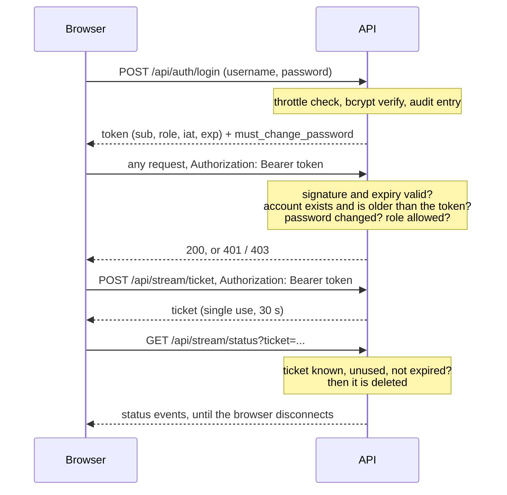

# Security

What the system defends against, how, and what it knowingly does not. Fault
injection has its own page, [chaos.md](chaos.md).

## What is worth protecting

| Asset | Why it matters |
| --- | --- |
| The admin functions | An admin can redraw the topology, silence monitoring (settings), create users and, in chaos mode, stop devices. |
| The monitoring data | A map of an industrial network: device names, addresses, what depends on what. Useful to an intruder. |
| Passwords and login tokens | They are the admin functions. |
| The Docker host | In chaos mode one service holds the Docker socket, which is as good as root. |

The attacker considered here is **someone on the same network** as the
monitor: a curious employee, a compromised laptop, a visitor on the plant
Wi-Fi. They can reach the frontend (`:8080`) and the API (`:8000`), read the
README, and send any request they like. They are not root on the server and
cannot read the database file.

## Threats and what is done about them

| # | Threat | Mitigation | Where |
| --- | --- | --- | --- |
| 1 | **Default credentials.** `admin / admin123` is in the README. | The two default accounts get their first password from `ADMIN_INITIAL_PASSWORD` / `VIEWER_INITIAL_PASSWORD`, or a random one written to the log once. Either way the account can do nothing but change it until it has (`403 password_change_required`). The documented credentials only exist with `DEMO_MODE=true`, which is off by default. | `db/seed_users.py`, `core/deps.py` |
| 2 | **Password guessing.** | A sliding-window limit: 5 wrong passwords in 5 minutes per (address, username), 20 per address, then `429` with `Retry-After`. Passwords are bcrypt hashes. A wrong username and a wrong password give the same answer in the same time, and an unknown username is throttled like a real one. | `services/rate_limit.py`, `routers/auth.py` |
| 3 | **The login token leaking through a URL.** The status stream cannot send headers, so it used to carry the token in its address, where logs and browser history keep it. | The stream is opened with a single-use ticket that expires after 30 seconds and is good for nothing else. | `services/stream_tickets.py` |
| 4 | **Old or stolen tokens.** | Tokens last 60 minutes (`JWT_EXPIRE_MINUTES`). On every request the account is looked up again: it must exist, and it must be older than the token, so a token of a deleted account does not work for a new account of the same name. The role is read from the database, never from the token. | `core/security.py`, `core/deps.py` |
| 5 | **A viewer doing admin things.** | Every write endpoint checks the role. A test builds its list from the app's routes, so a new endpoint cannot be forgotten. | `core/deps.py`, `tests/test_auth.py` |
| 6 | **Another website using a logged-in browser** (CSRF, cross-origin reads). | The API takes the token from the `Authorization` header only. A browser never adds that on its own, unlike a cookie, so a forged request arrives unauthenticated. CORS allows exactly the origins in `CORS_ORIGINS`: no wildcard (the backend refuses to start with one), four methods, two headers, no credentials. | `main.py`, `core/config.py` |
| 7 | **Injected script, framing, content sniffing** in the frontend. | React escapes what it renders. On top of that nginx sends a Content-Security-Policy (scripts only from the server itself, none inline; connections only to the server and the API; no framing), `X-Frame-Options: DENY`, `X-Content-Type-Options: nosniff` and `Referrer-Policy: no-referrer`. | `frontend/nginx.conf` |
| 8 | **"It was not me."** | An audit log of who did what, when and from which address. | `services/audit.py` |
| 9 | **The Docker socket.** | Off unless the `chaos` profile is started; then one small service holds it, reachable only by the backend. | [chaos.md](chaos.md) |
| 10 | **A signing secret that is public.** The example files carry a placeholder for `JWT_SECRET_KEY`. With one of them in use, anyone could sign a token for `admin` without knowing a password. | The backend refuses to start on a shipped placeholder, or on a secret shorter than 32 characters, before it touches the database. `DEMO_MODE` is the one exception, and it logs a warning. A test fails if an example file ships a value that is not on the list of placeholders. | `core/security.py`, `main.py` |
| 11 | **Input that breaks the monitor.** A setting or a device that an admin mistypes, or a seed file with a mistake. | Settings must be finite numbers inside their ranges (the poll interval between 5 seconds and an hour), so one value cannot stop the polling or make the settings unreadable. A device id is limited to what is safe in a URL, and text fields have a length. A loop of parents is refused by the API and skipped by the seed loader, and the analysis that walks the tree visits each device once. | `routers/settings.py`, `schemas/device.py`, `db/seed.py`, `services/incident_analysis.py` |

## How a request is authenticated

**Forced password change.** `must_change_password` is set on the accounts the
backend creates itself. While it is set, every endpoint answers
`403 {"detail": {"code": "password_change_required", ...}}` except
`/api/auth/login`, `/api/auth/me` and `/api/auth/change-password`. The new
password must differ from the old one. The frontend sends such an account to
the account page from wherever it goes. A backend that starts without
`DEMO_MODE` also sets the flag on a default account that still has its
documented demo password (a database from an older version, for instance).

**Login throttling.** Each key has a deque of the times of its recent wrong
passwords. A new one is appended on the right; those older than 5 minutes are
popped from the left; the key is blocked while the deque holds 5 (or 20 for
an address). The window slides with the clock, so there is no boundary to
straddle. An attempt is counted before its password is checked, in one locked
step with the "is the caller blocked?" test, and taken back if the password
is right. Counting only after a wrong password would let every guess sent
during the quarter second a check takes through. An attempt that is refused
is not counted, so trying again does not prolong the block; a right password
clears the pair but not the rest of the address's count. A wrong current
password in `/api/auth/change-password` counts as well.

**Stream tickets.** A ticket is 32 random bytes. It is kept in memory with its
expiry time and removed when it is redeemed or expired. A stream that drops
is reopened by the frontend with a new ticket, after 1, 2, 4 ... up to 30
seconds.

## The audit log

One row in `audit_event` per event: `ts`, `actor`, `action`, `target`, `ip`,
`details`. Admins read it with `GET /api/audit` or in the Audit tab; nothing
in the API changes or deletes it.

| Action | Recorded when |
| --- | --- |
| `auth.login`, `auth.login_failed` | A login succeeded or failed. For a failure the actor is the name that was tried. |
| `auth.login_blocked` | The throttle started refusing a caller (once, not per refused attempt). |
| `auth.password_changed` | A password was changed; `forced` says whether it had to be. |
| `user.created`, `user.deleted` | An admin created or deleted an account. |
| `device.created`, `device.updated`, `device.deleted` | With the fields, or what changed from what to what. |
| `link.created`, `link.deleted` | An extra link between two devices. |
| `settings.updated` | With what changed from what to what. |
| `incident.acknowledged`, `incident.note_added` | The note itself is in the incident's timeline. |
| `chaos.fail`, `chaos.degrade`, `chaos.flap`, `chaos.scenario`, `chaos.restore_all` | A fault injection action went through. |

Passwords and tokens are never written to it. An entry is written after the
action succeeded, so a request that was rejected leaves none, failed logins
excepted. If the entry cannot be written the action still counts and the
failure goes to the application log: a full disk must not lock everybody out.

## Known limitations, accepted

- **The token is in `localStorage`, not an httpOnly cookie.** Script running
  in the page could read it. That is what the CSP and the 60-minute lifetime
  are for. A cookie would be out of script's reach but would be sent
  automatically, which needs CSRF protection and the frontend and API on one
  site; here they are two origins.
- **A token cannot be revoked.** Logging out forgets it in the browser only,
  and a password change does not end other sessions. It stays valid until it
  expires. Deleting the account does end it at once.
- **No TLS.** The stack speaks plain HTTP: passwords and tokens can be read on
  the wire. A real deployment puts a TLS reverse proxy in front (and can then
  add `Strict-Transport-Security`).
- **SQLite.** One unencrypted file. Whoever can read the volume has the
  password hashes and the audit log, and whoever can write it can edit the
  log: it is not tamper-evident. One writer at a time, which is enough for one
  site and not for several backends.
- **The throttle and the tickets live in memory.** They are per process and
  empty after a restart. With more than one backend process they would have
  to move to a shared store.
- **The caller's address is the peer of the connection.** Behind a reverse
  proxy, NAT or Docker Desktop's port forwarding, every user has the proxy's
  address: the audit log shows that address, and five wrong passwords for a
  username block that username for everyone behind it for five minutes.
  `X-Forwarded-For` is deliberately not trusted, because the caller writes it.
- **The Docker socket in chaos mode** is root on the host for whoever gets
  through the chaos agent. It is off by default and fenced in (chaos.md), and
  still not something to run on a production host.
- **Generated first passwords are in the backend log.** Anyone who can read
  the log before the first login can use them. They stop working at that
  login's forced change.
- **`DEMO_MODE` is insecure on purpose.** Publicly documented passwords, no
  forced change, and it starts on a placeholder signing secret.
- **The signing secret is checked for two things only:** that it is not a
  shipped placeholder, and that it has 32 characters. A long secret that is
  easy to guess is accepted. Changing the secret ends every session.
- **The seed file is trusted.** Its devices are stored without the checks the
  API makes (id, lengths, type); only a loop of parents is caught. It is
  written by whoever deploys the system, not by a user.
- **The audit log is never trimmed**, and it records outcomes, not attempts:
  a rejected request other than a login is not in it. Failed logins cannot
  flood it: an address is stopped after 20 in five minutes.
- **An open status stream stays open** until the browser disconnects, even if
  the account is deleted meanwhile. It only carries device statuses.
- **Passwords:** eight characters minimum (1024 at most, of which bcrypt
  uses the first 72 bytes), no complexity or breach check, no second factor.
  An account created by an admin is not made to change the password the admin
  chose.
- **`style-src 'unsafe-inline'`** in the CSP: the UI library's dropdown
  inserts a style element at runtime. Inline scripts stay forbidden.
- **The API's own documentation** (`/docs`, `/openapi.json`) is public. It
  shows what the API can do, not any data.
